<h1 align="center">π-WBC</h1>

<p align="center"><b>Whole-body control for the Unitree G1 humanoid: a PPO teacher-student controller
trained in Isaac Lab, tested sim-to-sim on PhysX and MuJoCo without retraining, and built to sit
under a vision-language-action model.</b></p>

<p align="center">
  
  
  
  
  
  
  
</p>

<p align="center">
  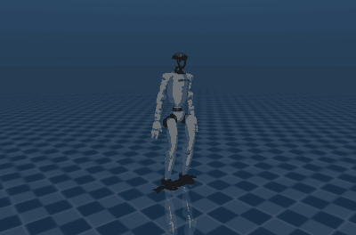
</p>
<p align="center">
  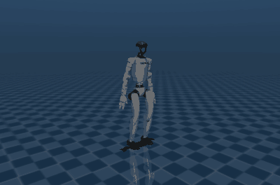
  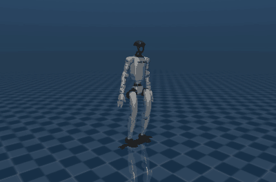
  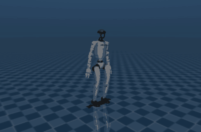
</p>
<p align="center"><em>The stage 1 controller, trained in Isaac Lab and run unchanged in plain MuJoCo on
MuJoCo Menagerie's G1 model, which it never trained on: walking while turning, turning in place,
kicked at 2 m/s while walking at 1 m/s, and walking while the arms sweep their trained range.
Training seed 2, recording seed 0, the first take, on the fixed bench (D-040).</em></p>

| **1** | **3** | **2.5 m/s** | **3.2 h** |
|:---:|:---:|:---:|:---:|
| fall in 66,000 MuJoCo test episodes without kicks, with low friction, 1 kg in each hand, extra delay and sensor noise included | simulators the same policy runs in without retraining: Isaac Lab (Newton), Isaac Sim (PhysX) and MuJoCo | the largest kick survived at least 95% of the time on every training seed (98.6%-99.4% of kicks) | of training for one seed on one L40S GPU, 4096 robots in parallel (seed 3: teacher 2.5 h, student 0.7 h) |

> **Status: stage 1 of 5, the whole-body controller, is done.** A student policy that sees only
> what a real G1 measures walks, turns, crouches, leans and keeps its balance while its arms
> move, under randomized physics and kicks. All transfer here is sim-to-sim; nothing has run on
> hardware. Next: the pick-and-place task and the VLA on top ([roadmap](#roadmap)).

**Contents:** [Highlights](#highlights) · [The project](#the-project) ·
[How it works](#how-it-works) · [Results](#results) ·
[What went wrong](#what-went-wrong-on-the-way-and-the-fixes) · [Reproduce](#reproduce) ·
[Limitations](#limitations) · [Roadmap](#roadmap) · [Related work](#related-work) ·
[Citation](#citation)

## Highlights

- **Whole-body control from proprioception alone.** The exported student sees what a real G1
  measures: the IMU and the joint encoders over the last 0.5 s, with sensor noise, and no base
  velocity. It follows walking, turning, pelvis-height and torso commands while its arms move
  through their trained range (beside and in front of the body) and its hands through their
  full range, with up to 1 kg in each hand.
- **Runs unchanged in two other simulators.** Trained on Isaac Lab's Newton physics, it is
  exported to ONNX and run as-is in plain MuJoCo, on MuJoCo Menagerie's independently built G1
  model as well as its training model, and in Isaac Sim's PhysX engine. Without kicks it fell
  once in 66,000 MuJoCo test episodes and never in Isaac Lab or PhysX; walking errors agree to
  within 0.03 m/s.
- **Robustness that is measured, not assumed.** Six domain-randomization groups and a curriculum.
  An ablation switches each one off in turn, on three training seeds, and measures what it buys:
  without kicks in training, 95% of episodes with 1 m/s kicks end in a fall; without any
  randomization, sensor noise alone floors the robot in 31% of episodes.
- **Evaluated like a study, not a demo.** Three training seeds per configuration, development
  seeds for choices and frozen test seeds reported in full for every candidate recipe (one
  problem first seen there led to D-024), 95% Wilson intervals, and result files stamped with
  their commit, code hash, package versions and GPU. 40 decisions are logged with what each one
  cost.
- **Debugged in the open.** Four problems were found and fixed on the way (slow walking, falls at
  full arm ranges, too short a history, lost turning), each traced to its cause with an
  experiment; one fix that did not work is kept as a negative result. An audit of the MuJoCo test
  bench then found eight faults, among them the feet of one robot model standing on the wrong
  friction and IMU readings one 2.5 ms physics step old; every published bench number was rerun
  after the fixes (D-039, D-040), and turning in place, which one seed had met, now misses on all
  three.
- **Built for a cluster.** The same commit trains on a workstation (RTX 4070) and on a Slurm
  cluster (L40S) through an Apptainer container, with jobs that restart from checkpoints.

## The project

A simulated Unitree G1 walks to a table, picks up the named object and puts it in the named bin,
from a language instruction. Two layers share the work:

- **High level, stages 3-5: a vision-language-action model.** GR00T N1.6, with π0.5 as a second
  model, reads the head camera and the instruction and outputs base velocity, pelvis height,
  torso orientation and arm and hand targets.
- **Low level, stage 1: this whole-body controller.** It turns those commands into leg and waist
  joint targets and keeps the robot balanced.

**Research question.** When the robot fails, which layer is at fault: did the VLA choose wrong,
or did the controller slip, fall or miss the grasp? And does a more robust controller raise
whole-task success? The controller uses the command interface of NVIDIA's Decoupled WBC, the
controller GR00T is paired with on the G1, so NVIDIA's controller can be swapped in under the
same VLA as a baseline.

**Stack:** Isaac Lab 3.0 on the Newton physics engine (NVIDIA Warp) · rsl_rl (PPO and
distillation) · PyTorch · ONNX Runtime · MuJoCo 3.12 · Isaac Sim 6.2 (PhysX) · Slurm and
Apptainer · Python 3.12, uv, pytest

## How it works

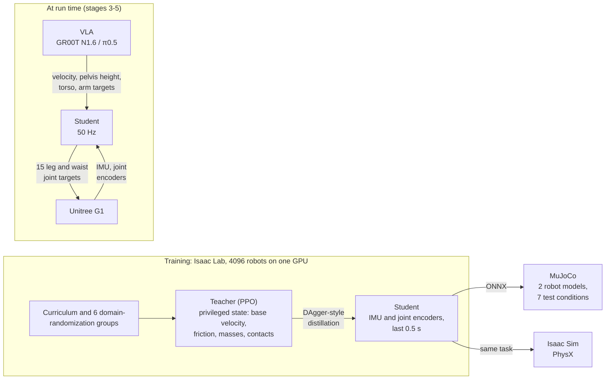

1. **Commands a VLA can send.** Base velocity (forward -0.5 to 1.0 m/s, sideways ±0.5 m/s, yaw
   rate ±1.0 rad/s), pelvis height 0.50-0.78 m and torso roll, pitch and yaw, as in NVIDIA's
   Decoupled WBC. The policy drives the 12 leg and 3 waist joints at 50 Hz; the arms and hands
   follow their own joint targets, and the legs learn to keep balance whatever the arms do
   within their trained range.
2. **A human-like gait.** A gait clock and Unitree's G1 rewards turn the first policy's fast
   shuffle into a walk of about 2.5 steps per second. Each reward term's weight, source and
   reason are in the [design](docs/STAGE1_DESIGN.md#5-gait-how-the-robot-is-told-to-walk-like-a-person).
3. **A curriculum.** Pelvis-height and torso ranges, arm motion and kick size grow as the robot
   copes (the velocity ranges are full from the start); the teacher then trains 7000 more
   iterations at the full ranges (D-028).
4. **Domain randomization in six groups:** friction, link masses and centre of mass, PD gains and
   joint armature, action delay, sensor noise, and kicks. Each can be switched off on its own for
   the ablation.
5. **Teacher and student.** The teacher learns with PPO from privileged state that a real robot
   cannot measure. The student, which sees only proprioception, is distilled from it
   DAgger-style: it acts, and the teacher labels what it should have done.
6. **Checks outside the training simulator.** The exported student runs in a MuJoCo bench under
   seven conditions on two robot models, and in Isaac Sim's PhysX, on seeds frozen in advance.

## Results

All numbers are for the three trained students (training seeds 1-3) of the final recipe, unless
marked. Full tables, raw data and the path that led here: [results/stage1](results/stage1/README.md).

### Following commands

<p align="center">
<picture>
  <source media="(prefers-color-scheme: dark)" srcset="results/figures/tracking-dark.png">
  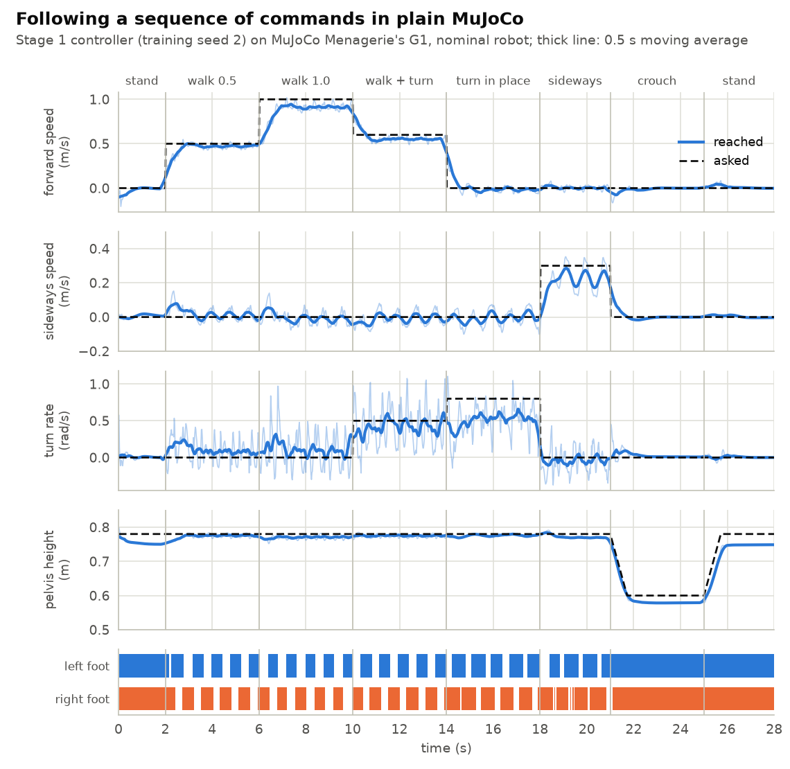
</picture>
</p>

The design's finish line, on the frozen MuJoCo test seeds (1000-1199, 4400 episodes per seed:
11 commands × 200 starts × 2 robot models); each cell is Menagerie / Newton model:

| Measure | Target | Seed 1 | Seed 2 | Seed 3 | Met |
|---|---|---|---|---|---|
| Falls, all commands | upper 95% bound below 5% | 0/4400 | 0/4400 | 0/4400 | yes: 0 of 13,200 (0.00%-0.03%) |
| Speed error, walking 1 m/s | at most 0.15 m/s | 0.10 / 0.10 | 0.09 / 0.09 | 0.05 / 0.04 | yes |
| Speed error, walking 0.5 m/s | at most 0.15 m/s | 0.05 / 0.04 | 0.05 / 0.04 | 0.03 / 0.04 | yes |
| Speed error, sideways 0.3 m/s | at most 0.15 m/s | 0.08 / 0.08 | 0.09 / 0.10 | 0.07 / 0.07 | yes |
| Turn-rate error, 0.8 rad/s in place | at most 0.2 rad/s | 0.21 / 0.19 | 0.29 / 0.26 | 0.24 / 0.22 | no (D-029, D-040) |
| Step rate at 1 m/s | 1.5-3 steps/s | 2.4 / 2.4 | 2.5 / 2.5 | 2.4 / 2.5 | yes |
| Step length at 1 m/s | at least 30 cm | 38 / 38 cm | 37 / 37 cm | 40 / 40 cm | yes |
| Foot lift at 1 m/s (the ankle's rise) | at least 5 cm | 7.1 / 7.1 cm | 7.3 / 7.5 cm | 6.8 / 6.8 cm | yes |
| Slip at the sole, 1 m/s | at most 0.1 m/s | 0.03 / 0.01 | 0.07 / 0.02 | 0.03 / 0.01 | yes |
| Arm joint error, arms moving while walking | report | 0.039 / 0.033 rad | 0.039 / 0.033 rad | 0.039 / 0.033 rad | - |

Every target is met on every seed except turning in place, which every seed misses by
0.01-0.09 rad/s (seed 1 meets it on Newton's model only); it is accepted as a known limit
(D-029). Seed 1 met it on both models before the bench fixes of D-040.

### Robustness

<p align="center">
<picture>
  <source media="(prefers-color-scheme: dark)" srcset="results/figures/falls-dark.png">
  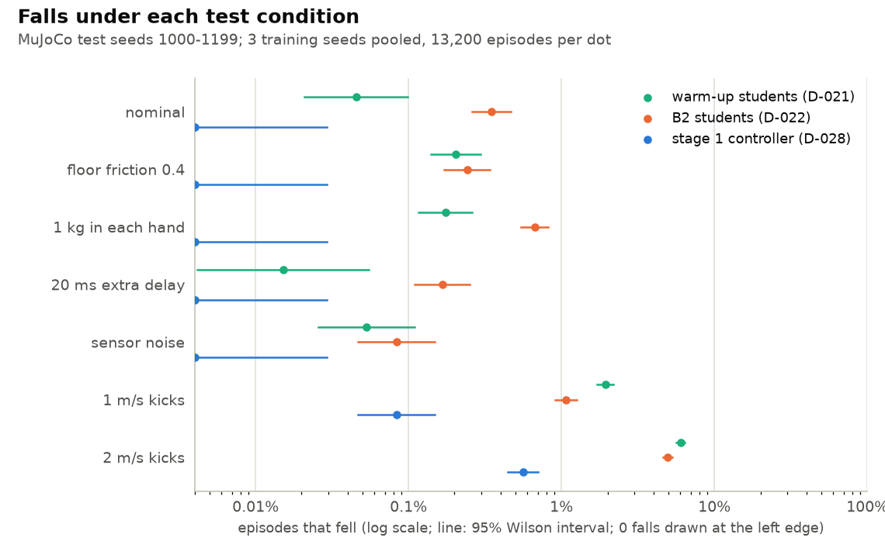
</picture>
</p>

Falls on the MuJoCo test seeds, per training seed 1 / 2 / 3 and pooled (13,200 episodes per
condition) with 95% Wilson intervals, against the two earlier recipes:

| Condition | Warm-up students (D-021) | B2 students (D-022) | Stage 1 controller (D-028) |
|---|---|---|---|
| nominal | 0 / 10 / 2 (0.05%-0.16%) | 49 / 4 / 1 (0.31%-0.53%) | **0 / 0 / 0 (0.00%-0.03%)** |
| floor friction 0.4 | 2 / 15 / 5 (0.11%-0.25%) | 30 / 3 / 0 (0.18%-0.35%) | **0 / 0 / 0 (0.00%-0.03%)** |
| 1 kg in each hand | 4 / 11 / 5 (0.10%-0.23%) | 55 / 16 / 8 (0.48%-0.75%) | **0 / 0 / 0 (0.00%-0.03%)** |
| 20 ms extra delay | 0 / 9 / 1 (0.04%-0.14%) | 22 / 3 / 2 (0.14%-0.30%) | **0 / 0 / 0 (0.00%-0.03%)** |
| sensor noise | 0 / 4 / 2 (0.02%-0.10%) | 9 / 1 / 0 (0.04%-0.14%) | **1 / 0 / 0 (0.00%-0.04%)** |
| 1 m/s kicks every 4 s | 90 / 146 / 85 (2.18%-2.71%) | 71 / 96 / 77 (1.63%-2.09%) | **8 / 10 / 3 (0.10%-0.24%)** |
| 2 m/s kicks every 4 s | 254 / 317 / 235 (5.71%-6.53%) | 248 / 331 / 159 (5.21%-6.00%) | **14 / 14 / 10 (0.21%-0.39%)** |

<p align="center">
<picture>
  <source media="(prefers-color-scheme: dark)" srcset="results/figures/kicks-dark.png">
  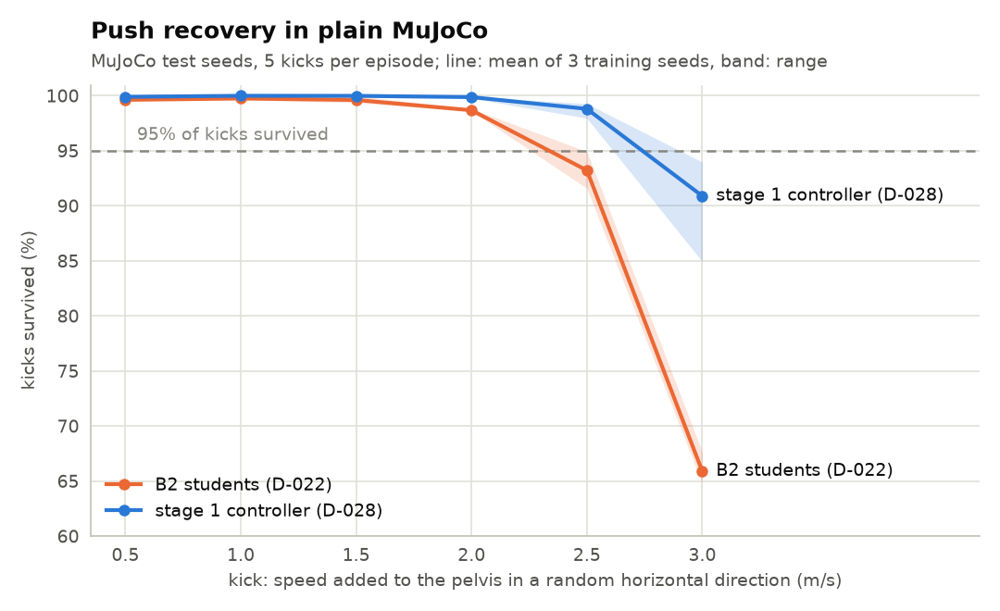
</picture>
</p>

The largest kick survived at least 95% of the time is 2.5 m/s on every seed (98.6%-99.4% of
kicks survived at 2.5 m/s, 87%-95% at 3 m/s); the B2 students' was 2.0 m/s (91%-94% at 2.5).
Episodes with kicks run 23 s, so the last kick, at 19 s, is watched for 4 s like the others.
One weakness: walking at 0.5 m/s on Menagerie's model, seed 1 trips over gentle 0.5 m/s kicks
in 10 of 200 episodes, though never over 1 m/s kicks there. Before the bench fixes it was 30;
the corrected floor friction accounts for about two thirds of that drop, and the cause of the
remaining 10 is not known.

### One policy, three simulators

Four setups: Isaac Lab on Newton (training), Isaac Sim on PhysX, and MuJoCo with two robot
models (Menagerie's G1 and the training model).

<p align="center">
<picture>
  <source media="(prefers-color-scheme: dark)" srcset="results/figures/engines-dark.png">
  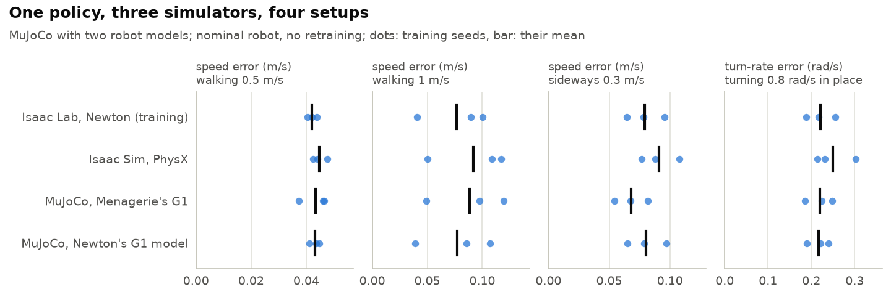
</picture>
</p>

| Falls, 550 robots per training seed (seeds 1 / 2 / 3, pooled 95% interval) | Isaac Lab, Newton (training) | Isaac Sim, PhysX |
|---|---|---|
| nominal robot | 0 / 0 / 0 | 0 / 0 / 0 |
| 1 m/s kicks | 0 / 0 / 0 (0.0%-0.2%) | 2 / 0 / 3 (0.1%-0.7%) |
| 2 m/s kicks | 1 / 1 / 5 (0.2%-0.9%) | 27 / 39 / 22 (4.3%-6.5%) |

Newton's solver is MuJoCo-Warp, so MuJoCo is the nearer transfer (its harder part is the
independently built Menagerie model); PhysX, with its own contact model and solver, is the
harder one. Walking transfers to PhysX with little loss (speed errors within 0.03 m/s of
Newton's). Hard kicks transfer less well: 5% of episodes with 2 m/s kicks end in a fall on
PhysX against 0.4% on Newton, though that is a third of the previous students' rate on PhysX
(16%). Kick episodes run 23 s on every engine.

### What each part of training buys

<p align="center">
<picture>
  <source media="(prefers-color-scheme: dark)" srcset="results/figures/ablation-dark.png">
  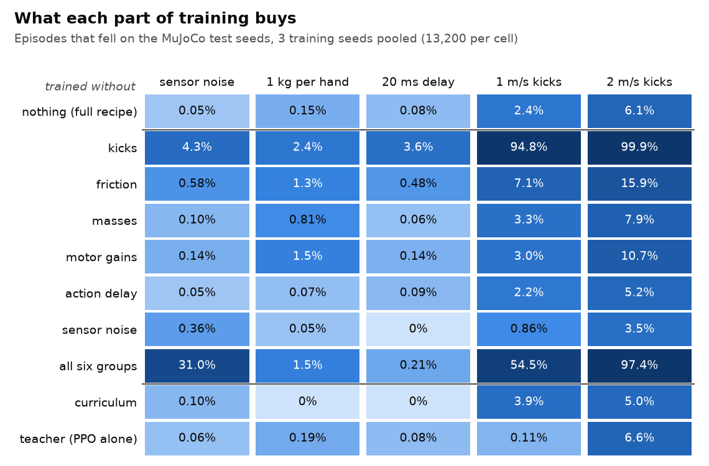
</picture>
</p>

Each row is the step 4 recipe (before the fixes below) trained without one part, three seeds
each. Seen on every seed:

- **Kicks in training are what keep it up when kicked:** without them 95% of episodes with
  1 m/s kicks end in a fall, against 2.4%.
- **Randomization costs precision.** Without any, sensor noise floors the robot in 31% of
  episodes, but it walks more precisely (speed error at 1 m/s 0.10-0.14 m/s against 0.16-0.22).
- **Without friction randomization, falls to kicks rise 2.6-2.9 times** (pooled). Without the
  curriculum, or without the teacher (PPO alone), the turning error about doubles.
- **Two surprises.** The student trained without a teacher fell least of all to 1 m/s kicks
  (3 / 4 / 8 falls against 90 / 146 / 85 for the full recipe), though not to 2 m/s kicks (164 /
  214 / 493 against 254 / 317 / 235: fewer on two seeds, twice as many on the third). The one
  trained without sensor noise fell less to kicks of both sizes (1 m/s: 31 / 53 / 29; 2 m/s:
  84 / 258 / 116) and more to sensor noise, though still rarely (48 against 6 of 13,200). So
  noise randomization seems to cost some push recovery; neither cause was tested.

## What went wrong on the way, and the fixes

<p align="center">
<picture>
  <source media="(prefers-color-scheme: dark)" srcset="results/figures/training-dark.png">
  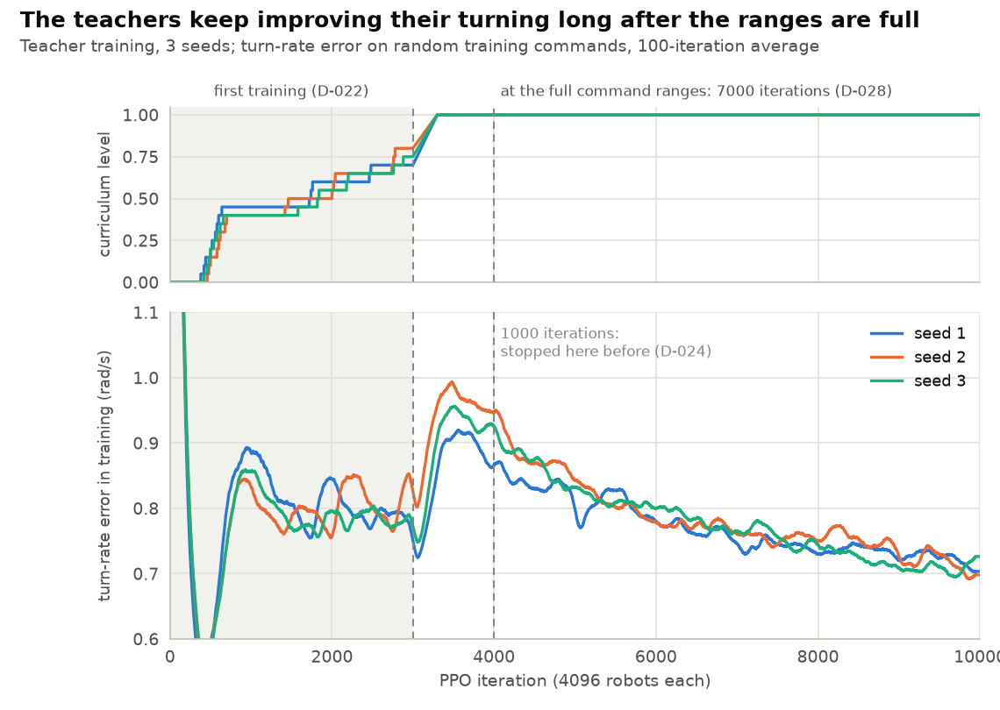
</picture>
</p>

Each fix is a decision in [docs/DECISIONS.md](docs/DECISIONS.md), with what it cost:

| Problem | Cause found | Fix | Result |
|---|---|---|---|
| Students walked at 86% of the commanded speed | the speed reward still paid 92% at 0.14 m/s off | a second, narrower speed reward (D-022) | speed error at 1 m/s 0.19 → 0.10 m/s (test seeds, mean of three) |
| Falls with the arms moving over their full trained range | the curriculum stopped at 70-80% of the ranges | train the teachers on to the full ranges (D-024) | teachers fell in 3 of 9900 Isaac Lab episodes |
| Students of those teachers walked slower | 0.12 s of history was too short | 0.5 s of history (D-026) | seed 1 walks at 1.00 m/s asked 1.0, against 0.71 (Isaac Lab; one seed compared) |
| Turning in place dropped to 0.31-0.47 rad/s for 0.8 | the teachers were undertrained at the full ranges (figure above) | train them 7 times longer there (D-028) | 0.57-0.70 rad/s in Isaac Lab (0.56-0.72 in MuJoCo), and 1 fall in 66,000 MuJoCo test episodes without kicks |
| Tried and dropped: a narrow turning reward | it helped one seed and hurt two | stays off (D-027) | a negative result, kept |

<p align="center">
<picture>
  <source media="(prefers-color-scheme: dark)" srcset="results/figures/turning-dark.png">
  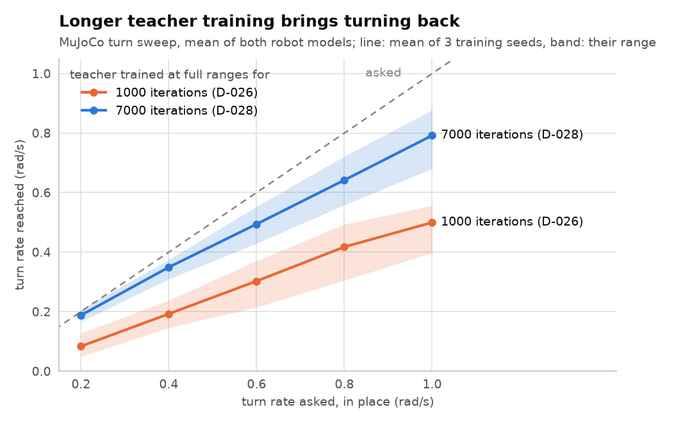
</picture>
</p>

## Reproduce

Linux x86_64, an NVIDIA GPU with driver 580.65.06 or newer (CUDA 13), Python 3.12 and
[uv](https://docs.astral.sh/uv/).

```bash
git clone https://github.com/ApurvK032/pi-wbc.git && cd pi-wbc
uv sync                     # Isaac Lab 3.0 on Newton and the dev tools; about 3.8 GB
scripts/fetch_menagerie.sh  # MuJoCo Menagerie's G1 model, pinned
uv run pytest
```

| Step | Command | Time |
|---|---|---|
| Teacher (3000 iterations) and a first student, one seed | `OVERRIDES="env.rewards.track_lin_vel_xy_fine.weight=0.5" scripts/teacher_student_local.sh 3000 1000 results/mine b2 1` | about 1.5 h on an RTX 4070 |
| That teacher 7000 more iterations at the full ranges, then the final student | `CONTINUE_FROM="logs/rsl_rl/pi_wbc_g1_teacher/pc-b2-teacher-s{seed}-3000it/model_2999.pt" OVERRIDES="env.rewards.track_lin_vel_xy_fine.weight=0.5 env.observations.policy.history_length=25" scripts/teacher_student_local.sh 7000 3000 results/mine final 1` | about 4 h on an RTX 4070 (estimated) |
| The same on a Slurm cluster | `msi/jobs/teacher_student.sbatch` ([docs/MSI.md](docs/MSI.md)) | 3.2 h for seed 3 on an L40S |
| Frozen MuJoCo test seeds | `scripts/test_seeds.sh final-s1 logs/rsl_rl/pi_wbc_g1_student/pc-final-student-ramp-s1-3000it/exported results/mine` | about 1.5 h on 7 CPU threads |
| Isaac Sim PhysX check | `scripts/isaacsim_env.sh`, then `pi-wbc-isaac-eval ... physics=isaacsim_physx` | about 10 min per seed |
| Tables and figures | `uv run python scripts/figures.py` | seconds |

`{seed}` stands for the seed. For lint and unit tests only (no GPU, small download):
`uv sync --no-group sim`.

## Repository layout

| Path | What |
|---|---|
| [`src/pi_wbc/tasks/`](src/pi_wbc/tasks/) | Isaac Lab tasks: gait, whole body, randomization, teacher and student; ONNX export |
| [`src/pi_wbc/sim2sim/`](src/pi_wbc/sim2sim/) | the MuJoCo bench: robot models, observation history, test conditions, gait metrics, GIFs |
| [`src/pi_wbc/isaac_eval.py`](src/pi_wbc/isaac_eval.py) | the same tests in Isaac Lab, on Newton or PhysX |
| [`scripts/`](scripts/) | training and test runs, the ablation queue, figures and tables |
| [`msi/`](msi/) | Apptainer container and Slurm jobs ([docs/MSI.md](docs/MSI.md)) |
| [`results/`](results/) | every result in the write-ups, stamped with the commit, package versions and GPU |
| [`docs/`](docs/) | [project plan](docs/PROJECT_PLAN.md), [stage 1 design](docs/STAGE1_DESIGN.md), [decision log](docs/DECISIONS.md) |

## Limitations

- **Simulation only.** Transfer is sim-to-sim (Newton to PhysX and MuJoCo); nothing has run on a
  real G1.
- **Flat ground only.** No stairs, slopes or rough terrain: the stage 3 task is on a flat
  floor, and Newton's rough-terrain support is newer (D-015).
- **Turning in place falls short.** Asked for 0.8 rad/s, the students turn at 0.56-0.72 rad/s
  in MuJoCo (0.57-0.70 in Isaac Lab); every seed misses the design's 0.2 rad/s turn-error
  target, by 0.01-0.09 rad/s (D-029, D-040).
- **Hard kicks depend on the engine.** At 2 m/s, 5% of episodes on PhysX end in a fall against
  0.4% on Newton: the controller's push recovery is partly tuned to its training physics.
- **The arms are position-controlled.** They follow joint targets; there is no wrist-pose or
  force control yet, and in training the hands only move to random poses.
- **Three seeds per configuration.** Enough to trust differences seen on every seed, which is
  the only kind claimed; not enough to rank small effects.

## Roadmap

| Stage | What | Status |
|---|---|---|
| 0 | Setup: Isaac Lab training, MuJoCo sim-to-sim bench, cluster jobs ([results](results/stage0/README.md)) | done |
| 1 | Whole-body controller: PPO, rewards, curriculum, domain randomization, teacher-student ([results](results/stage1/README.md)) | done |
| 2 | Human motion imitation from retargeted motion capture | planned |
| 3 | Pick-and-place task, scripted expert, rendered demonstrations | in progress |
| 4 | VLA fine-tuning (GR00T N1.6, π0.5) and closed-loop evaluation | planned |
| 5 | Failure attribution study and controller swap against NVIDIA's controller | planned |

The full plan: [docs/PROJECT_PLAN.md](docs/PROJECT_PLAN.md).

## Related work

π-WBC builds on established methods. Massively parallel PPO for legged robots follows Rudin et
al., *Learning to Walk in Minutes Using Massively Parallel Deep Reinforcement Learning* (CoRL
2021), whose rsl_rl library trains it here. The privileged teacher and proprioceptive student
follow Lee et al., *Learning Quadrupedal Locomotion over Challenging Terrain* (Science Robotics
2020) and Kumar et al., *RMA: Rapid Motor Adaptation for Legged Robots* (RSS 2021), with DAgger
(Ross et al., 2011) for the distillation. The split into an RL lower body and directly driven
arms follows humanoid controllers such as NVIDIA's Decoupled WBC, HOMIE and AMO. What this
project adds is the measurement: each randomization group switched off on three seeds with
frozen test seeds, transfer to two other simulators, and a controller built for a swap test
against NVIDIA's under the same VLA.

## Citation

```bibtex
@misc{kushwaha2026piwbc,
  title  = {π-WBC: PPO Whole-Body Control for the Unitree G1, Trained in Isaac Lab},
  author = {Kushwaha, Apurv},
  year   = {2026},
  url    = {https://github.com/ApurvK032/pi-wbc}
}
```

## Acknowledgements

Built on [Isaac Lab](https://github.com/isaac-sim/IsaacLab) and Newton,
[rsl_rl](https://github.com/leggedrobotics/rsl_rl), [MuJoCo](https://mujoco.org/) and
[MuJoCo Menagerie](https://github.com/google-deepmind/mujoco_menagerie)'s Unitree G1 model. The
gait rewards follow Unitree's G1 training setup, and the joint gains are NVIDIA's Decoupled WBC
values. Each keeps its own license.

## License

Copyright (c) 2026 Apurv Kushwaha. All rights reserved.

This repository is public so the work can be read and cited. It is not open source: no license
is granted to copy, modify or redistribute its code, results or media ([LICENSE](LICENSE)). To
ask for permission, contact me through GitHub. Upstream projects, models and datasets keep their
own licenses.
