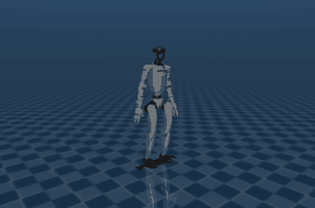
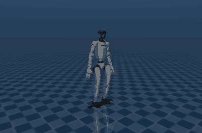
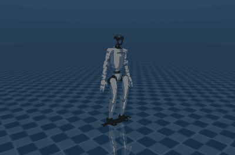
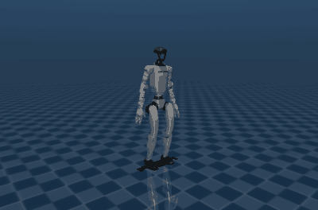

# Stage 0 results

1. [Isaac Lab smoke test](#1-isaac-lab-smoke-test): does Isaac Lab 3.0 train a G1 policy on
   the workstation, and how fast?
2. [MuJoCo sim-to-sim bench](#2-mujoco-sim-to-sim-bench): does a policy trained in Isaac Lab
   still walk in plain MuJoCo?
3. [The same training on MSI](#3-the-same-training-on-msi): does the same code train the same
   policy on the cluster, and how fast?
4. [Run-to-run spread](#4-run-to-run-spread-13-runs-of-the-same-setup): how much do 13 runs of
   the same setup differ?
5. [Reward pilot](#5-reward-pilot-four-reward-changes-two-runs-each): which reward change turns
   the shuffle into a walk?

<p align="center">
  <br>
  <em>The stage 0 policy, trained in Isaac Lab, running in plain MuJoCo on MuJoCo Menagerie's
  G1 model (command: 0.6 m/s forward, 0.5 rad/s turn).</em>
</p>

## 1. Isaac Lab smoke test

**Question:** does Isaac Lab 3.0 train a G1 policy on this PC with the Newton backend, and how
fast, at which environment counts?

**Answer:** yes. PPO on the built-in G1 flat-terrain task runs at 42,000 environment steps per
second with 512 environments and 122,000 with 8192, using at most 2.6 GB of the RTX 4070's
12 GB. At Isaac Lab's default settings (4096 environments, 1500 iterations) a full flat-terrain
run takes about 22 minutes here.

### Setup

| Item | Value |
|---|---|
| Task | `Isaac-Velocity-Flat-G1` (built-in), rsl_rl PPO, seed 1 |
| Robot | Isaac Lab's built-in G1 (`G1_MINIMAL_CFG`: older 37-joint model, reduced collision meshes), not the 29-DoF robot used in part 2 and from stage 1 |
| Physics | Newton 1.6.1, MuJoCo-Warp solver (`physics=newton_mjwarp`); 0.005 s step, 4 steps per policy step (50 Hz control) |
| Software | Isaac Lab 3.0.0, torch 2.11.0+cu130, Warp 1.17.0, rsl-rl-lib 5.5.1 |
| Hardware | RTX 4070 12 GB (driver 595.99.02), Ryzen 9 7900X; no CPU or GPU caps |
| Run | 50 PPO iterations of 24 steps per environment; the first 5 iterations are warm-up and left out |

Command (one run per environment count):

```bash
uv run pi-wbc-bench --num-envs 512 1024 2048 4096 8192 --warmup-iters 5 \
    --out results/stage0/bench_rtx4070_newton_g1flat.json -- \
    isaaclab train --rl_library rsl_rl --task Isaac-Velocity-Flat-G1 \
    --num_envs {num_envs} --max_iterations 50 --seed 1 physics=newton_mjwarp
uv run pi-wbc-bench-table results/stage0/bench_rtx4070_newton_g1flat.json
```

### Results

| Envs | Steps/s | Sim time / iter | Learn time / iter | Peak VRAM | Median power | Status |
|---:|---:|---:|---:|---:|---:|---|
| 512 | 42,061 | 0.253 s | 0.039 s | 0.5 GB | 84 W | ok |
| 1024 | 65,441 | 0.335 s | 0.040 s | 0.6 GB | 103 W | ok |
| 2048 | 91,429 | 0.492 s | 0.046 s | 0.9 GB | 126 W | ok |
| 4096 | 110,682 | 0.813 s | 0.075 s | 1.5 GB | 144 W | ok |
| 8192 | 122,261 | 1.460 s | 0.149 s | 2.6 GB | 159 W | ok |

- **Steps/s** is rsl_rl's figure: environment (policy) steps per second, including learning
  time; median over the 45 timed iterations. Physics steps are 4× higher.
- **Peak VRAM** is the whole GPU's memory in use (nvidia-smi), start-up included; the desktop
  used 15 MB before each run. **Median power** covers the timed iterations only; the card's
  limit is 200 W.
- Raw data: [`bench_rtx4070_newton_g1flat.json`](bench_rtx4070_newton_g1flat.json), with a
  provenance record: commit `8aadd62` with a clean working tree, package versions, GPU, driver
  and time.

### What this shows

- Throughput is still rising at 8192 environments, but slowly: doubling from 4096 to 8192 adds
  about 10%. Power reaches 159 of 200 W, so the GPU is close to full use. Simulation takes
  87-91% of each iteration; PPO updates are the rest.
- During the 1024-environment run the Isaac Lab process held one CPU core at 100% while the GPU
  drew about 100 W (one spot check), so small runs are probably limited by Python and
  kernel-launch overhead rather than the GPU.
- Memory is not a constraint for this task: 8192 environments use under a quarter of 12 GB.
- Start-up (imports, scene build, solver set-up) takes 12-16 s per run once GPU kernels are
  cached. The very first run on this machine spent 15 s on solver set-up and 23 s on the first
  iteration while Warp compiled its kernels; later runs reuse `~/.cache/warp`.

### Limits

- Two runs per environment count: this one and an identical earlier run made before the first
  commit (kept in commit `8aadd62`). Their medians agree within 0.3% at every count, and
  iteration-to-iteration variation within a run is 0.5-1.2% (coefficient of variation).
- Throughput only: 50 iterations are far too few to learn to walk.
- Flat terrain and the 37-joint built-in G1. Rough terrain will be slower; re-measure in
  stage 1.

## 2. MuJoCo sim-to-sim bench

**Question:** does a walking policy trained in Isaac Lab (Newton) still work when the same
ONNX file runs in plain MuJoCo, on (a) the model Isaac Lab itself simulates and (b) an
independent model of the same robot?

**Answer:** yes, for walking. In the 100 MuJoCo episodes (20 s each, both models) that stand,
walk at 0.5 and 1.0 m/s, side-step or walk while turning, the robot never fell, and walking
speed errors were 0.09-0.13 m/s. The one weak spot is turning in place at 0.8 rad/s: the robot
turns far too slowly on both models (error about 0.6 rad/s) and fell in 1 of 10 episodes on
each model. That is a training gap, not a transfer gap (see below).

> **Corrected 2026-10-29.** The first version of parts 2-4 held the hand joints, which the
> policy does not drive, at the default pose in MuJoCo. In training Isaac Lab held them at 0
> (it leaves the targets of joints no action drives at 0). The bench now holds every such
> joint where training did, and parts 2-4 were re-run: walking numbers moved by at most
> 0.02 m/s and the shuffle findings are unchanged; turning in place now shows one fall on
> each model instead of two on Newton's. The same check found a much larger mismatch in the
> first stage 1 gait policies, whose arms are not driven either.

### Policy

| Item | Value |
|---|---|
| Task | `PiWbc-G1-Flat-Stage0` ([D-007](../../docs/DECISIONS.md)): the built-in G1 flat task on the 29-DoF G1 with Dex3 hands; the policy drives the 29 body joints |
| Training | rsl_rl PPO, 4096 environments, 1500 iterations (147 M steps), seed 1, 27 min on the RTX 4070 (about 90,000 steps/s); commit `9b03ad7`, clean tree |
| End of training (Isaac Lab, with noise, pushes and randomization) | mean episode length 996 of 1000 steps, speed error 0.137 m/s, turn-rate error 0.40 rad/s |
| Export | ONNX actions match PyTorch within 1.7e-6 over a 200-step Isaac Lab rollout |

### Protocol

Both MuJoCo models get the training's PD gains, armature, effort limits, 2.5 ms time step,
solver settings and floor friction ([D-008](../../docs/DECISIONS.md)):

- **newton:** the MuJoCo model Newton builds for training, exported by Isaac Lab. Same robot
  description; only the simulator differs (MuJoCo's collision detection and CPU solver).
- **menagerie:** MuJoCo Menagerie's `g1_with_hands.xml`, an independent description of the same
  robot (0.21 kg heavier: Isaac's left palm is lighter; heel contact points 3 cm further back).

Six fixed commands inside the training ranges, 10 seeded starts each (joint offsets ±0.05 rad,
random heading, base velocity ±0.1 m/s), 20 s per episode, no noise or pushes. A fall is the
torso touching the floor or the pelvis below 0.35 m. Errors are averaged from 2 s on, over
episodes without a fall.

```bash
uv run pi-wbc-export --task PiWbc-G1-Flat-Stage0 --checkpoint <run>/model_1499.pt physics=newton_mjwarp
MUJOCO_GL=egl uv run pi-wbc-sim2sim --policy <run>/exported/policy.onnx \
    --policy-io <run>/exported/policy_io.json \
    --model newton=<run>/exported/newton_model.xml \
    --model menagerie=third_party/mujoco_menagerie/unitree_g1/scene_with_hands.xml \
    --seeds 10 --duration-s 20 --out results/stage0/sim2sim_mujoco_g1flat_seed1.json
```

### Results

| Model | Command (vx, vy, yaw rate) | Falls | Fall rate (95% CI) | Speed error | Turn-rate error |
|---|---|---:|---|---:|---:|
| newton | stand (0, 0, 0) | 0/10 | 0% (0%-28%) | 0.00 m/s | 0.00 rad/s |
| newton | walk (0.5, 0, 0) | 0/10 | 0% (0%-28%) | 0.10 m/s | 0.07 rad/s |
| newton | walk (1.0, 0, 0) | 0/10 | 0% (0%-28%) | 0.13 m/s | 0.12 rad/s |
| newton | side-step (0, 0.3, 0) | 0/10 | 0% (0%-28%) | 0.10 m/s | 0.15 rad/s |
| newton | turn in place (0, 0, 0.8) | 1/10 | 10% (2%-40%) | 0.10 m/s | 0.62 rad/s |
| newton | walk and turn (0.6, 0, 0.5) | 0/10 | 0% (0%-28%) | 0.09 m/s | 0.09 rad/s |
| menagerie | stand (0, 0, 0) | 0/10 | 0% (0%-28%) | 0.00 m/s | 0.00 rad/s |
| menagerie | walk (0.5, 0, 0) | 0/10 | 0% (0%-28%) | 0.09 m/s | 0.14 rad/s |
| menagerie | walk (1.0, 0, 0) | 0/10 | 0% (0%-28%) | 0.12 m/s | 0.21 rad/s |
| menagerie | side-step (0, 0.3, 0) | 0/10 | 0% (0%-28%) | 0.09 m/s | 0.22 rad/s |
| menagerie | turn in place (0, 0, 0.8) | 1/10 | 10% (2%-40%) | 0.15 m/s | 0.56 rad/s |
| menagerie | walk and turn (0.6, 0, 0.5) | 0/10 | 0% (0%-28%) | 0.09 m/s | 0.10 rad/s |

Raw data, including every episode: [`sim2sim_mujoco_g1flat_seed1.json`](sim2sim_mujoco_g1flat_seed1.json)
(commit `f456e84`, clean tree). The two falls happened at 16.2 s (Newton's model) and 9.4 s
(Menagerie's). MuJoCo is
deterministic: three runs of this evaluation gave identical numbers.

### What this shows

- **The conventions carry over.** Joint order, default pose, gains, observation frames and
  timing match well enough for the policy to walk; mistakes in these typically make a humanoid
  fall almost at once. The unit tests pin each convention down separately.
- **Walking transfers to both models.** Fall-free walking and similar tracking errors on the
  newton and menagerie models mean neither the simulator change nor the model differences
  (palm mass, heel contact points) break this policy.
- **Turning in place is a training gap.** In the built-in task, every turn command comes from a
  heading controller (turn rate = 0.5 × heading error, capped at 1 rad/s), which shrinks as
  the robot faces its target. A sustained 0.8 rad/s turn is rare in training, and the policy's
  turn-rate error in Isaac Lab was already 0.40 rad/s. Stage 1 samples turn rates directly.

### Limits

- **The gait is not natural.** Measured in MuJoCo (Menagerie model) at a 1 m/s command, both
  policies (this one and part 3's) take about 11 steps per second of about 8 cm each, lift
  their feet only 2-3 cm, let the feet slide at about 0.3 m/s while on the ground, keep the
  knees almost straight (-5° to 19°) and barely swing the arms (2-3°). A person, or a good G1
  controller, takes about 2 steps per second of 0.4-0.5 m. The built-in rewards ask only for
  speed tracking and a few penalties, so PPO found a fast, low shuffle that is stable and
  scores well. Stage 1 adds gait-shaping rewards and reports these gait measures next to falls.
- **Small samples.** One training seed and 10 episodes per cell: 0/10 falls only bounds the true
  rate below 28%. The data cannot rank the two models against each other; one fall in 10 on
  each model when turning is within noise. (Part 3 adds a second policy: the same seed trained
  on a different GPU.)
- **No Isaac Lab baseline under the same protocol yet.** The end-of-training numbers above come
  from random commands with noise, pushes and randomization, so they are not directly
  comparable. Stage 1 adds an Isaac Lab evaluation with these exact commands and seeds.
- **Easy conditions.** No sensor noise, delay, pushes or friction changes in MuJoCo, and MuJoCo
  has no joint velocity limits. Stage 1's ablation adds these.
- **A bench policy.** Built-in rewards and settings, not the project's controller (stage 1).

## 3. The same training on MSI

**Question:** does the same code train the same policy on the Minnesota Supercomputing
Institute (MSI) cluster, and how fast?

**Answer:** yes. On an MSI NVIDIA L40S the stage 0 policy trained in 17 min 41 s (27 min 12 s
on the RTX 4070), finished with the same tracking error, exported to a byte-identical policy
description, and walked in MuJoCo without a single fall in 120 episodes.

### Setup

Runs use an Apptainer container (Ubuntu 24.04, Python 3.12) and the workstation's `uv.lock`;
see [docs/MSI.md](../../docs/MSI.md) and [D-009](../../docs/DECISIONS.md). Training ran from
commit `15e86b4` with a clean tree (job 4913225, `msi/jobs/train_stage0.sbatch`, seed 1). The
training code, task registration and lockfile are identical to `9b03ad7`, the commit the
workstation policy was trained from (`git diff` between them is empty for those files). GPU:
L40S 46 GB, driver 580.178.04.

### Training: workstation vs cluster

| | RTX 4070 (workstation) | L40S (MSI) |
|---|---:|---:|
| Training time, 1500 iterations | 27 min 12 s | 17 min 41 s |
| Steps per second at the end | about 90,000 | 145,228 |
| End-of-training reward / episode length | 22.42 / 996 | 22.16 / 1000 |
| End-of-training speed / turn-rate error | 0.137 m/s / 0.401 rad/s | 0.137 m/s / 0.418 rad/s |
| ONNX vs PyTorch, largest action difference | 1.7e-6 | 2.1e-6 |
| `policy_io.json` and Newton's MuJoCo model | | byte-identical to the workstation's |

The two policies are not bit-identical (GPU arithmetic and parallel reductions differ between
cards), but they behave alike.

### Throughput: same sweep on the L40S

| Envs | RTX 4070 steps/s | L40S steps/s | L40S / 4070 | L40S peak VRAM | L40S median power |
|---:|---:|---:|---:|---:|---:|
| 512 | 42,061 | 37,576 | 0.89 | 0.8 GB | 138 W |
| 1024 | 65,441 | 65,119 | 1.00 | 0.9 GB | 160 W |
| 2048 | 91,429 | 109,808 | 1.20 | 1.2 GB | 196 W |
| 4096 | 110,682 | 164,311 | 1.48 | 1.8 GB | 242 W |
| 8192 | 122,261 | 202,375 | 1.66 | 3.0 GB | 287 W |
| 16384 | not run | 217,959 | | 5.2 GB | 326 W |

Raw data: [`bench_l40s_newton_g1flat.json`](bench_l40s_newton_g1flat.json) (commit `15e86b4`,
clean tree, job 4913226).

### MuJoCo: the cluster-trained policy

Same protocol, commands and seeds as part 2.

| Model | Command (vx, vy, yaw rate) | Falls | Fall rate (95% CI) | Speed error | Turn-rate error |
|---|---|---:|---|---:|---:|
| newton | stand (0, 0, 0) | 0/10 | 0% (0%-28%) | 0.01 m/s | 0.03 rad/s |
| newton | walk (0.5, 0, 0) | 0/10 | 0% (0%-28%) | 0.04 m/s | 0.12 rad/s |
| newton | walk (1.0, 0, 0) | 0/10 | 0% (0%-28%) | 0.11 m/s | 0.15 rad/s |
| newton | side-step (0, 0.3, 0) | 0/10 | 0% (0%-28%) | 0.11 m/s | 0.12 rad/s |
| newton | turn in place (0, 0, 0.8) | 1/10 | 10% (2%-40%) | 0.06 m/s | 0.66 rad/s |
| newton | walk and turn (0.6, 0, 0.5) | 0/10 | 0% (0%-28%) | 0.08 m/s | 0.16 rad/s |
| menagerie | stand (0, 0, 0) | 0/10 | 0% (0%-28%) | 0.06 m/s | 0.11 rad/s |
| menagerie | walk (0.5, 0, 0) | 0/10 | 0% (0%-28%) | 0.03 m/s | 0.18 rad/s |
| menagerie | walk (1.0, 0, 0) | 0/10 | 0% (0%-28%) | 0.10 m/s | 0.16 rad/s |
| menagerie | side-step (0, 0.3, 0) | 0/10 | 0% (0%-28%) | 0.13 m/s | 0.23 rad/s |
| menagerie | turn in place (0, 0, 0.8) | 0/10 | 0% (0%-28%) | 0.04 m/s | 0.72 rad/s |
| menagerie | walk and turn (0.6, 0, 0.5) | 0/10 | 0% (0%-28%) | 0.06 m/s | 0.21 rad/s |

Raw data: [`sim2sim_mujoco_g1flat_msi_seed1.json`](sim2sim_mujoco_g1flat_msi_seed1.json)
(evaluated on the workstation, commit `f456e84`, clean tree).

### What this shows

- **The cluster pipeline works end to end.** The container builds without admin rights, the
  environment comes from the same lockfile, every job prints its commit, and results come home
  with provenance.
- **Same code, same behaviour.** Across both policies, 237 of 240 MuJoCo episodes ran 20 s
  without a fall; all three falls happened while turning in place (the workstation policy once
  on each model, the cluster policy once on Newton's). Walking speed errors are 0.03-0.13 m/s
  for both. Both under-turn when asked to turn in place (0.56-0.72 rad/s error). Part 4 shows
  this varies a lot between runs: across 13 runs the error ranges from 0.11 to 0.80 rad/s,
  though most runs under-turn.
- **The L40S pays off at scale.** It is slightly slower than the 4070 at 512 environments
  (small runs are limited by per-step CPU overhead, and the desktop CPU is faster per core) and
  1.5-1.7× faster at 4096-8192. Cluster runs should use at least 4096 environments.
- **Queue rule found on the way:** the interactive GPU partition used here runs one job per
  user at a time (`AssocMaxJobsLimit`), so parallel seeds need another partition.

### Limits

- One seed per machine. Part 4 measures the spread over 13 runs.
- The same caveats as part 2 apply: easy MuJoCo conditions, no Isaac Lab evaluation under the
  same protocol yet, and a bench policy rather than the project's controller.

## 4. Run-to-run spread: 13 runs of the same setup

**In short:** all 13 runs of the default stage 0 setup learn the same fast shuffle, so the
shuffle comes from the rewards, not from an unlucky run. But the details vary a lot between
runs (for example, time with both feet down: 9-59%), so comparing reward changes needs
several runs per change.

### How these runs came about

The overnight cluster batch on 2026-10-28 was meant to test five reward changes against the
default (two seeds each). A file written by an earlier job blocked `git pull` on the cluster,
so the jobs ran the previous job script, which ignored the variant arguments. Every run's saved
configuration (`params/env.yaml`) has the default reward weights, so all 12 trained the default
setup: six with seed 2 and six with seed 3. With part 3's seed 1 run, that gives 13 runs. The
cause is fixed (jobs now write only under the ignored `logs/` folder, and submissions check the
commit first; [MSI guide](../../docs/MSI.md)); the reward pilot was re-run (part 5).

**Runs with the same seed are not identical.** All 13 exported policies differ, including
same-seed runs on the same node: GPU training is not bit-for-bit reproducible here. Each run
is an independent sample of what this setup learns.

### Results

Same protocol as part 2: both MuJoCo models, 6 commands, 10 seeded starts each, 20 s. Gait is
measured on the Menagerie model at a 1 m/s command, after the first 2 s. Mean over runs, with
the lowest and highest run in brackets:

| Runs | Falls (all commands) | Speed error | Steps/s | Step length | Foot lift | Ankle speed in stance | Sole slip | Both feet down | Knee range | Arm swing |
|---:|---|---:|---:|---:|---:|---:|---:|---:|---:|---:|
| 13 | 17/1560 (1%-2%) | 0.12 m/s | 10.2 (9.1-11.4) | 9 cm (8-11) | 3.0 cm (2.3-3.9) | 0.31 m/s (0.20-0.42) | 0.14 m/s (0.03-0.27) | 40% (9-59) | 18° (14-23) | 3° (2-4) |

Raw data: one file per run in [`base_runs/`](base_runs/) (evaluated at commit `9a55b47`, clean
tree; first evaluated at `f456e84`, which gave the same numbers without sole slip), the summary
in [`base_runs_compare.json`](base_runs_compare.json), and the training-side numbers of the 12
overnight runs in [`base_runs_training.json`](base_runs_training.json). The per-run table:
`uv run pi-wbc-sim2sim-compare results/stage0/base_runs/*.json --per-run`.

### What this shows

- **The shuffle is what this setup learns.** All 13 runs take 9-11 steps per second of
  8-11 cm, with 2-4 cm of foot lift. A gait fix should move these numbers far outside these
  ranges (towards about 2 steps/s, 30+ cm steps and 5-10 cm of lift), so two runs per reward
  change are enough to see whether it works, but not to rank changes with smaller effects.
- **Some measures vary widely between runs.** Time with both feet down ranges from 9% to 59%,
  and the turn-rate error when turning in place from 0.11 to 0.80 rad/s (3 of 13 runs track it
  within 0.25 rad/s). A difference of this size between two single runs says nothing.
- **Training and MuJoCo agree on which runs differ.** The runs that collected the most
  foot-air-time reward in training are the ones that step slowest in MuJoCo (Spearman ρ = -0.70
  over the 12 runs with training logs).
- **Falls are rare and nearly all happen while turning in place.** 17 of 1560 episodes (1.1%,
  95% CI 0.7%-1.7%) fell, 15 of them turning in place. 10 of these come from one run, which falls
  every time it turns in place on Newton's model and never on Menagerie's.

### Four measurement fixes found on the way

- **Inactive contacts.** Newton's exported model gives every collision shape a 1 cm `gap`, so
  MuJoCo also lists shapes up to 2 cm apart as contacts that carry no force. The evaluation
  now counts only contacts that carry force, both for foot contact and for the torso-on-floor
  fall check. Re-running parts 2 and 3 with the fix changed none of their numbers; the two
  falls in part 2 happened at the same moments.
- **Joints the policy does not drive.** Isaac Lab leaves their PD targets at 0 unless the
  task sets them; the bench had held them at the default pose. It now holds them at the
  targets the export records (0 for these runs), and every number above uses that (see the
  correction note in part 2).
- **Contact stiffness differs between the two models.** Newton's model asks for a contact time
  constant of 1.8 ms, which MuJoCo raises to its minimum of two steps (5 ms). Menagerie uses
  MuJoCo's default of 20 ms, so its feet sink further into the floor (median 3 mm while
  walking). This adds to the model-description differences listed in part 2.
- **Slip at the sole, not the ankle** (found in stage 1, D-016). "Foot speed in stance" is the
  speed of the ankle, 3.5 cm above the sole, so it also counts the foot rolling from heel to
  toe. The evaluation now also reports the sole's own speed at its floor contacts ("sole
  slip"). For these 13 runs it is 0.14 m/s (0.03-0.27) on Menagerie's model, against 0.31 m/s
  at the ankle; every other number is unchanged.

## 5. Reward pilot: four reward changes, two runs each

**In short:** a stronger foot-air-time reward with a longer target air time is enough to turn
the shuffle into a walk: both runs take about 3 steps per second of 32 cm, far outside all 13
default runs. Stronger slip and smoothness penalties only halve the step rate, and a stronger
torque penalty changes nothing. All four changes together walk at 2.5 steps per second of 38
cm, but one of the two runs sways from side to side with its arms thrown out. No change
improves turning, and the slower walks track commands worse in training.

### Setup

The default stage 0 setup of parts 2-4 with one change per variant, passed as config overrides
to `msi/jobs/train_stage0.sbatch`:

| Variant | Change from the default |
|---|---|
| airtime | foot-air-time reward 0.75 → 2.0, target air time per step 0.4 → 0.5 s |
| slide | foot-slide penalty −0.1 → −0.5 |
| smooth | action-rate penalty −0.005 → −0.02 |
| energy | joint-torque penalty −2e-6 → −2e-5 |
| all | all four together |

Training seeds 2 and 3, 1500 iterations, one A40 GPU per run, commit `065f4d5` (cluster jobs
5048189-5048199, 2026-10-29). This time each job log shows the expected commit, variant and
overrides, and each run's saved configuration (`params/env.yaml`) has the intended weights.
MuJoCo protocol as in part 2.

### Results

Menagerie model, 1 m/s command. Mean over runs, with the lower and higher run in brackets; the
default row is part 4's 13 runs:

| Variant | Runs | Falls (all commands) | Speed error | Steps/s | Step length | Foot lift | Ankle speed in stance | Sole slip | Both feet down | Knee range | Arm swing |
|---|---:|---|---:|---:|---:|---:|---:|---:|---:|---:|---:|
| default | 13 | 17/1560 (1%-2%) | 0.12 m/s | 10.2 (9.1-11.4) | 9 cm (8-11) | 3.0 cm (2.3-3.9) | 0.31 m/s (0.20-0.42) | 0.14 m/s (0.03-0.27) | 40% (9-59) | 18° (14-23) | 3° (2-4) |
| airtime | 2 | 0/240 (0%-2%) | 0.10 m/s | 3.0 (2.9-3.1) | 32 cm (32-32) | 6.8 cm (6.6-6.9) | 0.24 m/s (0.23-0.24) | 0.13 m/s (0.12-0.14) | 1% (0-1) | 18° (16-21) | 9° (8-11) |
| slide | 2 | 0/240 (0%-2%) | 0.07 m/s | 5.7 (5.2-6.2) | 18 cm (16-19) | 3.7 cm (3.6-3.8) | 0.20 m/s (0.17-0.23) | 0.15 m/s (0.13-0.16) | 4% (3-5) | 23° (23-23) | 5° (4-6) |
| smooth | 2 | 3/240 (0%-4%) | 0.07 m/s | 6.9 (6.6-7.1) | 15 cm (15-16) | 5.5 cm (4.8-6.2) | 0.30 m/s (0.27-0.34) | 0.16 m/s (0.15-0.18) | 46% (36-56) | 29° (28-29) | 4° (4-5) |
| energy | 2 | 15/240 (4%-10%) | 0.10 m/s | 9.2 (8.3-10.2) | 10 cm (8-12) | 4.0 cm (3.7-4.3) | 0.38 m/s (0.34-0.43) | 0.18 m/s (0.11-0.25) | 33% (14-51) | 20° (18-22) | 3° (2-3) |
| all | 2 | 0/240 (0%-2%) | 0.09 m/s | 2.5 (2.4-2.5) | 38 cm (37-39) | 8.1 cm (6.4-9.9) | 0.16 m/s (0.14-0.17) | 0.09 m/s (0.09-0.09) | 1% (0-2) | 41° (19-63) | 16° (10-22) |

Turning in MuJoCo (Menagerie model, 0.8 rad/s in place) and Isaac Lab's training statistics
(mean of the last 50 iterations, over the random training commands), per run, seed 2 then
seed 3:

| Variant | Turn-rate error, turning in place | Training: speed error | Training: turn-rate error | Training: falls (share of episode ends) |
|---|---|---|---|---|
| default | 0.11-0.80 rad/s (13 runs) | 0.13-0.15 m/s (12 runs) | 0.38-0.44 rad/s | 0.9-1.8% |
| airtime | 0.20, 0.44 rad/s | 0.20, 0.20 m/s | 0.73, 0.64 rad/s | 3.2%, 1.3% |
| slide | 0.15, 0.35 rad/s | 0.15, 0.16 m/s | 0.41, 0.48 rad/s | 2.0%, 2.7% |
| smooth | 0.28, 0.21 rad/s | 0.14, 0.14 m/s | 0.41, 0.40 rad/s | 2.1%, 2.1% |
| energy | 0.38, 0.19 rad/s | 0.14, 0.13 m/s | 0.36, 0.38 rad/s | 1.5%, 1.1% |
| all | 0.28, 0.23 rad/s | 0.19, 0.20 m/s | 0.62, 0.57 rad/s | 5.3%, 3.3% |

<p align="center">
  
  
  <br>
  <em>1 m/s in MuJoCo (Menagerie model). Left: airtime, seed 2, which drifts off its heading
  by about 0.2 rad/s. Middle: all four changes, seed 2, swaying with high knees and arms thrown
  out. Right: all four changes, seed 3, upright.</em>
</p>

Raw data: one file per run in [`pilot_runs/`](pilot_runs/) (evaluated at commit `9a55b47`,
clean tree), the summary with the default runs in
[`pilot_runs_compare.json`](pilot_runs_compare.json), and the training-side numbers in
[`pilot_runs_training.json`](pilot_runs_training.json). The per-run table:
`uv run pi-wbc-sim2sim-compare results/stage0/pilot_runs/*.json --per-run`.

### What this shows

- **Air time is the lever.** Both airtime runs step at 2.9-3.1 steps per second, take 32 cm
  steps and lift their feet 6.6-6.9 cm, outside every default run on all three. This matches
  part 4: the default runs that collected the most air-time reward stepped slowest.
- **The penalties on their own slow the shuffle but don't make it a walk.** slide and smooth
  take 5-7 steps per second of 15-19 cm (smooth also lifts its feet higher, 4.8-6.2 cm).
  energy stays inside the default range on every gait measure.
- **All four together give the longest steps,** and their ankles move least in stance
  (0.14-0.17 m/s, below every default run). Measured at the sole (D-016), their slip of
  0.09 m/s is the lowest of the variants but inside the default runs' range (0.03-0.27 m/s).
  The two runs walk differently: seed 2 sways, lifts its knees high (63° of
  knee range) and swings its arms 22°; seed 3 walks upright (19°, 10°).
- **Slower walking costs tracking in training.** Over Isaac Lab's random training commands,
  airtime and all have speed errors of 0.19-0.20 m/s (default 0.13-0.15), turn-rate errors of
  0.57-0.73 rad/s (default 0.38-0.44), and fall more often. The MuJoCo test commands don't show
  this: at 1 m/s their speed errors are 0.08-0.12 m/s.
- **No change fixes turning.** Every variant's turn-in-place error (0.15-0.44 rad/s) is inside
  the default range, as is its heading drift while walking at 1 m/s (0.01-0.19 rad/s).
- **Falls give no signal.** All 18 falls happened while turning in place, as with the default
  rewards. 15 come from one energy run (seed 2), but a default run once fell 10 times, so this
  is no evidence that the torque penalty causes falls.

Stage 1 does not tune these weights. Its gait task describes the walk instead, with a gait
clock and Unitree's G1 rewards, and adds a heading reward ([stage 1 results](../stage1/README.md)).
Its three runs walk like "all" (2.5 steps per second, 39 cm), stay upright, and also turn and
hold their heading (turn-in-place error 0.06-0.08 rad/s). That is not a controlled comparison:
stage 1 also changes the actions, gains and commands.

### Limits

- Two runs per variant: enough to see effects far outside the default range (D-011), not to
  rank variants with smaller differences, such as slide against smooth.
- One weight per change, not a sweep.
- The caveats of part 2 apply: easy MuJoCo conditions and a bench policy.
