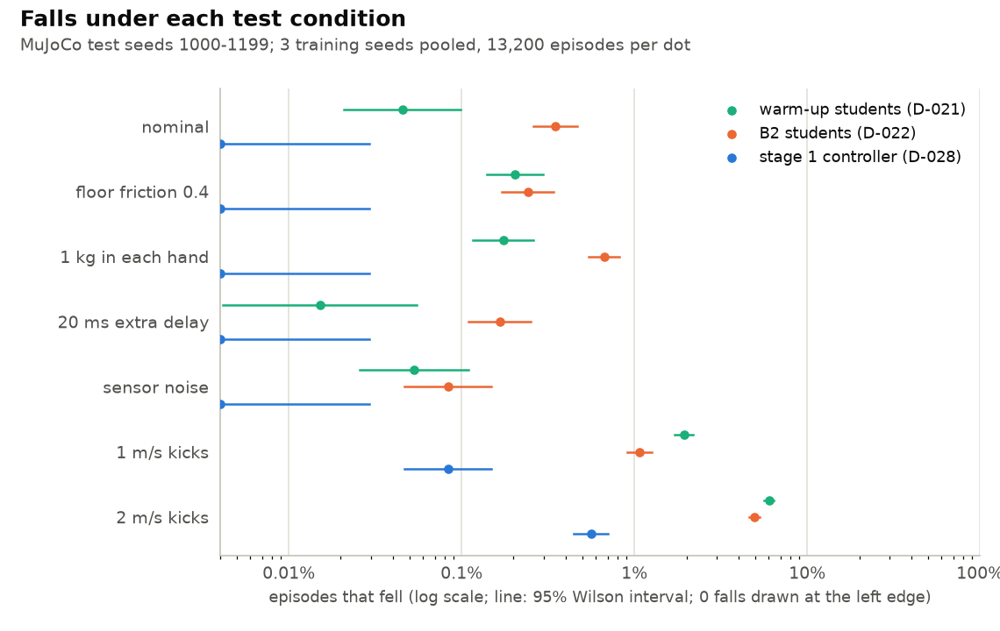
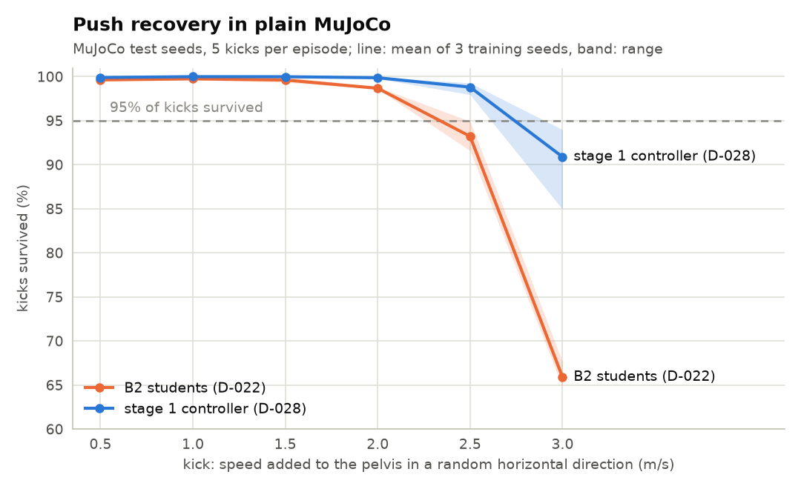
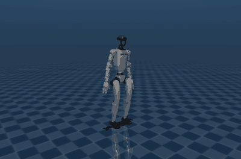
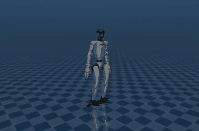
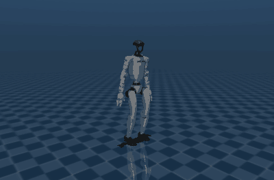
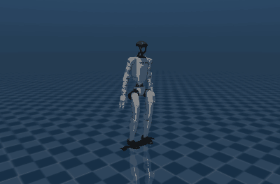
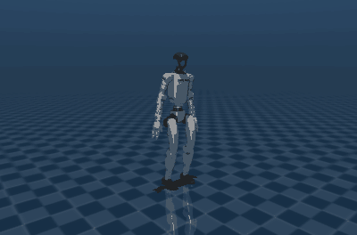
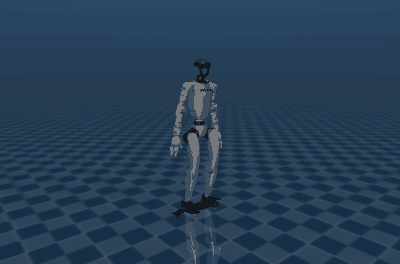
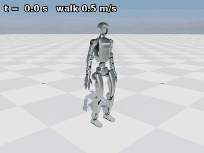

# Stage 1 results: the whole-body controller

The stage 1 controller is a student policy that sees only proprioception (the IMU and joint
encoders over the last 0.5 s), distilled from a PPO teacher with privileged state. Its teacher
trains 3000 iterations under the curriculum and then 7000 more at the full command ranges
(D-022, D-024, D-026, D-028); three training seeds. This page first gives its final numbers on
the frozen test seeds, then the record of how it got there, step by step, in the order of the
[design](../../docs/STAGE1_DESIGN.md)'s section 12. Every number links to raw data in this
folder, and every result file records the commit, package versions and GPU it came from.

**Contents**

- [Final result: the stage 1 controller on the test seeds](#final-result-the-stage-1-controller-on-the-test-seeds)
- [Step 1: gait](#step-1-gait): a gait clock and Unitree's G1 rewards turn a shuffle into a walk
- [Step 2: body pose and moving arms](#step-2-body-pose-and-moving-arms): height, torso and arm commands
- [Step 3: domain randomization](#step-3-domain-randomization): six groups, each checked in a running simulation
- [Step 4: teacher and student](#step-4-teacher-and-student): distillation, then the fixes that led to the final recipe:
  [warm-up (D-021)](#student-recipe-held-level-or-warm-up-d-021),
  [speed (D-022)](#speed-fix-a-narrow-speed-reward-d-022),
  [full ranges and history (D-024, D-026)](#full-command-ranges-and-a-25-step-student-d-024-d-026),
  [a turning reward that failed (D-027)](#a-narrow-turning-reward-does-not-fix-turning-d-027),
  [longer teacher training (D-028)](#longer-full-range-training-brings-turning-back-d-028),
  [PhysX check](#the-stage-1-controller-on-isaac-sims-physx)
- [Step 5: test conditions in the MuJoCo bench](#step-5-test-conditions-in-the-mujoco-bench)
- [Step 6: ablation](#step-6-ablation): every randomization group, the curriculum and the teacher switched off in turn
- [Step 7: the controller in Isaac Sim's PhysX](#step-7-the-controller-in-isaac-sims-physx)

## Final result: the stage 1 controller on the test seeds

The three students of D-028 (training seeds 1-3) on the frozen MuJoCo test seeds 1000-1199:
every command (11) from 200 starts on both robot models, 4400 episodes per seed and condition,
each episode 20 s, or 23 s with kicks so that the last kick (at 19 s) is watched for 4 s like
the others; and the kick sweep (kicks of 0.5-3 m/s at 3, 7, 11, 15 and 19 s while standing,
walking at 0.5 and 1 m/s, turning in place and moving the arms; 2000 episodes per seed and
kick). These three students had not been run on the test seeds before; earlier recipes were,
and are reported with them (step 4). Tables from `scripts/finish_line.py
results/stage1/full_range_long_test full-range-long`. The same students in Isaac Lab and on
Isaac Sim's PhysX: [below](#the-stage-1-controller-on-isaac-sims-physx).

**On the fixed bench (D-040).** Every number in this section, and every test-seed and engine
comparison table further down, comes from the MuJoCo bench after the fixes of D-039 (the feet
of Menagerie's model stood on friction 0.6) and D-040 (seven more, among them stale IMU
readings and 20 s kick episodes). D-040 lists what changed; the main change is that turning in
place now misses its target on every seed. The development record between here and step 6 is
kept as measured at the time ([How it got here](#how-it-got-here)).

**The design's finish line** (section 1); each cell is Menagerie / Newton model:

| Measure | Target | Seed 1 | Seed 2 | Seed 3 | Met |
|---|---|---|---|---|---|
| Falls, all commands, both models | upper 95% bound below 5% | 0/4400 | 0/4400 | 0/4400 | yes: 0 of 13,200 (0.00%-0.03%) |
| Speed error, walking 1 m/s | at most 0.15 m/s | 0.10 / 0.10 | 0.09 / 0.09 | 0.05 / 0.04 | yes |
| Speed error, walking 0.5 m/s | at most 0.15 m/s | 0.05 / 0.04 | 0.05 / 0.04 | 0.03 / 0.04 | yes |
| Speed error, sideways 0.3 m/s | at most 0.15 m/s | 0.08 / 0.08 | 0.09 / 0.10 | 0.07 / 0.07 | yes |
| Turn-rate error, 0.8 rad/s in place | at most 0.2 rad/s | 0.21 / 0.19 | 0.29 / 0.26 | 0.24 / 0.22 | no (D-029, D-040) |
| Step rate at 1 m/s | 1.5-3 steps/s | 2.4 / 2.4 | 2.5 / 2.5 | 2.4 / 2.5 | yes |
| Step length at 1 m/s | at least 0.3 m | 38 cm / 38 cm | 37 cm / 37 cm | 40 cm / 40 cm | yes |
| Foot lift at 1 m/s (the ankle's rise) | at least 5 cm | 7.1 cm / 7.1 cm | 7.3 cm / 7.5 cm | 6.8 cm / 6.8 cm | yes |
| Slip at the sole, 1 m/s (D-016) | at most 0.1 m/s | 0.03 / 0.01 | 0.07 / 0.02 | 0.03 / 0.01 | yes |
| Arm joint error, walking with the arms moving | report | 0.039 / 0.033 rad | 0.039 / 0.033 rad | 0.039 / 0.033 rad | - |
| Kicks survived at 2.0 / 2.5 m/s | report the largest kick survived 95% of the time | 100.0% / 99.3% | 99.9% / 99.4% | 99.9% / 98.6% | 2.5 m/s on every seed |

<picture>
  <source media="(prefers-color-scheme: dark)" srcset="../figures/falls-dark.png">
  
</picture>

**Falls per test condition**, per training seed 1 / 2 / 3 and pooled with 95% Wilson intervals
(13,200 episodes per condition), against the warm-up students (D-021) and the B2 students
(D-022) on the same seeds:

| Condition | Warm-up (D-021) | B2 (D-022) | Stage 1 controller (D-028) |
|---|---|---|---|
| nominal | 0 / 10 / 2 (12: 0.05%-0.16%) | 49 / 4 / 1 (54: 0.31%-0.53%) | 0 / 0 / 0 (0: 0.00%-0.03%) |
| floor friction 0.4 | 2 / 15 / 5 (22: 0.11%-0.25%) | 30 / 3 / 0 (33: 0.18%-0.35%) | 0 / 0 / 0 (0: 0.00%-0.03%) |
| 1 kg in each hand | 4 / 11 / 5 (20: 0.10%-0.23%) | 55 / 16 / 8 (79: 0.48%-0.75%) | 0 / 0 / 0 (0: 0.00%-0.03%) |
| 20 ms extra delay | 0 / 9 / 1 (10: 0.04%-0.14%) | 22 / 3 / 2 (27: 0.14%-0.30%) | 0 / 0 / 0 (0: 0.00%-0.03%) |
| sensor noise | 0 / 4 / 2 (6: 0.02%-0.10%) | 9 / 1 / 0 (10: 0.04%-0.14%) | 1 / 0 / 0 (1: 0.00%-0.04%) |
| 1 m/s kicks every 4 s | 90 / 146 / 85 (321: 2.18%-2.71%) | 71 / 96 / 77 (244: 1.63%-2.09%) | 8 / 10 / 3 (21: 0.10%-0.24%) |
| 2 m/s kicks every 4 s | 254 / 317 / 235 (806: 5.71%-6.53%) | 248 / 331 / 159 (738: 5.21%-6.00%) | 14 / 14 / 10 (38: 0.21%-0.39%) |

<picture>
  <source media="(prefers-color-scheme: dark)" srcset="../figures/kicks-dark.png">
  
</picture>

**Kick sweep** (the design's push-recovery measure), 2000 episodes per seed and kick. "Kicks
survived" counts the kicks an episode received before its fall, and the fall as one kick not
survived:

| Kick | Episodes that fell (seeds 1 / 2 / 3) | Pooled, 95% | Kicks survived |
|---|---|---|---|
| 0.5 m/s | 10 / 1 / 0 | 0.10%-0.33% | 99.9% / 100.0% / 100.0% |
| 1.0 m/s | 0 / 8 / 2 | 0.09%-0.31% | 100.0% / 99.9% / 100.0% |
| 1.5 m/s | 0 / 1 / 4 | 0.04%-0.19% | 100.0% / 100.0% / 100.0% |
| 2.0 m/s | 4 / 7 / 7 | 0.19%-0.47% | 100.0% / 99.9% / 99.9% |
| 2.5 m/s | 66 / 59 / 138 | 3.89%-4.93% | 99.3% / 99.4% / 98.6% |
| 3.0 m/s | 463 / 577 / 993 | 32.70%-35.09% | 94.8% / 93.3% / 87.2% |

- **1 fall without kicks in 66,000 episodes** (five conditions, three seeds; 0.00%-0.01%):
  seed 1 under sensor noise, walking while turning on Menagerie's model, at 7.9 s. The B2
  students fell 203 times and the warm-up students 70. The B2 students' weakness, standing with
  the arms moving, is gone.
- **A tenth to a twentieth of the earlier falls under kicks:** 21 and 38 of 13,200 episodes
  with 1 and 2 m/s kicks, against 244 and 738 for B2. The largest kick survived 95% of the time
  is 2.5 m/s on every seed (B2: 2.0 m/s).
- **Every finish-line target is met on every seed except turning in place:** the turn-rate
  error is 0.21 / 0.19 rad/s on seed 1 (Menagerie / Newton's model), 0.29 / 0.26 on seed 2 and
  0.24 / 0.22 on seed 3, against at most 0.2. Before the bench fixes seed 1 met it on both
  models (0.19 / 0.19). Stage 1 closes with this as a known limit (D-029, amended by D-040).
- **The test seeds repeat the development seeds** to within 0.01 m/s and 0.01 rad/s on every
  tracking error.
- **One weakness the test seeds showed:** walking at 0.5 m/s on Menagerie's model, seed 1 falls
  1.4-1.8 s after a gentle 0.5 m/s kick in 10 of 200 episodes, but never after 1 m/s kicks
  there. Before the bench fixes it was 30 of 200, which D-039 put down to the 0.6 floor (on the
  old bench, development seeds 0-99: 16 of 100 on that floor, none on the corrected one). On the
  fixed bench it falls in 5 of 100 of those development seeds (2%-11%,
  [foot_friction/fixed_bench/](foot_friction/fixed_bench/)): the corrected floor and the other
  fixes together cut it to a third, but it is not gone.

Raw data: [`full_range_long_test/`](full_range_long_test/) (labels `full-range-long-s{1,2,3}`,
the kick sweep in `push/`); the command-tracking runs of the front page in
[`full_range_long/`](full_range_long/) (`tracking_trace_s*.json.gz`,
`scripts/tracking_trace.py`) and the teachers' training curves there too
(`teacher_training.json.gz`, `scripts/teacher_curves.py`).

## How it got here

The working record, step by step: what was tried, what was found and what changed. Its numbers
were measured as each step was taken, on the MuJoCo bench as it was then: on Menagerie's model
the feet stood on friction 0.6 (D-039), and the bench had the six other faults that D-040 fixed.
They were the basis of the choices made at the time and are kept as measured. Rerun on the
fixed bench (D-040), and marked so where they appear: every test-seed table of steps 4 and 6,
the turn sweeps, the B2 students' and the D-028 students' development seeds, and the MuJoCo
columns of the engine comparisons (step 4's PhysX check and step 7). The test seeds 1000-1199
were run for every candidate recipe from step 4 on and are reported in full; one problem first
seen there (the B2 students falling with their arms moving) led to D-024.

## Step 1: gait

**In short:** a gait clock and Unitree's G1 rewards turn the stage 0 shuffle (about 10 steps
per second of 9 cm) into a walk. Three training runs of 3000 iterations each take 2.5 steps per
second of 39 cm at 1 m/s and lift their feet 6.5 cm. Their speed error at 1 m/s is 0.06 m/s,
their turn-rate error when turning in place at most 0.08 rad/s, and none fell in 360 MuJoCo
episodes. All seven gait targets of the design are met on average over the three runs; one
run's slip is just over its target (0.102 against at most 0.1 m/s). Slip is measured where the
sole touches the floor (D-016); the first measure, at the ankle, also counted the foot rolling
from heel to toe and read 0.15-0.21 m/s.

   
  <em>Gait v3, training seed 1 (the first run, not picked), walking at 1 m/s in plain MuJoCo on
  MuJoCo Menagerie's G1 model.</em>

Task: `PiWbc-G1-Gait` (`src/pi_wbc/tasks/g1_gait.py`): the policy drives the 12 leg and 3
waist joints with NVIDIA's Decoupled WBC gains; arms and hands are held in the default pose;
velocity commands sample the yaw rate directly; the policy sees a gait clock (period 0.8 s).

### Result: 3 runs of v3, 3000 iterations

Training seeds 1-3, 3000 iterations, 4096 environments, on the workstation's RTX 4070 (about
58 min per run) at commit `3ea445b`, 2026-10-29. The design planned these runs for the cluster;
the workstation was free overnight and runs the same code. MuJoCo protocol as in stage 0: both
models, 6 commands, 10 seeded starts each, 20 s. The starts use evaluation seeds 0-9, inside
the development range (0-99); the test range (1000-1199) is kept for the final stage 1 result.

Gait on the Menagerie model at 1 m/s; mean over the 3 runs, with the lowest and highest run in
brackets:

| Measure (design, section 1) | Target | Stage 0 default (13 runs) | v3 (3 runs) | Met |
|---|---|---|---|---|
| Falls, all MuJoCo test commands, both models | upper 95% bound below 5% | 17/1560 (1%-2%) | 0/360 (0%-1%) | yes |
| Speed error while walking | at most 0.15 m/s | 0.12 m/s | 0.06 m/s (0.06-0.07); at most 0.09 m/s on any walking command and model | yes |
| Turn-rate error, turning in place at 0.8 rad/s | at most 0.2 rad/s | 0.11-0.80 rad/s | 0.06-0.08 rad/s | yes |
| Step rate at 1 m/s | 1.5-3 steps/s | 10.2 | 2.5 (2.4-2.5) | yes |
| Step length at 1 m/s | at least 0.3 m | 9 cm | 39 cm (38-39) | yes |
| Foot lift | at least 5 cm | 3.0 cm | 6.5 cm (6.1-6.9) | yes |
| Slip: sole speed at its floor contacts (D-016) | at most 0.1 m/s | 0.14 m/s (0.03-0.27) | 0.07 m/s (0.04-0.10) | on average; seed 3 at 0.102 |
| Ankle speed in stance (first slip measure, for comparison) | — | 0.31 m/s | 0.17 m/s (0.15-0.21) | — |
| Push recovery, arm tracking | report | — | — | later steps |

Other measures at 1 m/s: both feet down 6% of the time (4-10%), knee range 23° (14-30°), heading
drift 0.02-0.08 rad/s. Isaac Lab's training statistics (last 50 iterations, over the random
training commands): speed error 0.14 m/s, turn-rate error 0.34-0.36 rad/s, 1.0-1.3% of episodes
ending in a fall. Stage 1's training commands differ from stage 0's, so these don't compare
directly with stage 0's.

Raw data: one file per run in [`gait_step1/`](gait_step1/) (trained at commit `3ea445b`,
evaluated at `9a55b47` with the sole-slip measure, clean tree; every other number is unchanged
from the first evaluation at `3ea445b`), the
summary in [`gait_step1_compare.json`](gait_step1_compare.json), the training-side numbers in
[`gait_step1_training.json`](gait_step1_training.json). Rerun with
`scripts/train_eval_local.sh PiWbc-G1-Gait 3000 results/stage1/gait_step1 gait-v3 1 2 3`.

What the numbers show:

- **Longer training closed the speed gap.** The 1000-iteration development run of v3 (below)
  fell 0.27 m/s short of 1 m/s with 28 cm steps; all three 3000-iteration runs track within
  0.07 m/s with 38-39 cm steps.
- **The three runs agree** on step rate, step length, foot lift and tracking. They differ in
  how much they bend the knee: seed 3 uses 14° of knee range against 25-30° for the others, and
  has the most slip (0.10 m/s at the sole) and time with both feet down (10%).
- **Foot lift drops at slower commands:** 3.9-4.6 cm at 0.5 m/s and 1.6-2.9 cm when stepping
  sideways or turning in place. The gait targets are measured at 1 m/s (D-010).
- **The ankle moves more in stance as the steps grow longer:** 0.13 m/s for the 1000-iteration
  run, 0.15-0.21 m/s now. Most of that is the foot rolling, not sliding (next section).

### Slip: measured at the sole

The first slip measure was the planar speed of each ankle-roll link's origin while its foot
touched the floor. That point sits 3.5 cm above the sole, so it also moves when the foot rolls
from heel to toe or pivots on its toe without sliding. The bench now also measures the speed of
the sole itself at each floor contact, weighted by the contact's force (D-016). A unit test
pivots the robot on its toe at 2 rad/s: the ankle measure reads 0.07 m/s, the sole measure
0.0002 m/s.

Walking at 1 m/s, per run:

| Run | Sole slip, Menagerie | Sole slip, Newton | Ankle speed, Menagerie | Ankle speed, Newton |
|---|---:|---:|---:|---:|
| seed 1 | 0.042 m/s | 0.005 m/s | 0.150 m/s | 0.107 m/s |
| seed 2 | 0.062 m/s | 0.012 m/s | 0.154 m/s | 0.131 m/s |
| seed 3 | 0.102 m/s | 0.044 m/s | 0.212 m/s | 0.151 m/s |
| stage 0 default (13 runs) | 0.14 m/s (0.03-0.27) | 0.03 m/s (0.01-0.05) | 0.31 m/s (0.20-0.42) | 0.22 m/s (0.20-0.26) |

- **Most of the first measure was rolling.** At the sole, the three runs slip 0.04-0.10 m/s on
  Menagerie's model, 30-50% of the ankle measure. Two runs meet the target clearly; seed 3 is
  at the line.
- **Gait v3 slips about half as much as the stage 0 shuffle** at the sole (0.07 against
  0.14 m/s on Menagerie's model).
- **Every policy slips more on Menagerie's model than on Newton's**, the stage 0 shuffle as
  well (0.14 against 0.03 m/s). That points at the models rather than the policies: Menagerie's
  contacts are softer (stage 0 results, part 4), which may let a loaded foot creep. Its feet
  also had friction 0.6 instead of 1.0 (D-039), but that is not the cause: with 1.0, seed 1's
  final controller still slips 0.043 m/s there at 1 m/s (0.045 with 0.6).
- **Training's slip penalty uses the ankle's velocity too,** so it also discourages rolling.
  Whether that matters is a question for the reward work in later steps (D-016).

### Development runs: three versions, 1000 iterations, one run each

| Version | Change | Falls (all commands, both models) | Steps/s | Step length | Foot lift | Ankle speed in stance | Speed error | Heading drift | Turn-in-place error | Stands still |
|---|---|---|---:|---:|---:|---:|---:|---:|---:|---|
| stage 0 bench (13 runs) | built-in rewards | 17/1560 | 10.2 | 9 cm | 3.0 cm | 0.31 m/s | 0.12 m/s | — | 0.11-0.80 rad/s | yes |
| v1 | gait clock, Unitree's rewards | 0/120 | 2.5 | 37 cm | 5.8 cm | 0.15 m/s | 0.11 m/s | 0.08 rad/s | 0.18 rad/s | no: steps in place |
| v2 | + heading reward, stand signal | 0/120 | 2.6 | 34 cm | 5.1 cm | 0.14 m/s | 0.16 m/s | 0.05 rad/s | 0.09 rad/s | yes |
| v3 | + arms held in the default pose | 0/120 | 2.7 | 28 cm | 4.6 cm | 0.13 m/s | 0.27 m/s | 0.11 rad/s | 0.07 rad/s | yes |

Gait, speed error and heading drift: MuJoCo Menagerie model, 1 m/s command; turning: 0.8
rad/s in place; same protocol as stage 0 (10 seeded starts per command, 20 s). Heading drift
is the average turn rate over an episode minus the commanded one, which the per-step
turn-rate error hides under the rocking of each step. Raw data in [`gait_dev/`](gait_dev/)
(commit `746fc4c`, clean tree). Single training runs: differences between versions smaller
than stage 0's run-to-run spread (D-011) are not evidence.

### What happened on the way

- **The shuffle is fixed by describing the walk.** With a clock that says when each foot
  should be down and rewards for following it, lifting the swing foot and not slipping, every
  version steps at the clock's 2.5 steps per second with 4-6 cm of foot lift. Stage 0's reward
  pilot ([stage 0 results, part 5](../stage0/README.md#5-reward-pilot-four-reward-changes-two-runs-each))
  reaches a similar step rate by raising the foot-air-time reward alone, but none of its
  variants turns or holds its heading as well, and one of its two best runs sways.
- **A bench mismatch looked like a transfer failure.** The first MuJoCo tests of v1 and v2
  fell often (up to 10 of 10 episodes per command) and walked in circles. The cause was the
  arms: no action drives them, Isaac Lab leaves such joints' targets at 0, and the bench held
  them in the default pose with elbows bent. The robot was being tested with a different
  centre of mass from training. The bench now holds such joints at the targets the export
  records; with that, both versions walk without falling (table above). Stage 0's hands had the
  same mismatch on a much smaller scale (re-run in its results, part 2).
- **Direct turn-rate commands need a heading term.** v1's turn-rate reward let a steady turn
  bias through. v2 adds a reward for staying on the heading the commanded turn rates add up to;
  it also gives the clock a "stand" reading (zero) when the command is zero, so the robot stops
  stepping when told to stand.
- **v3 holds the arms as designed** (default pose, elbows bent) instead of hanging. At 1000
  iterations it fell short of 1 m/s, with its training curves still improving; 3000 iterations
  closed the gap (result above).

## Step 2: body pose and moving arms

**In short:** the task works end to end. After five development runs, the current policy
stands, walks, crouches to 0.60 m (within 2-4 cm), leans its torso forward and keeps its balance
while its arms move through their full training range with up to 1 kg in each hand: no falls in 220
MuJoCo episodes on either model. But walking and turning got worse than in step 1: at 1 m/s the
speed error is about 0.4 m/s (step 1, 1000 iterations: 0.27; 3000 iterations: 0.06), and turning
in place is 0.42-0.74 rad/s off a 0.8 rad/s command (step 1: 0.07). These are single
1400-iteration runs on the workstation; the result proper needs longer runs and 3 seeds.

Task: `PiWbc-G1-Body` (`src/pi_wbc/tasks/g1_body.py`, D-017), the gait task plus:

- a body-pose command: pelvis height 0.50-0.78 m and the three waist angles (yaw ±0.6, roll
  ±0.2, pitch 0-0.45 rad), moving smoothly to a new goal every 4-8 s; the policy sees it;
- random arm and hand poses, written straight to those joints' PD targets (the policy still
  drives only legs and waist), a new pose every 2-4 s;
- 0-1 kg added to each palm;
- a curriculum that widens body-pose and arm ranges from none to full while few episodes end
  in a fall and velocity tracking holds;
- leg actions centred on a crouch pose that follows the commanded height
  (`scripts/crouch_table.py`).

The MuJoCo bench gained five scenarios: crouch to 0.60 m, walk at 0.5 m/s at 0.65 m, lean
forward 0.4 rad, and arms moving at full range while standing and while walking at 0.5 m/s
(`src/pi_wbc/sim2sim/commands.py`), with height, waist and arm joint errors.

### Development runs

1400 iterations each (v2: 1000), training seed 1, MuJoCo Menagerie model unless stated;
falls are over all 11 commands and both models.

| Run | Change | Falls | Arms moving: falls | Speed error, 1 m/s | Turn-in-place error | Crouch 0.60 m: height error | Walk low: height, speed error | Lean 0.4: waist error | Arms walking: arm error |
|---|---|---|---|---:|---:|---:|---|---:|---:|
| v1 | payload changed at every reset | stopped: training 2.3x slower | | | | | | | |
| v2 | payload once per robot | 24/220 | 24/40 | 0.28 m/s | 0.18 rad/s | 18.8 cm | 13.7 cm, 0.17 m/s | 0.119 rad | 0.044 rad |
| v3 | curriculum judged over 20-iteration windows | 0/220 | 0/40 | 0.36 m/s | 0.61 rad/s | 18.3 cm | 13.4 cm, 0.19 m/s | 0.085 rad | 0.045 rad |
| v4 | + height bonus (exp form) | 0/220 | 0/40 | 0.58 m/s | 0.53 rad/s | 17.0 cm | 13.1 cm, 0.32 m/s | 0.074 rad | 0.044 rad |
| v5 | + leg actions centred on a crouch pose | 0/220 | 0/40 | 0.40 m/s | 0.74 rad/s | 1.7 cm | 0.3 cm, 0.37 m/s | 0.043 rad | 0.046 rad |
| v6 | + arm poses every 2-4 s instead of 1-3 s | 0/220 | 0/40 | 0.42 m/s | 0.42 rad/s | 3.5 cm | 0.7 cm, 0.43 m/s | 0.096 rad | 0.041 rad |
| v7 | + curriculum also needs turning to hold | 0/220 | 0/40 | 0.54 m/s | 0.49 rad/s | 4.8 cm | 2.0 cm, 0.32 m/s | 0.063 rad | 0.041 rad |
| v8 | + turning reward ×2, 20% turn-in-place commands | 0/220 | 0/40 | 0.72 m/s | 0.32 rad/s | 0.5 cm | 1.1 cm, 0.50 m/s | 0.064 rad | 0.041 rad |

Raw data in [`body_dev/`](body_dev/). Each run was trained, exported and evaluated at its own
commit (v2 `d1b35cb`, v3 `c1d08b2`, v5 `27728b4`, v6 `39c9079`, v7 `7fd051b`, v8 `8188cdb`;
v3's tree differed only in `docs/`). v7's first attempt stopped at iteration 182 when the workstation
crashed (no error in the system log); the run above is its restart. v4 was trained at `71bf947`; its first export picked up a half-written change and was
redone from `71bf947`, then evaluated at `39c9079` (below). Single runs: differences between
versions smaller than stage 0's run-to-run spread (D-011) are not evidence; v5 against v6 is one
such case.

### What happened on the way

- **Changing masses at reset is slow on Newton.** Adding the payload at every reset made each
  training iteration take 2.7 s instead of 1.2 s; the payload is now drawn once per robot.
- **The curriculum needed whole windows.** Judging each step's few resetting robots on their
  own made it start late (iteration 750 of 1000) and move in fits; v2 reached only 45% of the
  full range and fell in 24 of 40 episodes with the arms at full range. Judged over
  20-iteration windows, it reaches the full range by about iteration 1050 with falls at 5-10%.
- **Crouching needs the crouch pose.** v3 and v4 never crouched: their training height error,
  10 cm, was what standing still gives, and in MuJoCo they stayed 17-18 cm above a 0.60 m
  command. A 0.60 m crouch needs knee actions of about 5 at the action scale of 0.25 (actions
  are usually within ±2), and a stronger height reward (v4) did not get the policy there.
  Centring the leg actions on the crouch for the commanded height (v5) gets crouching within
  2-4 cm, with no falls.
- **Turning in place is given up as the ranges widen.** In every run the training yaw-rate
  error improves until the curriculum starts and then rises as it widens (v5: 0.65 to
  1.05 rad/s; step 1 kept improving to 0.45). Slower arm motion (v6) did not change that
  trend in training. The turning rewards lose the most as the curriculum widens (turn-rate
  tracking 0.39 to 0.26, heading 0.54 to 0.30, per second); speed tracking holds. Holding the
  curriculum once turning dropped (v7) stopped it at 90% of the full range, but turning kept
  degrading there (training yaw-rate error 0.67 to 0.97 rad/s at a fixed range), so the cause
  is something the wider commands bring, not the widening itself.
- **An export once used code edited during the run.** v4's first export picked up the
  crouch-pose change while it was half-written, so MuJoCo tested its policy with leg offsets it
  never trained with (10 of 10 falls when crouching). Re-exported from its training commit, it
  doesn't fall; it just doesn't crouch. `scripts/train_eval_local.sh` now runs every step from
  a copy of the starting commit.

### Where turning goes: three probes

Each probe is v7 with one ingredient of the upper-body commands removed, through config
overrides (1200 iterations, seed 1; `scripts/train_eval_local.sh` with `OVERRIDES`):

| Probe | Removed | Training yaw-rate error, start of curriculum → end | MuJoCo turn-in-place error | MuJoCo speed error, 1 m/s |
|---|---|---|---:|---:|
| v7 | nothing | 0.67 → 0.97 rad/s | 0.49 rad/s | 0.54 m/s |
| A | crouching (height fixed at 0.78 m) | 0.67 → 0.83 rad/s | 0.38 rad/s | 0.29 m/s |
| B | arm motion (arms held still) | 0.71 → 0.91 rad/s | 0.35 rad/s | 0.34 m/s |
| C | the waist command (waist held at 0) | 0.61 → 0.82 rad/s | 0.44 rad/s | 0.32 m/s |

(Probes A and B also fell 40 of 220 times in MuJoCo, all in the scenarios they did not train
for: crouching for A, moving arms for B.) No single ingredient is the cause: with any two of
the three, turning in place is still given up as the curriculum widens, while removing one
helps walking speed a little. The likeliest reading is that turning while the upper body
disturbs the robot risks a fall, which costs far more than turning earns, so the policy stops
trying. v8 doubles the turning reward and the share of turn-in-place commands (20%). Two
cluster runs test the rest: the same task with every upper-body command off (is it the
commands at all?) and v7 trained for 3000 iterations (does longer training bring turning
back, as it brought walking speed back in step 1?).

Raw data in [`body_dev/`](body_dev/) (`probeA-*`, `probeB-*`, `probeC-*`).

**v8: turning kept, walking lost.** With the turning reward doubled and twice the share of
turn-in-place commands, v8 is the first version whose training yaw-rate error stays flat
(0.44-0.45 rad/s) all the way to the full range, and it turns in place best in MuJoCo
(0.26-0.32 rad/s off a 0.8 rad/s command). But it walks slowest: asked for 1 m/s it makes about
0.3 m/s, in 7 cm steps. Every run so far stops at 1400 iterations with the curriculum taking
the second half, while step 1 needed 3000 iterations to walk well; whether full-length training
recovers walking is the next question (v7 at 3000 iterations on the cluster, v8 at 3000 on the
workstation).

### Full-length training brings walking back

Every run above stops at 1400 iterations. Their training speed error stayed at 0.35-0.39 m/s,
which is what a robot that never moves would score under the training commands (0.38 m/s;
0.33 m/s with v8's command mix), while step 1's gait reached 0.14. Four runs pinned down why:

| Run | Where | Training speed error at 450 / 1000 / 1500 / 3000 iterations | MuJoCo, 1 m/s: speed error, steps | Turn in place | Falls (all 11 commands, both models) |
|---|---|---|---|---:|---|
| step 1 gait | workstation | 0.34 / 0.19 / 0.16 / 0.14 | 0.07 m/s, 2.4/s of 38 cm | 0.08 rad/s | 0/120 (6 commands) |
| control: v7 with every upper-body command held still | cluster | 0.32 / 0.21 / 0.17 / 0.17 | 0.15 m/s, 2.4/s of 35 cm | 0.09 rad/s | 80/220, all in the crouch and arm commands it never trained for |
| **v7, 3000 iterations** | cluster | 0.37 / 0.33 / 0.31 / 0.21 | **0.25 m/s, 2.4/s of 32 cm** | 0.22 rad/s | **0/220** |
| probe P: v8 without the payload | workstation | 0.43 at 450, 0.36 at 700 | 0.65 m/s | 0.13 rad/s | — |

- **The task itself walks.** With the upper-body commands held still, the body task (payload,
  new rewards and all) learns to walk almost as well as step 1. The payload is not the cause
  either (probe P walks as badly as v8 at 700 iterations).
- **The moving upper body slows learning, and time fixes it.** With the full curriculum, v7's
  speed error falls slowly but steadily to 0.21 by 3000 iterations, and in MuJoCo it walks in
  real steps (32 cm at 2.4 per second), crouches to 0.60 m within 0.6 cm and keeps its balance
  with the arms moving, with no falls in 220 episodes. 1400 iterations was simply too short.
- Turning in place is still v7's weak spot (0.22 rad/s off).
- **v8's turning change does not survive full-length training.** v8 at 3000 iterations
  (workstation) never learned to walk: training speed error 0.38 at 1000 and 2000 iterations
  and 0.35 at 3000, the standing-still level; in MuJoCo it shuffles at 1 m/s (0.56 m/s off,
  10 cm steps at 4.5 per second) and turns worse than v7 (0.32 against 0.22 rad/s), with no
  falls. Doubling the turning reward and the share of turn-in-place commands held turning over
  1400 iterations but kept the policy from learning to walk, so the task is back to v7's
  turning settings (one run each, on different machines, but the gap is large throughout).

Cluster runs: jobs 5204130 and 5204131, commit `810d67f`, one A40 each, about 1 h 16 min for
3000 iterations; evaluated on the workstation at `a633152`.

### Next

- The teacher and student at full length with v7's settings; then better turning without
  costing walking.
- Longer training: step 1 needed 3000 iterations to walk well, and here the curriculum takes
  the second half of a 1400-iteration run. Then 3 seeds, as in step 1.
- The stand-still penalty costs about 0.35 per second in training, mostly from the exploration
  noise added to actions (the policy itself stands still in MuJoCo: both feet down 95-100% of
  the time). Step 1's version measured the offset from the default pose, so the two values
  don't compare.

## Step 3: domain randomization

Task: `PiWbc-G1-Robust` (`src/pi_wbc/tasks/g1_robust.py`, D-018), the body task plus six
randomization groups, each removable for the ablation by the config overrides in
`ABLATION_OVERRIDES`:

| Group | What varies | Range |
|---|---|---|
| Friction | robot friction, one value per robot for all its shapes, on a 0.05 ground | 0.1-1.25 |
| Mass | torso; every link; torso centre of mass; hand payload | -1 to +3 kg; ×0.9-1.1; ±3 cm; 0-1 kg |
| Actuators | PD stiffness and damping, joint armature | ×0.8-1.2 |
| Latency | physics steps between a new action and its PD targets | 0-4 (0-20 ms) |
| Sensor noise | the policy's readings | Unitree's values |
| Pushes | pelvis velocity kicks every 4-6 s | ±0.5 m/s, growing to ±1.5 m/s with the curriculum |

### Each group checked in a running simulation

`scripts/check_randomization.py`, 256 robots in Isaac Lab (Newton), results in
[`randomization_check/`](randomization_check/) (commit `8188cdb`, clean tree):

- **Mass, actuators:** the simulation holds torso masses of 6.2-11.5 kg (nominal 7.8), link
  masses ×0.90-1.10, torso centres of mass within ±3 cm, and stiffness, damping and armature
  ×0.80-1.20.
- **Latency:** after a jump in the action, every robot's PD targets switch exactly after its
  drawn delay (246 of 246 robots that did not reset in between).
- **Pushes:** 252 pushes, the largest 0.50 m/s per axis for a ±0.5 m/s setting.
- **Sensor noise:** two reads of the same state differ (up to 3.0, from the ±1.5 rad/s noise
  on joint speeds).
- **Stability:** 10 s with the centre of mass moved: the state stays finite.
- **Friction:** standing robots kicked sideways at 1 m/s; mean foot travel in the next 0.1 s
  (about 200 robots each):

  | Robot friction | Ground friction | Larger of the two | Foot travel |
  |---|---|---:|---:|
  | 0.1 | 0.05 | 0.1 | 8.7 cm |
  | 1.0 | 0.05 | 1.0 | 4.7 cm |
  | 1.25 | 0.05 | 1.25 | 3.7 cm |
  | 0.1 | 1.0 | 1.0 | 4.8 cm |

  On the low ground the robot's friction decides, and two pairs with the same larger value
  slide alike: Newton uses the larger of the two surfaces' friction, as its code says. (These
  runs used Isaac Lab's material event with a fixed value; the task now draws one value per
  robot with its own event, which gives the same slides: 9.6 cm at 0.1, 4.0 cm at 1.25.)
- **Friction per robot, not per shape:** Isaac Lab's material event draws a value per collision
  shape. Each G1 foot touches the ground through four spheres, so its friction mixed four
  draws and stayed near the middle of the range (0.43-0.94 over 16 robots). The task's own
  event gives all of a robot's shapes one value: 0.10-1.24 over 256 robots.

## Step 4: teacher and student

`src/pi_wbc/tasks/g1_student.py`: one environment, the robust task of step 3, with two
observation groups:

- **Student** (`policy`, 528 values): what a real G1 measures. The IMU's turn rate and
  gravity direction, joint positions and speeds, the commands, the last action and the gait
  clock, with sensor noise, over the last 6 policy steps (0.12 s). No base velocity: a real
  robot cannot measure it, so the student has to infer it from the history.
- **Teacher** (104 values): the same terms for the current step without noise, plus privileged
  state: base velocity, foot contacts and heights, the robot's friction (read from the solver),
  torso and hand mass offsets, torso centre-of-mass offset, leg gain scale and action delay.

`PiWbc-G1-Teacher` trains the teacher with PPO on the teacher group; `PiWbc-G1-Student`
distills the student from it with rsl_rl's `Distillation` (the student drives, the teacher
labels: DAgger). `scripts/teacher_student_local.sh` runs both, exports the student and tests it
in MuJoCo under every condition of step 5.

Checked so far:

- **History layout:** in Isaac Lab, with noise off, the student's 6 frames equal the teacher's
  slice of the same terms at each of the last 6 steps, oldest first, every frame the first one
  right after a reset; the MuJoCo bench builds the history the same way
  (`scripts/check_student_history.py`; a unit test checks the bench side).
- **Plumbing:** 5 iterations each of teacher and student train, the student exports (ONNX and
  PyTorch actions agree to 1e-7) and runs in the MuJoCo bench with its 528 inputs.

### Full-length result, seed 1

Teacher 3000 iterations, then student 1000 iterations starting at the teacher's curriculum level
(0.85), with v7's turning settings; workstation, commit `e9b92f0`, 2026-10-30
(`scripts/teacher_student_local.sh 3000 1000 results/stage1/student_dev ts-full 1`). The first
attempt carried v8's turning settings and was stopped after a minute when v8's full-length run
showed that setting stops walking. This student was distilled with the curriculum still
running (the first protocol, D-019): its level dipped from 0.85 to 0.45 while it was learning
and ended at 0.95, so it trained every command. A student held at the teacher's level is being
trained for comparison (step 6, "full").

**The student in MuJoCo** (both models, 11 commands × 10 starts; Menagerie model for the
tracking numbers):

| Condition | Falls | Speed error, 1 m/s | Speed error, 0.5 m/s | Turn in place | Crouch 0.60 m: height error | Arm joints, walking |
|---|---|---:|---:|---:|---:|---:|
| nominal | 0/220 | 0.20 m/s | 0.14 m/s | 0.19 rad/s | 3.6 cm | 0.040 rad |
| floor friction 0.4 | 0/220 | 0.20 m/s | 0.14 m/s | 0.15 rad/s | 3.6 cm | 0.039 rad |
| 1 kg in each hand | 0/220 | 0.18 m/s | 0.13 m/s | 0.19 rad/s | 3.4 cm | 0.058 rad |
| 20 ms extra delay | 0/220 | 0.18 m/s | 0.12 m/s | 0.20 rad/s | 3.6 cm | 0.041 rad |
| sensor noise | 0/220 | 0.24 m/s | 0.15 m/s | 0.24 rad/s | 3.7 cm | 0.041 rad |
| 1 m/s pushes every 4 s | 2/220 | 0.34 m/s | 0.25 m/s | 0.26 rad/s | 3.7 cm | 0.041 rad |

At 1 m/s it walks at 2.5 steps per second of 32 cm. Against step 2's best (v7 at 3000
iterations: 0.25 m/s off at 1 m/s, 0.22 rad/s turning), the student walks and turns a little
better, with only what a real G1 measures as input, and under every test condition: of 1320
MuJoCo episodes, 2 fell, both under 1 m/s pushes.

**Teacher against student in Isaac Lab** (`pi-wbc-isaac-eval`, nominal robots, 10 per command,
reset seed 0; achieved velocity in the heading frame):

| Command | Teacher: falls, speed error, turn error | Student: falls, speed error, turn error |
|---|---|---|
| walk 1.0 m/s | 0/10, 0.28 m/s, 0.24 rad/s (achieves 0.73 m/s) | 0/10, 0.28 m/s, 0.19 rad/s (0.73 m/s) |
| walk 0.5 m/s | 0/10, 0.10 m/s, 0.17 rad/s | 0/10, 0.13 m/s, 0.10 rad/s |
| sideways 0.3 m/s | 0/10, 0.11 m/s, 0.13 rad/s | 0/10, 0.12 m/s, 0.13 rad/s |
| turn 0.8 rad/s | 0/10, achieves 0.70 rad/s | 0/10, achieves 0.64 rad/s |
| crouch 0.60 m | 0/10, 4.5 cm off | 0/10, 3.8 cm off |
| arms moving, standing | 0/10, drifts 0.07 m/s | 0/10, drifts 0.20 m/s |

The student, without base velocity, matches its privileged teacher nearly everywhere; the gap
is standing still while the arms swing, where it drifts more. Isaac Lab reads a bit slower than
MuJoCo at 1 m/s (0.73 against about 0.80 m/s achieved). One seed so far; seeds 2 and 3 are
running.

  
  
   
  <em>The seed 1 student in plain MuJoCo (Menagerie's G1): walking at 1 m/s, crouching to
  0.60 m, and walking at 0.5 m/s while its arms move to random poses.</em>

Raw data: [`student_dev/`](student_dev/) (`ts-full-s1-*`, `isaac/ts-full-*`, `push/`,
`push_more/`).

### Final test, seed 1: test seeds 1000-1199

The seed 1 student on the frozen test range, 200 starts per command instead of 10 (both models,
11 commands: 4400 episodes per condition; Menagerie model for the tracking numbers). Evaluated
2026-10-30 at commit `2f36a7c` (the files record `88dac1c`, the commit when they were written;
only `docs/MSI.md` changed in between).

| Condition | Falls (95% CI) | Speed error, 1 m/s | Speed error, 0.5 m/s | Turn in place | Crouch 0.60 m: height error | Arm joints, walking |
|---|---|---:|---:|---:|---:|---:|
| nominal | 0/4400 (0.0%-0.1%) | 0.20 m/s | 0.14 m/s | 0.19 rad/s | 3.6 cm | 0.039 rad |
| floor friction 0.4 | 0/4400 (0.0%-0.1%) | 0.20 m/s | 0.14 m/s | 0.15 rad/s | 3.6 cm | 0.038 rad |
| 1 kg in each hand | 6/4400 (0.1%-0.3%) | 0.18 m/s | 0.13 m/s | 0.19 rad/s | 3.5 cm | 0.059 rad |
| 20 ms extra delay | 4/4400 (0.0%-0.2%) | 0.19 m/s | 0.12 m/s | 0.20 rad/s | 3.6 cm | 0.041 rad |
| sensor noise | 3/4400 (0.0%-0.2%) | 0.25 m/s | 0.15 m/s | 0.24 rad/s | 3.7 cm | 0.039 rad |
| 1 m/s kicks every 4 s | 23/4400 (0.3%-0.8%) | 0.33 m/s | 0.25 m/s | 0.26 rad/s | 3.7 cm | 0.039 rad |
| 2 m/s kicks every 4 s | 113/4400 (2.1%-3.1%) | 0.55 m/s | 0.46 m/s | 0.46 rad/s | 4.0 cm | 0.039 rad |

Every tracking number matches the development seeds above (to 0.01 m/s, 0.01 rad/s, 0.002 rad
and 0.1 cm). With 20 times the starts the rare falls show: at most 6 in 4400 (0.14%) under
low friction, payload, delay or noise, and 23 in 4400 (0.5%) under 1 m/s kicks.

**Push recovery** (the design's "largest push survived 95% of the time"): kicks to the pelvis at
3, 7, 11, 15 and 19 s, each in a random horizontal direction, while standing, walking at 0.5 and
1 m/s, turning in place, and standing with the arms moving; both MuJoCo models, 200 test starts
each (the first sweep, on development seeds 0-19 with 20 starts each, for comparison):

| Kick | Episodes that fell (5 kicks each) | 95% CI | Kicks survived | First sweep: fell, kicks survived |
|---|---|---|---|---|
| 0.5 m/s | 9/2000 | 0.2%-0.9% | 99.9% | 3/200, 99.7% |
| 1.0 m/s | 9/2000 | 0.2%-0.9% | 99.9% | 3/200, 99.7% |
| 1.5 m/s | 18/2000 | 0.6%-1.4% | 99.8% | 0/200, 100% |
| 2.0 m/s | 85/2000 | 3.5%-5.2% | 99.1% | 1/200, 99.9% |
| 2.5 m/s | 462/2000 | 21.3%-25.0% | 94.8% | 38/200, 95.9% |
| 3.0 m/s | 1492/2000 | 72.6%-76.5% | 74.6% | 141/200, 78.2% |

  
   
  <em>2 m/s kicks at 3, 7 and 11 s in plain MuJoCo (Menagerie's G1, seed 1 student, GIF seed 0,
  the first rendered): walking at 1 m/s, and standing with the arms moving.</em>

The largest kick it survives 95% of the time is just under 2.5 m/s (94.8% at 2.5, 99.1% at
2.0); whole episodes of five kicks come through at 2.0 m/s 96% of the time and at 1.5 m/s 99%.
Training pushed it to 1.35 m/s at most (the curriculum reached 85% of the 1.5 m/s top). At
2.5 m/s, 85% of the falls are while standing, with or without the arms moving, where the robot
has to start stepping from rest.

**The first sweep was lucky at 2.0 m/s.** Its 1 fall in 200 (and a page that said "199 of 200")
was not reproduced: the 120 episodes of seeds 0-19 standing, walking at 1 m/s and standing with
arms moving had 1 fall; the test seeds' blocks of 20 had 5 to 13 each, and the rest of the
development range (seeds 20-99, `student_dev/push_more/`) 39 in 480 (8%). Rerunning seeds 0-19
gives the same episodes exactly, and the bench draws each seed's start and kicks through NumPy's
seed sequence, which treats seed numbers alike, so it was the draw. 20 starts per command
are too few for falls of a few percent.

Raw data: [`student_test/`](student_test/) (`ts-full-s1-*`, `push/`), gzip-compressed JSON
(`pi_wbc.provenance.load_json` or `zcat` reads them); rerun with
`scripts/test_seeds.sh ts-full-s1 <run>/exported results/stage1/student_test`.

### Three training seeds: the stage 1 finish line

Seeds 2 and 3 trained on the cluster (`msi/jobs/teacher_student.sbatch`, commit `66ce51f`,
whose training code is seed 1's: A40 for seed 2, 1 h 53 min; L40S for seed 3, 1 h 05 min).
All three students were distilled with the first protocol (D-019) and all three trained every
command: their levels ended at 0.95, 0.90 and 0.90, above their teachers' 0.85, 0.80 and 0.80.
Test seeds 1000-1199, 4400 episodes per seed and condition (both models, 11 commands).

Falls per seed, and pooled over the three (13200 episodes) with 95% intervals:

| Condition | Seed 1 | Seed 2 | Seed 3 | Pooled |
|---|---:|---:|---:|---|
| nominal | 0 | 9 | 0 | 9 (0.04%-0.13%) |
| floor friction 0.4 | 0 | 11 | 0 | 11 (0.05%-0.15%) |
| 1 kg in each hand | 6 | 5 | 1 | 12 (0.05%-0.16%) |
| 20 ms extra delay | 4 | 14 | 0 | 18 (0.09%-0.22%) |
| sensor noise | 3 | 6 | 1 | 10 (0.04%-0.14%) |
| 1 m/s kicks every 4 s | 23 | 53 | 78 | 154 (1.0%-1.4%) |
| 2 m/s kicks every 4 s | 113 | 255 | 288 | 656 (4.6%-5.4%) |

Seed 2's falls without kicks are nearly all one command: walking with the arms moving on the
Menagerie model (8 of its 200 episodes nominal, 7 at friction 0.4, 14 with delay); seeds 1 and
3 have none there. Not looked into yet; one candidate is Menagerie's self-collisions, which
training does not have.

**Against the finish line** (design, section 1), test seeds, nominal robot; each cell is
Menagerie / Newton model:

| Measure | Target | Seed 1 | Seed 2 | Seed 3 | Met |
|---|---|---|---|---|---|
| Falls, all commands, both models | upper 95% bound below 5% | 0/4400 | 9/4400 | 0/4400 | yes: 0.13% pooled |
| Speed error, walking 1 m/s | at most 0.15 m/s | 0.20 / 0.28 | 0.20 / 0.22 | 0.19 / 0.17 | **no** |
| Speed error, walking 0.5 m/s | at most 0.15 m/s | 0.14 / 0.13 | 0.15 / 0.15 | 0.13 / 0.13 | yes, seed 2 at the limit |
| Speed error, sideways 0.3 m/s | at most 0.15 m/s | 0.11 / 0.12 | 0.17 / 0.18 | 0.16 / 0.18 | **no** for seeds 2 and 3 |
| Turn-rate error, 0.8 rad/s in place | at most 0.2 rad/s | 0.19 / 0.20 | 0.22 / 0.23 | 0.18 / 0.19 | seeds 1 and 3; seed 2 **no** |
| Step rate at 1 m/s | 1.5-3 steps/s | 2.5 / 2.5 | 2.5 / 2.5 | 2.4 / 2.5 | yes |
| Step length at 1 m/s | at least 0.3 m | 32 / 30 cm | 35 / 34 cm | 34 / 35 cm | yes (seed 1 on Newton: 29.7 cm) |
| Foot lift | at least 5 cm | 5.7 / 5.1 cm | 5.9 / 5.8 cm | 6.5 / 6.3 cm | yes |
| Slip at the sole (D-016) | at most 0.1 m/s | 0.06 / 0.02 | 0.06 / 0.03 | 0.09 / 0.01 | yes |
| Arm joint error, walking | report | 0.039 / 0.033 rad | 0.039 / 0.033 rad | 0.039 / 0.033 rad | — |
| Push recovery: kicks survived at 2.0 / 2.5 m/s | report the largest kick survived 95% of the time | 99.1% / 94.8% | 99.2% / 94.7% | 98.6% / 92.2% | 2.0-2.5 m/s on every seed |

The gait, falls and arm targets hold for every seed. Speed tracking does not: asked for 1 m/s,
the students walk at 0.73-0.87 m/s (step rate times step length), on every seed and both
models, while the gait-only policy of step 1 was 0.06 m/s off, so the robot can do better. The student trained without randomization was
also closer (0.11 m/s, step 6), so one or more randomization groups cost it; the ablation
should say which.

The kick sweep (as for seed 1 above: 5 commands, both models, 2000 episodes per kick size and
seed) puts every seed's 95% point between 2.0 and 2.5 m/s. The top kick in training followed
the curriculum level: 1.30-1.35 m/s for the teachers, 1.40-1.45 m/s for the students.

Raw data: [`student_test/`](student_test/) (`ts-full-s{1,2,3}-*`, `push/ts-full-s{1,2,3}-*`)
and [`student_dev/`](student_dev/) (`ts-full-s{2,3}-*`, development seeds 0-9).

### Student recipe: held level or warm-up (D-021)

Holding each student at its teacher's level from the first step (D-019) fixed the ablation's
problem but cost walking. A warm-up walks as well as the first protocol did, from the same
teachers: the level rises from 0 to the teacher's over the first 300 of the 1000 iterations,
then stays there, and it is the same for every configuration. Development seeds 0-9, nominal
robot, mean of the Menagerie and Newton models; each cell is training seeds 1 / 2 / 3 (mean):

| Student recipe | Speed error, 1 m/s | 0.5 m/s | Sideways 0.3 m/s | Turn 0.8 rad/s | Crouch error, cm | Falls without kicks | Falls, 2 m/s kicks |
|---|---|---|---|---|---|---|---|
| first protocol (level free) | 0.24 / 0.21 / 0.18 (0.21) | 0.14 / 0.15 / 0.13 (0.14) | 0.11 / 0.18 / 0.17 (0.15) | 0.20 / 0.23 / 0.18 (0.20) | 3.7 / 2.6 / 3.3 (3.2) | 0 / 1 / 0 (1/3300) | 1 / 12 / 20 (33/660) |
| held level (D-019) | 0.27 / 0.35 / 0.15 (0.26) | 0.15 / 0.20 / 0.11 (0.16) | 0.18 / 0.17 / 0.10 (0.15) | 0.18 / 0.32 / 0.17 (0.22) | 4.1 / 2.4 / 3.5 (3.3) | 0 / 0 / 0 (0/3300) | 4 / 11 / 15 (30/660) |
| warm-up (D-021) | 0.17 / 0.23 / 0.21 (0.21) | 0.10 / 0.16 / 0.09 (0.12) | 0.12 / 0.19 / 0.15 (0.15) | 0.20 / 0.23 / 0.22 (0.22) | 3.8 / 2.7 / 3.8 (3.4) | 0 / 2 / 1 (3/3300) | 14 / 11 / 10 (35/660) |

- The held level gives the worst seed: seed 2 is 0.35 m/s off at 1 m/s and 0.32 rad/s off
  turning. Its seed 3 is the best of all at 1 m/s (0.15), with long, slow strides (46 cm).
  The warm-up stays within 0.17-0.23.
- Three seeds don't rank the recipes (D-011): held minus warm-up is +0.10, +0.12 and
  -0.06 m/s at 1 m/s. The warm-up was chosen because it matches the first protocol and its
  level cannot depend on how fast a student learns.
- No recipe reaches the 1 m/s target, so the recipe is not what causes the speed miss.
- The warm-up's 3 falls without kicks are all arm-motion commands: arms moving while walking
  (seed 2, Menagerie, nominal) and while standing (seeds 2 and 3, Newton, friction 0.4, after
  15 s). The test seeds will show whether that is more than chance.

Test seeds 1000-1199, the same three recipes; 4400 episodes per seed and condition, so 22000
per seed without kicks (nominal, friction 0.4, 1 kg in each hand, 20 ms delay, sensor noise)
and 4400 per kick size. Speed errors are the mean of both models:

| Student recipe | Speed error, 1 m/s | 0.5 m/s | Falls without kicks | Falls, 1 m/s kicks | Falls, 2 m/s kicks |
|---|---|---|---|---|---|
| first protocol (level free) | 0.24 / 0.21 / 0.17 (0.21) | 0.14 / 0.15 / 0.13 (0.14) | 13 / 45 / 2 (60) | 23 / 53 / 78 (1.2%) | 113 / 255 / 288 (5.0%) |
| held level (D-019) | 0.26 / 0.35 / 0.15 (0.25) | 0.15 / 0.21 / 0.11 (0.16) | 7 / 0 / 7 (14) | 16 / 30 / 85 (1.0%) | 94 / 181 / 258 (4.0%) |
| warm-up (D-021) | 0.17 / 0.23 / 0.21 (0.21) | 0.10 / 0.16 / 0.09 (0.12) | 7 / 50 / 8 (65) | 84 / 106 / 66 (1.9%) | 254 / 298 / 241 (6.0%) |

- Walking repeats the development seeds within 0.01 m/s for every recipe and seed.
- The warm-up students fall more to kicks on seeds 1 and 2: 2-4 times as often as the other
  recipes at 1 m/s on seed 1. On seed 3 the warm-up falls least of the three. The spread
  between seeds is larger than the pooled intervals, so three seeds don't settle it (D-011).
  A likely cause, not checked: the kicks' top speed follows the level, so during the warm-up
  they grow from 0.5 m/s and reach the teacher's 1.30-1.35 m/s only at iteration 300.
- Falls without kicks are nearly all seed 2's arm commands (arms still or moving, mostly on
  Newton at friction 0.4 and with 1 kg in the hands) under the first protocol and the
  warm-up; the held student of seed 2 has none.
- The ablation keeps the warm-up, so its configurations stay comparable to each other. The
  finish-line table above stays the first protocol's until the recipe is settled.

**Kicks at full size from the start, seed 1.** To test the likely cause above, seed 1's
student was distilled again from the same teacher: the command ranges warm up as before, but
the kicks are at the teacher's size (1.35 m/s) from the first step
(`upper_body_level(..., ramp_pushes=False)`). Test seeds, as in the table above; falls are out
of 22000 episodes without kicks and 4400 per kick size, with 95% intervals:

| Student recipe, seed 1 | Speed error, 1 m/s | 0.5 m/s | Turn 0.8 rad/s | Falls without kicks | Falls, 1 m/s kicks | Falls, 2 m/s kicks |
|---|---:|---:|---:|---:|---:|---:|
| held level (D-019) | 0.26 | 0.15 | 0.18 | 7 | 16 (0.2%-0.6%) | 94 (1.7%-2.6%) |
| warm-up (D-021) | 0.17 | 0.10 | 0.20 | 7 | 84 (1.5%-2.4%) | 254 (5.1%-6.5%) |
| warm-up, full-size kicks | 0.35 | 0.19 | 0.33 | 3 | 42 (0.7%-1.3%) | 147 (2.8%-3.9%) |

- The full-size kicks halve the warm-up's kick falls, but the held level still falls least: the
  kick ramp explains part of the gap, not all of it. The intervals cover the episodes of one
  trained student, not the spread between training seeds.
- It walks worst of the four recipes on seed 1: 0.35 m/s off at 1 m/s, with shorter steps
  (26 cm against the warm-up's 35), and 0.33 rad/s off turning. Training ended at the same
  level (0.85) and about the same distillation loss (0.083 against 0.086), so the difference
  comes from the first 300 iterations. The held recipe's seed 2 was as far off (0.35), so one
  seed doesn't show that this variant walks worse in general; but nothing here argues for it.
  It is not adopted and was not run on seeds 2 and 3.

Raw data: [`student_ramp/`](student_ramp/) and [`student_test_ramp/`](student_test_ramp/)
(warm-up), [`student_fixed/`](student_fixed/) and [`student_test_fixed/`](student_test_fixed/)
(held level), [`student_ramp_kick/`](student_ramp_kick/) and
[`student_test_ramp_kick/`](student_test_ramp_kick/) (warm-up with full-size kicks).

### Speed fix: a narrow speed reward (D-022)

**In short:** every student so far walked at about 86% of the commanded speed, so it missed the
1 m/s target on every seed. A second speed-tracking reward with half the width (std 0.25 m/s,
weight 0.5; called B2) cuts the speed error on all three training seeds (at 1 m/s, from 0.21
to 0.10 m/s on average) without more falls.
One seed of three steps faster than the gait clock at 1 m/s and slides on the Menagerie model.

The robot is not at a limit: in MuJoCo the students reached 0.43 m/s when asked for 0.5, 0.86
for 1.0 and 1.10-1.16 for 1.4, while the gait-only policy of step 1 reached about 93%. The
existing speed reward (std 0.5) still pays 92% of its value at 0.14 m/s off, which is too
little against the effort and smoothness penalties. The new term, `track_lin_vel_xy_fine`, is
the same function with std 0.25 (73% at 0.14 m/s off); it is off by default and switched on with
`env.rewards.track_lin_vel_xy_fine.weight=0.5`. Teacher and student both train with it; the
student recipe is the warm-up (D-021).

**Three candidates, seed 1** (a one-day timebox; development seeds 0-9, mean of both models;
falls out of 1100 episodes without kicks and 220 per kick size):

| Candidate | Speed error, 1 m/s | 0.5 m/s | Sideways 0.3 m/s | Turn 0.8 rad/s | Steps/s at 1 m/s | Falls without kicks | Falls, 1 / 2 m/s kicks |
|---|---:|---:|---:|---:|---:|---:|---:|
| warm-up student (D-021) | 0.175 | 0.100 | 0.119 | 0.205 | 2.48 | 0 | 1 / 14 |
| A: existing reward at weight 2.0 | 0.185 | 0.074 | 0.047 | 0.295 | 3.02 | 22 | 8 / 19 |
| B: narrow reward at weight 1.0 | 0.083 | 0.046 | 0.074 | 0.239 | 2.66 | 2 | 6 / 66 |
| B2: narrow reward at weight 0.5 | 0.107 | 0.043 | 0.128 | 0.167 | 2.47 | 2 | 1 / 11 |

- A did not reach the speed, turned worse and fell without kicks; its teacher's level reached
  only 0.60.
- B reached the speed (1.04-1.07 m/s when asked for 1.0) but fell about five times as often to
  2 m/s kicks. Its teacher's level (0.70) was the same as B2's, so the level doesn't explain it.
- B2 met every finish-line target on seed 1's development seeds and was trained on seeds 2
  (workstation) and 3 (MSI, L40S, 1 h 05 min).

**B2 on three seeds** (development seeds; each cell is training seeds 1 / 2 / 3 (mean); falls
out of 3300 episodes without kicks and 660 with 2 m/s kicks, pooled):

| Student | Speed error, 1 m/s | 0.5 m/s | Sideways 0.3 m/s | Turn 0.8 rad/s | Crouch error, cm | Falls without kicks | Falls, 2 m/s kicks |
|---|---|---|---|---|---|---|---|
| warm-up (D-021) | 0.17 / 0.23 / 0.21 (0.21) | 0.10 / 0.16 / 0.09 (0.12) | 0.12 / 0.19 / 0.15 (0.15) | 0.20 / 0.23 / 0.22 (0.22) | 3.8 / 2.7 / 3.8 (3.4) | 3 | 35 |
| B2 (D-022) | 0.11 / 0.08 / 0.13 (0.10) | 0.04 / 0.04 / 0.07 (0.05) | 0.13 / 0.07 / 0.09 (0.10) | 0.17 / 0.24 / 0.23 (0.21) | 2.4 / 1.7 / 2.9 (2.3) | 2 | 26 |

- Lower on all three seeds: speed error at 1 m/s and 0.5 m/s, and crouch error. Asked for
  1.0 m/s, seeds 1 and 3 walk at 0.89-0.93 m/s and seed 2 at 1.01-1.04.
- Turning is better on seed 1 and slightly worse on seeds 2 and 3; it still misses its target
  (0.2 rad/s or less) on seeds 2 and 3, as it did before.
- The lower crouch error is not a higher curriculum level: B2's teachers ended at 0.70, 0.80 and
  0.75, the warm-up's at 0.85, 0.80 and 0.80.
- **Caveat, seed 2:** at 1 m/s its student steps faster than the gait clock: 3.17 steps/s on
  the Menagerie model and 2.85 on Newton, where the clock gives 2.5 and the target allows
  1.5-3. Its soles slide 0.18 m/s on Menagerie (target 0.1 or less), in every episode. Seeds 1
  and 3 stay on the clock (2.5 steps/s, 36-37 cm steps, slip 0.06 m/s or less), and at 0.5 m/s
  all three do. The clock's fixed 0.8 s period asks for 40 cm steps at 1 m/s; a period that
  shortens with speed would remove that pull. It was not tried: one seed in three can't show
  that it fixes anything (D-011).
- The ablation (step 6) keeps its students, trained without the narrow reward.

Raw data: [`speed_fix/`](speed_fix/) (labels `speed-w2` for A, `speed-fine` for B and
`speed-fine05` for B2).

**B2 against the finish line** (design, section 1), test seeds 1000-1199, nominal robot, on the
fixed bench (D-040); each cell is Menagerie / Newton model:

| Measure | Target | Seed 1 | Seed 2 | Seed 3 | Met |
|---|---|---|---|---|---|
| Falls, all commands, both models | upper 95% bound below 5% | 49/4400 | 4/4400 | 1/4400 | yes: 0.41% pooled (0.31%-0.53%) |
| Speed error, walking 1 m/s | at most 0.15 m/s | 0.08 / 0.11 | 0.09 / 0.08 | 0.13 / 0.12 | **yes** (first protocol: no) |
| Speed error, walking 0.5 m/s | at most 0.15 m/s | 0.04 / 0.04 | 0.04 / 0.04 | 0.08 / 0.07 | yes |
| Speed error, sideways 0.3 m/s | at most 0.15 m/s | 0.15 / 0.14 | 0.08 / 0.08 | 0.10 / 0.10 | seeds 2 and 3 (seed 1 on Menagerie: 0.152) |
| Turn-rate error, 0.8 rad/s in place | at most 0.2 rad/s | 0.19 / 0.17 | 0.25 / 0.24 | 0.24 / 0.25 | seed 1 only |
| Step rate at 1 m/s | 1.5-3 steps/s | 2.5 / 2.4 | **3.5** / 3.0 | 2.5 / 2.5 | seeds 1 and 3 |
| Step length at 1 m/s | at least 0.3 m | 38 / 37 cm | **28** / 34 cm | 37 / 37 cm | seeds 1 and 3 |
| Foot lift (the ankle's rise) | at least 5 cm | 6.8 / 6.3 cm | 6.3 / 7.1 cm | 6.5 / 6.5 cm | yes |
| Slip at the sole (D-016) | at most 0.1 m/s | 0.08 / 0.02 | **0.15** / 0.04 | 0.05 / 0.02 | seeds 1 and 3 |
| Arm joint error, walking | report | 0.038 / 0.033 rad | 0.039 / 0.033 rad | 0.039 / 0.033 rad | — |
| Push recovery: kicks survived at 2.0 / 2.5 m/s | report the largest kick survived 95% of the time | 98.7% / 94.1% | 98.0% / 91.1% | 99.1% / 91.1% | 2.0 m/s on every seed |

Falls on the test seeds, B2 against the warm-up students it replaces (D-021), per training seed
and pooled with 95% intervals (4400 episodes per seed and condition):

| Condition | Warm-up (D-021) | B2 (D-022) |
|---|---|---|
| nominal | 0 / 10 / 2 (12: 0.05%-0.16%) | 49 / 4 / 1 (54: 0.31%-0.53%) |
| floor friction 0.4 | 2 / 15 / 5 (22: 0.11%-0.25%) | 30 / 3 / 0 (33: 0.18%-0.35%) |
| 1 kg in each hand | 4 / 11 / 5 (20: 0.10%-0.23%) | 55 / 16 / 8 (79: 0.48%-0.75%) |
| 20 ms extra delay | 0 / 9 / 1 (10: 0.04%-0.14%) | 22 / 3 / 2 (27: 0.14%-0.30%) |
| sensor noise | 0 / 4 / 2 (6: 0.02%-0.10%) | 9 / 1 / 0 (10: 0.04%-0.14%) |
| 1 m/s kicks every 4 s | 90 / 146 / 85 (321: 2.18%-2.71%) | 71 / 96 / 77 (244: 1.63%-2.09%) |
| 2 m/s kicks every 4 s | 254 / 317 / 235 (806: 5.71%-6.53%) | 248 / 331 / 159 (738: 5.21%-6.00%) |

- Walking on the test seeds repeats the development seeds within 0.01 m/s. With B2 every seed
  meets the two forward-speed targets, the first stage 1 students to do so; sideways, seed 1 is
  just over on Menagerie's model. Turning still misses on seeds 2 and 3, and seed 2 keeps its
  fast, short steps and sliding at 1 m/s.
- Kicks: B2 falls less than the warm-up students to 1 m/s kicks on every seed, and to 2 m/s
  kicks on seeds 1 and 3 (seed 2: 331 against 317).
- **Without kicks B2 falls more, nearly all while standing with the arms moving.** Seed 1 is the
  worst: on the Newton model it falls in 38 of the 200 nominal episodes of that command (19%),
  on Menagerie in 8; the warm-up student of seed 1 never fell there. Seeds 2 and 3 fall less
  than their warm-up students (27 and 11 against 49 and 15 without kicks, summed over the five
  conditions). The pooled rate stays far under the 5% target, but standing at a table and
  moving the arms is what stage 3 asks for, so it was looked into (below).

Raw data: [`speed_fix_test/`](speed_fix_test/) (`speed-fine05-s{1,2,3}-*`, and the kick sweep
in `push/`).

**Why B2 falls with the arms moving: the arm range it trained on.** The upper-body command draws
each arm pose from the arm ranges shrunk towards the default pose by the curriculum level; the
tests use level 1 (the full training ranges, `g1_body.ARM_RANGES`, which keep the arms beside
and in front of the body and are narrower than the joints' limits), and training stops at the
teacher's last level. B2's
teachers stopped at 0.70, 0.80 and 0.75 (the warm-up's at 0.85, 0.80 and 0.80). Isaac Lab on
Newton, nominal robot, falls while standing with the arms moving (`pi-wbc-isaac-eval
--arm-level`):

| Student (its training level) | Arms at 0.6 | 0.7 | 0.75-0.8 | 0.85 | 1.0 (the tests') |
|---|---|---|---|---|---|
| B2, seed 1 (0.70) | 0/50 | 0/300 (0%-1.3%) | | 3/50 | 36/300 (8.8%-16.2%) |
| B2, seed 2 (0.80) | | | 0/50 | | 1/50 |
| B2, seed 3 (0.75) | | | 0/50 | | 0/50 |
| warm-up, seeds 1-3 (0.85, 0.80, 0.80) | | 0/50 (seed 1) | 0/50 (seeds 2, 3) | | 0/50 each |

- Within the range it trained on, seed 1 does not fall; beyond it, falls grow with the swing.
  The warm-up students, trained a little further, cope with the full range; B2's seed 1 does not.
- So the speed reward matters through the curriculum: its teachers widened the ranges more
  slowly (the level waits for the turning reward, D-021).
- The first guess, that B2 avoids corrective steps, does not hold: seed 1 steps more while its
  arms move than the warm-up student does.

Raw data: [`arm_level/`](arm_level/).

### Full command ranges and a 25-step student (D-024, D-026)

Each B2 teacher was resumed for 1000 more iterations with its curriculum level ramped to 1, the
full ranges (D-024), and a new student was distilled from it. Isaac Lab on Newton, arms over the
full range, 300 robots per test command (3300 per seed over the 11 commands); seed 1 took three
tries:

| Seed 1 student | Distillation | History | Falls, nominal / randomized robot | Speed asked 1.0 m/s |
|---|---|---|---|---|
| first try | 1000 iterations | 6 steps (0.12 s) | 55 / not run | 0.80 |
| longer | 3000 | 6 steps | 6 / 42 | 0.71 |
| longer history | 3000 | 25 steps (0.5 s) | 5 / 24 | 1.00 |

The 6-step student fell less when trained longer but walked slower, with the randomized robot
too, so it is not a bias of the nominal test. With 25 steps of history it walks at the commanded
speed (the fallback named in [STAGE1_DESIGN.md](../../docs/STAGE1_DESIGN.md) section 4). Three
seeds (seeds 1 / 2 / 3, total with 95% interval):

| Controller | Falls, nominal robot | Falls, randomized robot | Speed asked 1.0 m/s | Turn rate asked 0.8 rad/s | Turn rate asked 0.5 rad/s while walking at 0.6 m/s |
|---|---|---|---|---|---|
| B2 student (D-022) | 38 / 6 / 9 (53: 0.41%-0.70%) | 98 / 111 / 76 (285: 2.6%-3.2%) | 0.90 / 1.02 / 0.91 | 0.64 / 0.59 / 0.67 | 0.29 / 0.30 / 0.47 |
| full-range teacher | 3 / 0 / 0 (3: 0.01%-0.09%) | 6 / 1 / 10 (17: 0.11%-0.27%) | 0.96 / 0.91 / 0.98 | 0.60 / 0.40 / 0.59 | 0.26 / 0.28 / 0.55 |
| 25-step student | 5 / 1 / 0 (6: 0.03%-0.13%) | 24 / 36 / 24 (84: 0.69%-1.05%) | 1.00 / 0.91 / 0.98 | 0.47 / 0.31 / 0.45 | 0.17 / 0.25 / 0.45 |

MuJoCo (development seeds 0-9, both robot models, 110 episodes per model and condition; seeds 1-3
pooled, B2 against the 25-step student): falls without kicks 2 against 0 of 3300; with 1 m/s kicks
4 against 2 of 660; with 2 m/s kicks 26 against 4 of 660. Speed error at 1 m/s 0.11 / 0.08 / 0.13
against 0.07 / 0.10 / 0.08. Turn rate asked 0.8 rad/s in place (`scripts/turn_sweep.py`, mean of
both models; rerun on the fixed bench, D-040) 0.65 / 0.58 / 0.68 against 0.49 / 0.31 / 0.45.

- **Falls:** the 25-step student falls about a ninth as often as B2 with the nominal robot and a
  third as often with the randomized one, on every seed, and keeps the speed. With the
  randomized robot it still falls five times as often as its teacher, 36 of its 84 falls while
  walking at 1 m/s.
- **Turning is worse, and most of the loss is in the teacher.** Seed 2's B2 teacher turned at
  0.78 rad/s when asked for 0.8; after the full-range training it turned at 0.40. Seed 1's
  teacher kept its turning in place (0.64, then 0.60) but lost it while walking (0.45, then
  0.26). Each student then turns a little slower than its teacher. A longer history does not
  help here: the gyro gives the student its turn rate directly.
- Next: the full-range training again with a narrow turning reward, the speed fix's tool
  (`track_ang_vel_z_fine`, std 0.25 rad/s, weight 0.5); result in the next section: it does not
  fix turning. The test seeds (1000-1199) wait until turning is settled, since it may change
  the final controller.

Raw data: [`full_range/`](full_range/) (MuJoCo; labels `full-range-s1` for the first try,
`full-range-3k-s1`, `full-range-h25-s{1,2,3}`; the turn sweeps in `turn_sweep/`) and
[`arm_level/`](arm_level/) (Isaac Lab, `*-arm1.0-300.json`, `-rand` for the randomized robot).

### A narrow turning reward does not fix turning (D-027)

The same training as the 25-step students above, with the narrow turning reward on in the
teacher's 1000 full-range iterations (`env.rewards.track_ang_vel_z_fine.weight=0.5`). Seeds 1 and
2 trained on the workstation, seed 3 on MSI (an L40S, same commit). Isaac Lab, the same tests
(seeds 1 / 2 / 3, total with 95% interval):

| Controller | Falls, nominal robot | Falls, randomized robot | Speed asked 1.0 m/s | Turn rate asked 0.8 rad/s | Turn rate asked 0.5 rad/s while walking at 0.6 m/s |
|---|---|---|---|---|---|
| full-range teacher | 3 / 0 / 0 (3: 0.01%-0.09%) | 6 / 1 / 10 (17: 0.11%-0.27%) | 0.96 / 0.91 / 0.98 | 0.60 / 0.40 / 0.59 | 0.26 / 0.28 / 0.55 |
| same, with the turning reward | 0 / 0 / 2 (2: 0.01%-0.07%) | 4 / 3 / 22 (29: 0.20%-0.42%) | 0.92 / 0.93 / 0.94 | 0.58 / 0.48 / 0.41 | 0.34 / 0.33 / 0.47 |
| 25-step student | 5 / 1 / 0 (6: 0.03%-0.13%) | 24 / 36 / 24 (84: 0.69%-1.05%) | 1.00 / 0.91 / 0.98 | 0.47 / 0.31 / 0.45 | 0.17 / 0.25 / 0.45 |
| same, with the turning reward | 1 / 2 / 1 (4: 0.02%-0.10%) | 21 / 15 / 35 (71: 0.57%-0.90%) | 0.93 / 0.88 / 0.98 | 0.37 / 0.44 / 0.31 | 0.19 / 0.36 / 0.35 |

MuJoCo (development seeds 0-9, both robot models, seeds 1-3 pooled; 25-step student against the
one with the turning reward): no falls without kicks for either; with 1 m/s kicks 2 against 1 of
660; with 2 m/s kicks 4 against 14 of 660. Yaw-rate error walking straight at 1 m/s 0.17 / 0.31
/ 0.26 against 0.20 / 0.24 / 0.21 rad/s. Turn rate asked 0.8 rad/s in place (turn sweep, mean of
both models; rerun on the fixed bench, D-040) 0.49 / 0.31 / 0.45 against 0.37 / 0.44 / 0.32.

- **No gain on average.** The reward helped seed 2 and hurt seeds 1 and 3, in the teacher and
  in the student alike, and the student fell more often to hard kicks in MuJoCo. Straight
  walking drifted a little less on two seeds of three. The reward stays off (D-027).
- **Turning in place follows the gait.** In the MuJoCo turn sweep, students that step around
  while turning in place (about 2.5 steps per second) reach 0.44-0.49 rad/s when asked for 0.8;
  students that twist on their feet with fewer steps (1.3-1.9 per second) reach 0.31-0.37.
  Without the reward one seed of three twists (seed 2), with it two (seeds 1 and 3). Only 10%
  of the training robots are asked to turn in place.
- Next: the same teacher trained for 7000 instead of 1000 iterations at the full ranges (seed 3,
  on MSI), tested every 1000 iterations, to see whether the teacher is undertrained there; then
  more robots turning in place during training.

Raw data: [`turn_fine/`](turn_fine/) (MuJoCo, labels `turn-fine-s{1,2,3}`; the turn sweeps in
`turn_sweep/`) and [`arm_level/`](arm_level/) (Isaac Lab, `turn-fine-s*` for the students,
`turn-fine-teacher-s*` for the teachers).

### Longer full-range training brings turning back (D-028)

The teachers of the 25-step students trained 7000 iterations at the full ranges instead of
1000 (on MSI, an L40S per seed, about 2 h each; seed 1 was resumed from iteration 5000 after its
first job stopped on NaN observations at 5432), then the same 3000-iteration distillation.
Isaac Lab, the same tests (seeds 1 / 2 / 3):

| Controller | Falls, nominal robot | Falls, randomized robot | Speed asked 1.0 m/s | Turn rate asked 0.8 rad/s | Turn rate asked 0.5 rad/s while walking at 0.6 m/s |
|---|---|---|---|---|---|
| teacher, 1000 iterations (D-024) | 3 / 0 / 0 (3: 0.01%-0.09%) | 6 / 1 / 10 (17: 0.11%-0.27%) | 0.96 / 0.91 / 0.98 | 0.60 / 0.40 / 0.59 | 0.26 / 0.28 / 0.55 |
| teacher, 7000 iterations | 0 / 0 / 2 (2: 0.01%-0.07%) | 0 / 0 / 9 (9: 0.05%-0.17%) | 0.96 / 0.93 / 0.96 | 0.75 / 0.73 / 0.65 | 0.49 / 0.45 / 0.41 |
| student, 1000-iteration teacher (D-026) | 5 / 1 / 0 (6: 0.03%-0.13%) | 24 / 36 / 24 (84: 0.69%-1.05%) | 1.00 / 0.91 / 0.98 | 0.47 / 0.31 / 0.45 | 0.17 / 0.25 / 0.45 |
| student, 7000-iteration teacher | 0 / 0 / 0 (0: 0.00%-0.04%) | 17 / 41 / 52 (110: 0.92%-1.34%) | 0.92 / 0.92 / 0.98 | 0.70 / 0.57 / 0.64 | 0.52 / 0.51 / 0.39 |
| B2 student (D-022), for reference | 38 / 6 / 9 | 98 / 111 / 76 | 0.90 / 1.02 / 0.91 | 0.64 / 0.59 / 0.67 | 0.29 / 0.30 / 0.47 |

The teacher's turning along the way, asked 0.8 rad/s in place, nominal robot (checkpoints every
1000 iterations from the start of the full-range training):

| Seed | +1000 | +2000 | +3000 | +4000 | +5000 | +6000 | +7000 |
|---|---|---|---|---|---|---|---|
| 1 | 0.52 | 0.72 | 0.56 | 0.64 | 0.54 | 0.80 | 0.75 |
| 2 | 0.45 | 0.39 | 0.70 | 0.66 | 0.71 | 0.66 | 0.73 |
| 3 | 0.60 | 1.00 | 0.59 | 0.28 | 0.80 | 0.77 | 0.65 |

MuJoCo (development seeds 0-9, both robot models, seeds 1-3 pooled; students of the
7000-iteration teachers against those of the 1000-iteration ones; both rerun on the fixed bench,
D-040): falls without kicks 0 against 1 of 3300; with 1 m/s kicks 1 against 5 of 660; with 2 m/s
kicks 2 against 8 of 660. Speed error walking at 1 m/s 0.10 / 0.09 / 0.04 against 0.07 / 0.10 /
0.08 m/s; yaw-rate error walking straight at 1 m/s 0.20 / 0.20 / 0.17 against 0.18 / 0.31 / 0.27
rad/s; turn-rate error asked 0.8 rad/s in place 0.20 / 0.27 / 0.23 against 0.32 / 0.50 / 0.36
rad/s. Turn sweep (mean of both models), asked to turn in place:

| Asked | 1000-iteration teacher's student | 7000-iteration teacher's student |
|---|---|---|
| 0.4 rad/s | 0.24 / 0.15 / 0.19 | 0.37 / 0.31 / 0.36 |
| 0.8 rad/s | 0.49 / 0.31 / 0.45 (steps 2.5 / 1.7 / 2.5 per second) | 0.72 / 0.56 / 0.65 (steps 2.5 / 2.5 / 2.5 per second) |
| 1.0 rad/s | 0.56 / 0.40 / 0.54 | 0.88 / 0.68 / 0.82 |

- **Turning comes back on every seed.** Asked to turn at 0.8 rad/s in place, the students turn
  at 0.70 / 0.57 / 0.64 rad/s in Isaac Lab (0.47 / 0.31 / 0.45 before) and 0.72 / 0.56 / 0.65 in
  MuJoCo, back to the B2 students' 0.64 / 0.59 / 0.67 but now at the full ranges. Walking at 0.6
  m/s while turning at 0.5 rad/s they reach 0.52 / 0.51 / 0.39 (0.17 / 0.25 / 0.45). All three
  now step around when turning in place, seed 2 included. The MuJoCo turn-rate error in place,
  0.20-0.27 rad/s, is near the design's 0.2 target; no seed meets it on both models (on the bench
  before D-040, seed 1 did).
- **The teachers were undertrained at the full ranges.** Their turning in place ends at 0.75 /
  0.73 / 0.65 rad/s against 0.60 / 0.40 / 0.59 after 1000 iterations, but swings between
  checkpoints 1000 iterations apart (seed 3: 0.28 to 1.00); the last checkpoint is used, never a
  chosen one.
- **Falls stay low.** None on the nominal robot in Isaac Lab (6 of 9900 before) or in MuJoCo
  without kicks (1 of 3300 before), and fewer under MuJoCo kicks (3 against 13 of 1320). On the
  randomized robot in Isaac Lab a few more: 110 against 84 of 9900 (0.92%-1.34% against
  0.69%-1.05%, overlapping); fewer on seed 1 (17 against 24), more on seeds 2 and 3; about half of
  them while walking at 1 m/s (53 against 36).
- **What it costs:** seed 1 walks a little slower (0.92 m/s asked 1.0 in Isaac Lab; speed error
  0.10 m/s in MuJoCo against 0.07, still inside the 0.15 target), and drifts a little more
  walking straight; seeds 2 and 3 walk as before or better and drift less.
- These three students are the stage 1 controller (D-028). Their final numbers on the test seeds
  are at the [top of this page](#final-result-the-stage-1-controller-on-the-test-seeds).

Raw data: [`full_range_long/`](full_range_long/) (MuJoCo, labels `full-range-long-s{1,2,3}`; the
turn sweeps in `turn_sweep/`), the 1000-iteration teachers' students on the fixed bench in
[`full_range/fixed_bench/`](full_range/fixed_bench/), and [`arm_level/`](arm_level/) (Isaac Lab,
`long-s*` for the students, `long-teacher-s*-it*` for the teacher checkpoints).

### The stage 1 controller on Isaac Sim's PhysX

The same check as step 7, on the three students of D-028: Isaac Lab's task on Newton
(training's engine) and on Isaac Sim 6.2's PhysX, 50 robots per command (550 per run), each
command held for 20 s (23 s with kicks), reset seed 0; the MuJoCo columns are the bench's
development seeds above, on the fixed bench (D-040). Each cell is training seeds 1 / 2 / 3
(mean):

| Measure | Isaac Lab, Newton (training) | Isaac Sim, PhysX | MuJoCo, Menagerie | MuJoCo, Newton's model |
|---|---|---|---|---|
| Speed error, 0.5 m/s | 0.04 / 0.04 / 0.04 (0.04) | 0.04 / 0.05 / 0.04 (0.04) | 0.05 / 0.05 / 0.03 (0.04) | 0.04 / 0.04 / 0.04 (0.04) |
| Speed error, 1 m/s | 0.10 / 0.09 / 0.04 (0.08) | 0.11 / 0.12 / 0.05 (0.09) | 0.10 / 0.09 / 0.05 (0.08) | 0.10 / 0.09 / 0.04 (0.08) |
| Sideways error, 0.3 m/s | 0.08 / 0.10 / 0.06 (0.08) | 0.09 / 0.11 / 0.08 (0.09) | 0.08 / 0.09 / 0.07 (0.08) | 0.08 / 0.10 / 0.06 (0.08) |
| Turn-rate error, 0.8 rad/s | 0.19 / 0.26 / 0.22 (0.22) | 0.23 / 0.30 / 0.21 (0.25) | 0.21 / 0.29 / 0.24 (0.24) | 0.19 / 0.26 / 0.22 (0.22) |
| Crouch error, cm | 1.2 / 1.8 / 0.3 (1.1) | 1.3 / 1.9 / 0.4 (1.2) | 1.6 / 1.9 / 0.5 (1.3) | 1.4 / 1.8 / 0.3 (1.2) |
| Falls | 0 / 0 / 0 of 550 | 0 / 0 / 0 of 550 | 0 / 0 / 0 of 110 | 0 / 0 / 0 of 110 |

Kicks (as in step 7: all 11 commands, 550 robots per seed, episodes of 23 s), falls per seed and
pooled with 95% intervals, against the B2 students of step 7:

| Kicks | Isaac Lab, Newton | Isaac Sim, PhysX | B2 on Newton | B2 on PhysX |
|---|---|---|---|---|
| 1 m/s | 0 / 0 / 0 (0: 0.0%-0.2%) | 2 / 0 / 3 (5: 0.1%-0.7%) | 26: 1.1%-2.3% | 62: 2.9%-4.8% |
| 2 m/s | 1 / 1 / 5 (7: 0.2%-0.9%) | 27 / 39 / 22 (88: 4.3%-6.5%) | 99: 5.0%-7.3% | 265: 14.4%-17.9% |

- **No falls anywhere without kicks**, on any engine (the B2 students: 8 on Newton, 15 on PhysX,
  all with the arms moving). Speed and sideways errors agree within 0.03 m/s across the four
  columns; crouch errors within 0.1 cm between Newton and PhysX and 0.4 cm across all four.
- **Turning is again slightly worse on PhysX** on two seeds of three (0.25 against 0.22 rad/s
  mean), as with B2.
- **Kick recovery on PhysX is three times better than B2's** (88 against 265 falls of 1650 at 2
  m/s), but the robots still fall far more often there than on Newton (88 against 7): the gap
  between the engines remains.

Raw data: [`physx/`](physx/) (`long-s{1,2,3}-{newton,isaacsim}-50.json`, `-push1.0`,
`-push2.0`); tables from `scripts/compare_engines.py --prefix long --mujoco
'results/stage1/full_range_long/full-range-long-s{s}-nominal.json'`.

## Step 5: test conditions in the MuJoCo bench

`pi-wbc-sim2sim --condition` (`src/pi_wbc/sim2sim/commands.py`), the conditions of design
section 9 that the bench can apply:

| Condition | What changes |
|---|---|
| `friction_0.4` | floor and robot friction 0.4 (every geom has contact priority 0, as in Newton's training model, so MuJoCo takes the larger of two frictions as Newton does; D-039, D-040) |
| `payload_1kg` | 1 kg added to each hand (Menagerie's model: to the wrist link that holds the palm) |
| `delay_20ms` | the joints the policy drives keep their previous PD targets for 4 physics steps (a whole policy period), as training's delay does; arm and hand targets are not delayed (D-040) |
| `noise` | the training's observation noise, from the export |
| `push_0.5` to `push_3.0` | horizontal kicks to the pelvis at 3, 7, 11, 15 and 19 s, random directions; the episode runs 23 s, so the last kick is watched for 4 s like the others (D-040) |

On the step 2 v7 policy (3 starts each, Menagerie model) every condition runs; 1 m/s kicks
knock it down in 2 of 3 standing episodes, as expected of a policy trained with ±0.5 m/s
pushes. The step 3-4 policies train with pushes growing to 1.5 m/s. The same commands run in
Isaac Lab too (`pi-wbc-isaac-eval`, from step 4 on), on Newton or on PhysX (step 7).

## Step 6: ablation

`scripts/ablation_queue.sh 1` on the workstation: for each configuration a teacher (3000
iterations) and a student (1000), as the full student, with one randomization group switched
off (`g1_robust.ABLATION_OVERRIDES`), all six, or none ("full", which reuses the full-length
run's teacher). Then the MuJoCo bench on development seeds 0-9 (both models, 11 commands, 220
episodes per condition, the same starts and kicks for every configuration) and on the test
seeds 1000-1199 (4400 episodes per condition). Seed 1 was trained here first (the first
table); seeds 2 and 3 of every configuration were trained on the cluster and scored here (the
second table). Only differences seen on all three seeds are claimed.

**Protocol change (D-019).** The first two runs (all groups off, then pushes off) distilled
their students with the curriculum still running. A student starts as an untrained network
and falls in nearly every episode, so the curriculum lowered the command ranges; the student
trained without pushes learned too slowly to bring them back, ended at level 0 and never
learned a crouch or a moving arm. It fell in every crouch, low-walk and arm-motion episode in
Isaac Lab and in both MuJoCo models, while its teacher did them all
([`ablation/isaac/`](ablation/isaac/)). Students then trained at their teacher's last level,
held fixed; held from the first step, they walked worse (step 4, D-021), so they now warm up
to it over their first 300 iterations. Every configuration, the full one included, is redone
this way from its teacher (teachers unchanged); the first protocol's results are kept in
[`ablation/first_protocol/`](ablation/first_protocol/) and
[`ablation_test/first_protocol/`](ablation_test/first_protocol/), the held level's (no pushes,
and no randomization on development seeds only) in [`ablation/fixed_level/`](ablation/fixed_level/)
and [`ablation_test/fixed_level/`](ablation_test/fixed_level/).

**Warm-up result so far, seed 1, development seeds** (220 episodes per condition, both models;
errors on the nominal robot, mean of both models; measured on the bench before D-040's fixes and
kept as the record of this step, the three-seed table below is on the fixed bench). "Nothing" is
the step 4 warm-up student of seed 1. The run without a teacher (PPO alone on the student's inputs
for 4000 iterations, its critic seeing the teacher's privileged inputs) stopped at iteration 3497
when the simulation returned NaN observations. It was resumed from its iteration 3400 checkpoint
(networks and optimizer) at the level it had then, 0.50, since checkpoints don't hold the level,
and finished at 0.65; that level is its own, not a teacher's:

| Trained without | Teacher's last level | Falls: nominal, friction, payload, delay (of 880) | Noise | 1 m/s kicks | 2 m/s kicks | Speed error, 1 m/s | 0.5 m/s | Sideways | Turn | Crouch 0.60 m, cm |
|---|---:|---:|---:|---:|---:|---:|---:|---:|---:|---:|
| nothing | 0.85 | 0 | 0 | 1 | 14 | 0.17 | 0.10 | 0.12 | 0.20 | 3.8 |
| pushes | 1.0 | 10 | 1 | 208 | 220 | 0.29 | 0.18 | 0.17 | 0.16 | 0.2 |
| all six groups | 1.0 | 8 | 32 | 80 | 204 | 0.13 | 0.11 | 0.09 | 0.13 | 0.1 |
| latency | 0.80 | 1 | 0 | 6 | 18 | 0.16 | 0.09 | 0.08 | 0.20 | 2.4 |
| friction | 1.0 | 12 | 3 | 18 | 33 | 0.13 | 0.09 | 0.24 | 0.31 | 0.1 |
| mass | 0.90 | 0 | 0 | 2 | 28 | 0.21 | 0.13 | 0.08 | 0.19 | 3.1 |
| actuators | 0.80 | 0 | 0 | 2 | 20 | 0.21 | 0.14 | 0.16 | 0.16 | 2.8 |
| sensor noise | 0.75 | 0 | 0 | 2 | 6 | 0.16 | 0.09 | 0.13 | 0.22 | 1.7 |
| curriculum (full ranges from the start) | 1.0 | 0 | 0 | 17 | 10 | 0.51 | 0.19 | 0.16 | 0.49 | 0.4 |
| teacher (PPO alone) | 0.65 | 0 | 0 | 0 | 11 | 0.23 | 0.14 | 0.13 | 0.44 | 1.3 |

- **Pushes are what keep the student up when kicked:** without them it falls in 208 of 220
  episodes with 1 m/s kicks, against 1. Without any randomization it also falls to sensor
  noise (32 of 220), as in the first protocol.
- **Without friction randomization** it turns and walks sideways worse (0.31 rad/s, 0.24 m/s)
  and falls more, with and without kicks. Seeds 2 and 3 repeat the falls but not the turning
  (below). Without latency or mass randomization it is close to the full student.
- **Crouch accuracy comes from training at full ranges, not from any randomization group.** The
  configurations whose teachers reached full ranges (level 1.0) crouch to within 0.1-0.2 cm;
  the others, at 0.75-0.90, are 1.7-3.8 cm off, like the first protocol's full students at
  0.90-0.95 (2.6-3.7 cm), although 0.60 m is inside every one's trained range (its low end is
  0.54-0.57 m at 0.75-0.90). Switching a group off makes the teacher's task easier, so its
  level rises. The run without a curriculum settles it: every group on and full ranges from
  the start, it crouches to within 0.4 cm. It pays in walking: 0.51 m/s off at 1 m/s, 0.49 rad/s
  off turning, 20 cm steps. So the curriculum buys the walking, and the last part of the range
  that the full teacher never reaches costs the crouch accuracy. Why it matters for a height
  inside the range is not known. The run without a teacher doesn't fit this: at level 0.65 it
  crouches to within 1.3 cm. It learns the crouch from the reward instead of copying a teacher,
  so the distilled students may inherit their teachers' crouch error (not checked).
- **Without a teacher**, PPO climbs the curriculum more slowly: level 0.65 after 4000 iterations,
  where the full teacher reached 0.85 in 3000. It turns worse than every configuration but the one
  without a curriculum (0.44 rad/s off, against 0.49) and takes 20 cm steps at 1 m/s. Under kicks
  it is mixed. On the test seeds (fixed bench) it falls 3 times in 4400 with 1 m/s kicks, the
  fewest of any seed 1 student (the full student 90). With 2 m/s kicks it falls 164 times (the
  full student 254), having trained with kicks of at most 1.15 m/s. Without kicks it falls 27
  times in 22,000 (the full student 6).
- **Without sensor noise in training** the student does not fall more under noise (0 of 220).
  Noise reaches only the student's inputs, so this configuration's teacher is the full teacher
  trained again; it ended at level 0.75 against 0.85, a measure of how much teachers vary.

**Three training seeds, all ten configurations** (seeds 2 and 3 trained on the cluster,
scored here), on the fixed bench (D-040). Test seeds 1000-1199: falls per training seed 1 / 2 / 3,
out of 4400 each, with the pooled 95% interval. Speed, turn and crouch errors: the same test
seeds, nominal robot, mean of both models (before D-040 these three columns came from the
development seeds). "Nothing" is each seed's step 4 warm-up student. Table from
`scripts/ablation_table.py`:

| Trained without | Nominal | Friction 0.4 | Sensor noise | 1 kg per hand | 20 ms delay | 1 m/s kicks | 2 m/s kicks | Speed error, 1 m/s | Turn | Crouch 0.60 m, cm |
|---|---|---|---|---|---|---|---|---|---|---|
| nothing | 0 / 10 / 2 (0.05%-0.16%) | 2 / 15 / 5 (0.11%-0.25%) | 0 / 4 / 2 (0.02%-0.10%) | 4 / 11 / 5 (0.10%-0.23%) | 0 / 9 / 1 (0.04%-0.14%) | 90 / 146 / 85 (2.18%-2.71%) | 254 / 317 / 235 (5.71%-6.53%) | 0.16 / 0.22 / 0.20 | 0.22 / 0.23 / 0.23 | 3.8 / 2.6 / 3.8 |
| all six groups | 12 / 1 / 1 (0.06%-0.18%) | 11 / 1 / 1 (0.06%-0.17%) | 760 / 1334 / 2000 (30.23%-31.81%) | 33 / 152 / 17 (1.33%-1.75%) | 24 / 3 / 1 (0.15%-0.31%) | 1915 / 2825 / 2460 (53.69%-55.39%) | 4166 / 4379 / 4308 (97.08%-97.63%) | 0.14 / 0.10 / 0.10 | 0.14 / 0.15 / 0.16 | 0.1 / 0.4 / 1.6 |
| pushes | 9 / 1 / 1 (0.05%-0.15%) | 10 / 1 / 0 (0.05%-0.15%) | 41 / 302 / 225 (3.97%-4.66%) | 34 / 256 / 28 (2.16%-2.68%) | 9 / 407 / 65 (3.34%-3.98%) | 4178 / 4025 / 4309 (94.40%-95.15%) | 4400 / 4383 / 4400 (99.79%-99.92%) | 0.31 / 0.14 / 0.24 | 0.17 / 0.22 / 0.17 | 0.2 / 0.4 / 0.3 |
| latency | 1 / 0 / 0 (0.00%-0.04%) | 5 / 0 / 0 (0.02%-0.09%) | 1 / 5 / 0 (0.02%-0.10%) | 7 / 2 / 0 (0.04%-0.13%) | 1 / 11 / 0 (0.05%-0.16%) | 224 / 59 / 12 (2.00%-2.50%) | 369 / 212 / 106 (4.84%-5.60%) | 0.15 / 0.19 / 0.14 | 0.19 / 0.33 / 0.31 | 2.3 / 2.7 / 2.2 |
| friction | 89 / 0 / 0 (0.55%-0.83%) | 15 / 0 / 6 (0.10%-0.24%) | 71 / 4 / 1 (0.46%-0.72%) | 125 / 50 / 0 (1.14%-1.54%) | 63 / 0 / 0 (0.37%-0.61%) | 429 / 231 / 277 (6.67%-7.55%) | 593 / 978 / 522 (15.24%-16.49%) | 0.12 / 0.16 / 0.14 | 0.32 / 0.17 / 0.17 | 0.1 / 1.8 / 0.1 |
| mass | 0 / 0 / 21 (0.10%-0.24%) | 0 / 0 / 22 (0.11%-0.25%) | 0 / 0 / 13 (0.06%-0.17%) | 4 / 8 / 95 (0.67%-0.98%) | 0 / 0 / 8 (0.03%-0.12%) | 38 / 139 / 263 (3.04%-3.65%) | 395 / 237 / 405 (7.41%-8.33%) | 0.20 / 0.17 / 0.18 | 0.21 / 0.21 / 0.35 | 3.1 / 3.8 / 2.8 |
| actuators | 0 / 7 / 9 (0.07%-0.20%) | 1 / 6 / 20 (0.14%-0.30%) | 0 / 18 / 1 (0.09%-0.22%) | 2 / 58 / 133 (1.27%-1.68%) | 0 / 8 / 10 (0.09%-0.22%) | 75 / 196 / 121 (2.69%-3.27%) | 495 / 409 / 505 (10.16%-11.21%) | 0.20 / 0.18 / 0.13 | 0.17 / 0.27 / 0.30 | 2.8 / 3.9 / 3.0 |
| sensor noise | 0 / 0 / 0 (0.00%-0.03%) | 0 / 0 / 0 (0.00%-0.03%) | 23 / 10 / 15 (0.27%-0.48%) | 2 / 5 / 0 (0.03%-0.11%) | 0 / 0 / 0 (0.00%-0.03%) | 31 / 53 / 29 (0.71%-1.03%) | 84 / 258 / 116 (3.17%-3.80%) | 0.16 / 0.25 / 0.18 | 0.24 / 0.20 / 0.21 | 1.6 / 3.4 / 3.0 |
| curriculum | 0 / 0 / 0 (0.00%-0.03%) | 0 / 0 / 0 (0.00%-0.03%) | 13 / 0 / 0 (0.06%-0.17%) | 0 / 0 / 0 (0.00%-0.03%) | 0 / 0 / 0 (0.00%-0.03%) | 445 / 42 / 26 (3.57%-4.23%) | 229 / 308 / 123 (4.64%-5.39%) | 0.51 / 0.27 / 0.22 | 0.51 / 0.49 / 0.40 | 0.4 / 1.4 / 1.0 |
| teacher (PPO alone) | 4 / 4 / 0 (0.03%-0.12%) | 4 / 4 / 1 (0.04%-0.13%) | 4 / 4 / 0 (0.03%-0.12%) | 9 / 10 / 6 (0.13%-0.28%) | 6 / 4 / 0 (0.04%-0.14%) | 3 / 4 / 8 (0.07%-0.19%) | 164 / 214 / 493 (6.19%-7.03%) | 0.22 / 0.17 / 0.14 | 0.47 / 0.40 / 0.51 | 1.3 / 1.1 / 0.1 |

- **The same on all three seeds:** without pushes, 1 m/s kicks floor the student in 95% of
  episodes (full students 2.4%); without any randomization, sensor noise floors it in 31%
  (0.05%) and it walks more precisely (0.10-0.14 m/s off at 1 m/s, against 0.16-0.22); without
  friction randomization it falls more to kicks, 2.6-2.9 times as often pooled, although its
  teachers reached level 1.0 and so trained with larger kicks than the full teachers
  (0.80-0.85).
- **Also the same on all three seeds:** without a teacher, PPO alone turns about twice as
  badly as the full student (0.40-0.51 rad/s off, against 0.22-0.23) and falls least of any
  configuration to 1 m/s kicks (3, 4 and 8 times, against 90, 146 and 85). It does not keep
  that at 2 m/s: fewer falls than the full student on seeds 1 and 2, twice as many on seed 3
  (493 against 235); it reaches only levels 0.65, 0.50 and 0.55 of the curriculum. Without the
  curriculum (full ranges from the start) the student turns about twice as badly too
  (0.40-0.51 rad/s) and rarely falls without kicks (13 times in 66,000 episodes, all under
  sensor noise on seed 1). Trained without sensor noise, the student falls less to kicks on
  every seed (1 m/s: 31, 53 and 29 against 90, 146 and 85; 2 m/s: 84, 258 and 116 against 254,
  317 and 235), and more to sensor noise, though still rarely (48 in 13,200, against 6).
  Without actuator randomization it falls more to 2 m/s kicks on every seed (495, 409 and 505).
- **The crouch pattern holds on all three seeds, with one overlap.** The configurations whose
  teachers reach level 1.0 on every seed (all groups off, pushes off, friction off, no
  curriculum) crouch to within 0.1-1.8 cm; those at 0.75-0.90 (full, latency, mass, actuators,
  sensor noise) are 1.6-3.9 cm off, and PPO alone 0.1-1.3 cm.
- **Not repeated, or one seed only:** seed 1's poorer turning without friction randomization
  (0.32 rad/s; seeds 2 and 3: 0.17), and its falls without kicks there (89 nominal, 125 with
  1 kg in the hands; seeds 2 and 3 fall about as the full students). Without pushes, seed 2
  falls 407 times with a 20 ms delay (seeds 1 and 3: 9 and 65). Without mass randomization,
  seed 3 falls 95 times with 1 kg in each hand (seeds 1 and 2: 4 and 8); without actuator
  randomization, seed 3 falls 133 times with it (seeds 1 and 2: 2 and 58). Without latency
  randomization, seeds 2 and 3 turn worse (0.33 and 0.31 rad/s), and falls with a 20 ms delay
  stay rare (12 in 13,200). Without the curriculum, seed 1 walks 0.51 m/s off at 1 m/s, seed 3
  only 0.22 (the full student 0.20), and its 1 m/s kick falls range from 26 to 445.
- The pooled intervals count episodes. The spread between training seeds is larger than
  their intervals, so only differences seen on every seed are claimed.

**First-protocol result, all six groups off** (its student recovered full ranges by
iteration 300, so it learned every command). Falls out of 4400 on the test seeds, with 95%
intervals, against the full student (also first protocol):

| Trained without | Nominal | Friction 0.4 | 1 kg per hand | 20 ms delay | Noise | 1 m/s kicks | 2 m/s kicks |
|---|---:|---:|---:|---:|---:|---:|---:|
| nothing (the full student) | 0 (0.0%-0.1%) | 0 (0.0%-0.1%) | 6 (0.1%-0.3%) | 4 (0.0%-0.2%) | 3 (0.0%-0.2%) | 23 (0.3%-0.8%) | 113 (2.1%-3.1%) |
| all six groups | 4 (0.0%-0.2%) | 4 (0.0%-0.2%) | 13 (0.2%-0.5%) | 15 (0.2%-0.6%) | 789 (16.8%-19.1%) | 1650 (36.1%-38.9%) | 4100 (92.4%-93.9%) |

- **Without randomization the student falls to noise and kicks:** 18% of episodes under
  sensor noise and 37.5% under 1 m/s kicks, against 0.07% and 0.5%. Under payload and delay
  it falls 2 to 4 times as often, but still in under 0.5% of episodes: as tests these are mild.
- **Randomization costs precision on the nominal robot** (development seeds, Menagerie model):
  without it the student walks at 1 m/s with about half the speed error (0.11 against
  0.20 m/s), turns in place better (0.12 against 0.19 rad/s) and crouches to within 0.2 cm,
  against 3.6 cm. Its teacher and student reached level 1.0; the warm-up result above shows
  crouch accuracy following that level.
- The run took 1 h 32 min (teacher 61 min, student 18, MuJoCo 13); its teacher reached full
  ranges at about iteration 1200, the full teacher 0.85 by 3000.

## Step 7: the controller in Isaac Sim's PhysX

**In short:** the B2 students (D-022), trained on Newton, were run without retraining on Isaac Sim
6.2's PhysX, a different physics engine, through the same Isaac Lab task. Walking speed and crouch
height match Newton and the MuJoCo bench within about 0.03; turning is slightly worse on every
seed. Kick recovery is weaker: 2 m/s kicks make the robots fall almost three times as often as on
Newton. All transfer here is sim-to-sim. The stage 1 controller (D-028) was checked the same way
later and does better on PhysX ([The stage 1 controller on Isaac Sim's
PhysX](#the-stage-1-controller-on-isaac-sims-physx)).

   
  <em>B2 student, seed 1, walking at 0.5 m/s and kicked sideways at 2 m/s at 3, 6 and 9 s
  (alternating sides), rendered with OVRTX on Newton physics (scripts/kick_video.py; reset seed
  0, the first rendered; no fall).</em>

Setup (D-023): `pi-wbc-isaac-eval ... physics=isaacsim_physx` in a second environment with
Isaac Sim (`scripts/isaacsim_env.sh`), 50 robots per command (550 per run), each command held
for 20 s (23 s with kicks), nominal robot; the MuJoCo columns are the bench's development seeds
(10 per command and model), rerun on the fixed bench (D-040, `speed_fix/fixed_bench/`). Isaac
Lab counts a fall when the task terminates (the torso link touches the ground); the bench, when
the torso touches the floor or the pelvis drops below 0.35 m. Each cell is training seeds
1 / 2 / 3 (mean):

| Measure | Isaac Lab, Newton (training) | Isaac Sim, PhysX | MuJoCo, Menagerie | MuJoCo, Newton's model |
|---|---|---|---|---|
| Speed error, 0.5 m/s | 0.04 / 0.04 / 0.07 (0.05) | 0.04 / 0.05 / 0.07 (0.05) | 0.04 / 0.04 / 0.08 (0.05) | 0.04 / 0.04 / 0.07 (0.05) |
| Speed error, 1 m/s | 0.11 / 0.08 / 0.12 (0.11) | 0.11 / 0.10 / 0.14 (0.12) | 0.08 / 0.08 / 0.13 (0.10) | 0.11 / 0.08 / 0.12 (0.11) |
| Sideways error, 0.3 m/s | 0.14 / 0.08 / 0.10 (0.11) | 0.17 / 0.10 / 0.11 (0.12) | 0.15 / 0.08 / 0.10 (0.11) | 0.14 / 0.08 / 0.10 (0.11) |
| Turn-rate error, 0.8 rad/s | 0.17 / 0.24 / 0.25 (0.22) | 0.22 / 0.28 / 0.27 (0.26) | 0.19 / 0.25 / 0.24 (0.23) | 0.17 / 0.24 / 0.25 (0.22) |
| Crouch error, cm | 2.7 / 1.8 / 3.2 (2.6) | 2.7 / 1.8 / 3.1 (2.5) | 2.3 / 1.6 / 2.8 (2.2) | 2.5 / 1.8 / 3.0 (2.5) |
| Falls | 7 / 1 / 0 of 550 | 14 / 1 / 0 of 550 | 1 / 0 / 0 of 110 | 5 / 0 / 0 of 110 |

Kicks as in the bench (the speed added to the pelvis in a random horizontal direction at 3, 7,
11, 15 and 19 s, in 23 s episodes; all 11 commands, 550 robots per seed), falls per seed and
pooled with 95% intervals:

| Kicks | Isaac Lab, Newton | Isaac Sim, PhysX |
|---|---|---|
| 1 m/s | 5 / 12 / 9 (26: 1.1%-2.3%) | 16 / 35 / 11 (62: 2.9%-4.8%) |
| 2 m/s | 29 / 57 / 13 (99: 5.0%-7.3%) | 73 / 103 / 89 (265: 14.4%-17.9%) |

- **Walking transfers.** On every seed, PhysX's speed errors are within 0.03 m/s of Newton's and
  its crouch error within 0.1 cm; the two MuJoCo models differ from each other by about as much
  (0.03 m/s, 0.2 cm).
- **Turning is the one consistent gap:** PhysX turns worse on all three seeds (0.26 against
  0.22 rad/s; seed 1: 0.22 against 0.17), and seeds 2 and 3 miss the 0.2 target everywhere.
- **Kick recovery does not transfer as well:** more falls on PhysX on every seed at both kick
  sizes, 2.7 times as many at 2 m/s. Newton's 6.0% is close to the MuJoCo test seeds' 5.6%
  (both with 23 s episodes and the same kick times), so the gap is PhysX's, not a difference
  between the two test harnesses. Newton on the GPU does not repeat a run exactly, so counts of
  a few falls move between runs of the same test.
- Without kicks every fall on both Isaac Lab engines is in the two arm-motion commands, most
  while standing (seed 1 again; see D-022).
- Not tested on PhysX: the other randomized conditions (friction, payload, delay, noise).

Raw data: [`physx/`](physx/) (`b2-s{1,2,3}-{newton,isaacsim}-50.json`, `-push1.0`, `-push2.0`);
tables from `scripts/compare_engines.py`.
