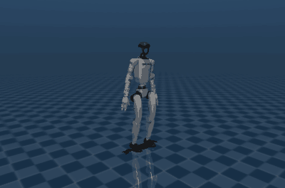

# Stage 1 results

Design: [docs/STAGE1_DESIGN.md](../../docs/STAGE1_DESIGN.md). This page grows as the steps of
its section 12 are done.

## Step 1: gait

**In short:** a gait clock and Unitree's G1 rewards turn the stage 0 shuffle (about 10 steps
per second of 9 cm) into a walk. Three training runs of 3000 iterations each take 2.5 steps per
second of 39 cm at 1 m/s and lift their feet 6.5 cm. Their speed error at 1 m/s is 0.06 m/s,
their turn-rate error when turning in place at most 0.08 rad/s, and none fell in 360 MuJoCo
episodes. All seven gait targets of the design are met on average over the three runs; one
run's slip is just over its target (0.102 against at most 0.1 m/s). Slip is measured where the
sole touches the floor (D-016); the first measure, at the ankle, also counted the foot rolling
from heel to toe and read 0.15-0.21 m/s.

   
  <em>Gait v3, training seed 1 (the first run, not picked), walking at 1 m/s in plain MuJoCo on
  MuJoCo Menagerie's G1 model.</em>

Task: `PiWbc-G1-Gait` (`src/pi_wbc/tasks/g1_gait.py`): the policy drives the 12 leg and 3
waist joints with NVIDIA's Decoupled WBC gains; arms and hands are held in the default pose;
velocity commands sample the yaw rate directly; the policy sees a gait clock (period 0.8 s).

### Result: 3 runs of v3, 3000 iterations

Training seeds 1-3, 3000 iterations, 4096 environments, on the workstation's RTX 4070 (about
58 min per run) at commit `3ea445b`, 2026-10-29. The design planned these runs for the cluster;
the workstation was free overnight and runs the same code. MuJoCo protocol as in stage 0: both
models, 6 commands, 10 seeded starts each, 20 s. The starts use evaluation seeds 0-9, inside
the development range (0-99); the test range (1000-1199) is kept for the final stage 1 result.

Gait on the Menagerie model at 1 m/s; mean over the 3 runs, with the lowest and highest run in
brackets:

| Measure (design, section 1) | Target | Stage 0 default (13 runs) | v3 (3 runs) | Met |
|---|---|---|---|---|
| Falls, all MuJoCo test commands, both models | upper 95% bound below 5% | 17/1560 (1%-2%) | 0/360 (0%-1%) | yes |
| Speed error while walking | at most 0.15 m/s | 0.12 m/s | 0.06 m/s (0.06-0.07); at most 0.09 m/s on any walking command and model | yes |
| Turn-rate error, turning in place at 0.8 rad/s | at most 0.2 rad/s | 0.11-0.80 rad/s | 0.06-0.08 rad/s | yes |
| Step rate at 1 m/s | 1.5-3 steps/s | 10.2 | 2.5 (2.4-2.5) | yes |
| Step length at 1 m/s | at least 0.3 m | 9 cm | 39 cm (38-39) | yes |
| Foot lift | at least 5 cm | 3.0 cm | 6.5 cm (6.1-6.9) | yes |
| Slip: sole speed at its floor contacts (D-016) | at most 0.1 m/s | 0.14 m/s (0.03-0.27) | 0.07 m/s (0.04-0.10) | on average; seed 3 at 0.102 |
| Ankle speed in stance (first slip measure, for comparison) | — | 0.31 m/s | 0.17 m/s (0.15-0.21) | — |
| Push recovery, arm tracking | report | — | — | later steps |

Other measures at 1 m/s: both feet down 6% of the time (4-10%), knee range 23° (14-30°), heading
drift 0.02-0.08 rad/s. Isaac Lab's training statistics (last 50 iterations, over the random
training commands): speed error 0.14 m/s, turn-rate error 0.34-0.36 rad/s, 1.0-1.3% of episodes
ending in a fall. Stage 1's training commands differ from stage 0's, so these don't compare
directly with stage 0's.

Raw data: one file per run in [`gait_step1/`](gait_step1/) (trained at commit `3ea445b`,
evaluated at `9a55b47` with the sole-slip measure, clean tree; every other number is unchanged
from the first evaluation at `3ea445b`), the
summary in [`gait_step1_compare.json`](gait_step1_compare.json), the training-side numbers in
[`gait_step1_training.json`](gait_step1_training.json). Rerun with
`scripts/train_eval_local.sh PiWbc-G1-Gait 3000 results/stage1/gait_step1 gait-v3 1 2 3`.

What the numbers show:

- **Longer training closed the speed gap.** The 1000-iteration development run of v3 (below)
  fell 0.27 m/s short of 1 m/s with 28 cm steps; all three 3000-iteration runs track within
  0.07 m/s with 38-39 cm steps.
- **The three runs agree** on step rate, step length, foot lift and tracking. They differ in
  how much they bend the knee: seed 3 uses 14° of knee range against 25-30° for the others, and
  has the most slip (0.10 m/s at the sole) and time with both feet down (10%).
- **Foot lift drops at slower commands:** 3.9-4.6 cm at 0.5 m/s and 1.6-2.9 cm when stepping
  sideways or turning in place. The gait targets are measured at 1 m/s (D-010).
- **The ankle moves more in stance as the steps grow longer:** 0.13 m/s for the 1000-iteration
  run, 0.15-0.21 m/s now. Most of that is the foot rolling, not sliding (next section).

### Slip: measured at the sole

The first slip measure was the planar speed of each ankle-roll link's origin while its foot
touched the floor. That point sits 3.5 cm above the sole, so it also moves when the foot rolls
from heel to toe or pivots on its toe without sliding. The bench now also measures the speed of
the sole itself at each floor contact, weighted by the contact's force (D-016). A unit test
pivots the robot on its toe at 2 rad/s: the ankle measure reads 0.07 m/s, the sole measure
0.0002 m/s.

Walking at 1 m/s, per run:

| Run | Sole slip, Menagerie | Sole slip, Newton | Ankle speed, Menagerie | Ankle speed, Newton |
|---|---:|---:|---:|---:|
| seed 1 | 0.042 m/s | 0.005 m/s | 0.150 m/s | 0.107 m/s |
| seed 2 | 0.062 m/s | 0.012 m/s | 0.154 m/s | 0.131 m/s |
| seed 3 | 0.102 m/s | 0.044 m/s | 0.212 m/s | 0.151 m/s |
| stage 0 default (13 runs) | 0.14 m/s (0.03-0.27) | 0.03 m/s (0.01-0.05) | 0.31 m/s (0.20-0.42) | 0.22 m/s (0.20-0.26) |

- **Most of the first measure was rolling.** At the sole, the three runs slip 0.04-0.10 m/s on
  Menagerie's model, 30-50% of the ankle measure. Two runs meet the target clearly; seed 3 is
  at the line.
- **Gait v3 slips about half as much as the stage 0 shuffle** at the sole (0.07 against
  0.14 m/s on Menagerie's model).
- **Every policy slips more on Menagerie's model than on Newton's**, the stage 0 shuffle as
  well (0.14 against 0.03 m/s). That points at the models rather than the policies: Menagerie's
  contacts are softer (stage 0 results, part 4), which may let a loaded foot creep. Not yet
  checked.
- **Training's slip penalty uses the ankle's velocity too,** so it also discourages rolling.
  Whether that matters is a question for the reward work in later steps (D-016).

### Development runs: three versions, 1000 iterations, one run each

| Version | Change | Falls (all commands, both models) | Steps/s | Step length | Foot lift | Ankle speed in stance | Speed error | Heading drift | Turn-in-place error | Stands still |
|---|---|---|---:|---:|---:|---:|---:|---:|---:|---|
| stage 0 bench (13 runs) | built-in rewards | 17/1560 | 10.2 | 9 cm | 3.0 cm | 0.31 m/s | 0.12 m/s | — | 0.11-0.80 rad/s | yes |
| v1 | gait clock, Unitree's rewards | 0/120 | 2.5 | 37 cm | 5.8 cm | 0.15 m/s | 0.11 m/s | 0.08 rad/s | 0.18 rad/s | no: steps in place |
| v2 | + heading reward, stand signal | 0/120 | 2.6 | 34 cm | 5.1 cm | 0.14 m/s | 0.16 m/s | 0.05 rad/s | 0.09 rad/s | yes |
| v3 | + arms held in the default pose | 0/120 | 2.7 | 28 cm | 4.6 cm | 0.13 m/s | 0.27 m/s | 0.11 rad/s | 0.07 rad/s | yes |

Gait, speed error and heading drift: MuJoCo Menagerie model, 1 m/s command; turning: 0.8
rad/s in place; same protocol as stage 0 (10 seeded starts per command, 20 s). Heading drift
is the average turn rate over an episode minus the commanded one, which the per-step
turn-rate error hides under the rocking of each step. Raw data in [`gait_dev/`](gait_dev/)
(commit `746fc4c`, clean tree). Single training runs: differences between versions smaller
than stage 0's run-to-run spread (D-011) are not evidence.

### What happened on the way

- **The shuffle is fixed by describing the walk.** With a clock that says when each foot
  should be down and rewards for following it, lifting the swing foot and not slipping, every
  version steps at the clock's 2.5 steps per second with 4-6 cm of foot lift. Stage 0's reward
  pilot ([stage 0 results, part 5](../stage0/README.md#5-reward-pilot-four-reward-changes-two-runs-each))
  reaches a similar step rate by raising the foot-air-time reward alone, but none of its
  variants turns or holds its heading as well, and one of its two best runs sways.
- **A bench mismatch looked like a transfer failure.** The first MuJoCo tests of v1 and v2
  fell often (up to 10 of 10 episodes per command) and walked in circles. The cause was the
  arms: no action drives them, Isaac Lab leaves such joints' targets at 0, and the bench held
  them in the default pose with elbows bent. The robot was being tested with a different
  centre of mass from training. The bench now holds such joints at the targets the export
  records; with that, both versions walk without falling (table above). Stage 0's hands had the
  same mismatch on a much smaller scale (re-run in its results, part 2).
- **Direct turn-rate commands need a heading term.** v1's turn-rate reward let a steady turn
  bias through. v2 adds a reward for staying on the heading the commanded turn rates add up to;
  it also gives the clock a "stand" reading (zero) when the command is zero, so the robot stops
  stepping when told to stand.
- **v3 holds the arms as designed** (default pose, elbows bent) instead of hanging. At 1000
  iterations it fell short of 1 m/s, with its training curves still improving; 3000 iterations
  closed the gap (result above).

## Step 2: body pose and moving arms (in progress)

**In short:** the task works end to end. After five development runs, the current policy
stands, walks, crouches to 0.60 m (within 2-4 cm), leans its torso forward and keeps its balance
while its arms move through their full range with up to 1 kg in each hand: no falls in 220
MuJoCo episodes on either model. But walking and turning got worse than in step 1: at 1 m/s the
speed error is about 0.4 m/s (step 1, 1000 iterations: 0.27; 3000 iterations: 0.06), and turning
in place is 0.42-0.74 rad/s off a 0.8 rad/s command (step 1: 0.07). These are single
1400-iteration runs on the workstation; the result proper needs longer runs and 3 seeds.

Task: `PiWbc-G1-Body` (`src/pi_wbc/tasks/g1_body.py`, D-017), the gait task plus:

- a body-pose command: pelvis height 0.50-0.78 m and the three waist angles (yaw ±0.6, roll
  ±0.2, pitch 0-0.45 rad), moving smoothly to a new goal every 4-8 s; the policy sees it;
- random arm and hand poses, written straight to those joints' PD targets (the policy still
  drives only legs and waist), a new pose every 2-4 s;
- 0-1 kg added to each palm;
- a curriculum that widens body-pose and arm ranges from none to full while few episodes end
  in a fall and velocity tracking holds;
- leg actions centred on a crouch pose that follows the commanded height
  (`scripts/crouch_table.py`).

The MuJoCo bench gained five scenarios: crouch to 0.60 m, walk at 0.5 m/s at 0.65 m, lean
forward 0.4 rad, and arms moving at full range while standing and while walking at 0.5 m/s
(`src/pi_wbc/sim2sim/commands.py`), with height, waist and arm joint errors.

### Development runs

1400 iterations each (v2: 1000), training seed 1, MuJoCo Menagerie model unless stated;
falls are over all 11 commands and both models.

| Run | Change | Falls | Arms moving: falls | Speed error, 1 m/s | Turn-in-place error | Crouch 0.60 m: height error | Walk low: height, speed error | Lean 0.4: waist error | Arms walking: arm error |
|---|---|---|---|---:|---:|---:|---|---:|---:|
| v1 | payload changed at every reset | stopped: training 2.3x slower | | | | | | | |
| v2 | payload once per robot | 24/220 | 24/40 | 0.28 m/s | 0.18 rad/s | 18.8 cm | 13.7 cm, 0.17 m/s | 0.119 rad | 0.044 rad |
| v3 | curriculum judged over 20-iteration windows | 0/220 | 0/40 | 0.36 m/s | 0.61 rad/s | 18.3 cm | 13.4 cm, 0.19 m/s | 0.085 rad | 0.045 rad |
| v4 | + height bonus (exp form) | 0/220 | 0/40 | 0.58 m/s | 0.53 rad/s | 17.0 cm | 13.1 cm, 0.32 m/s | 0.074 rad | 0.044 rad |
| v5 | + leg actions centred on a crouch pose | 0/220 | 0/40 | 0.40 m/s | 0.74 rad/s | 1.7 cm | 0.3 cm, 0.37 m/s | 0.043 rad | 0.046 rad |
| v6 | + arm poses every 2-4 s instead of 1-3 s | 0/220 | 0/40 | 0.42 m/s | 0.42 rad/s | 3.5 cm | 0.7 cm, 0.43 m/s | 0.096 rad | 0.041 rad |

Raw data in [`body_dev/`](body_dev/). Each run was trained, exported and evaluated at its own
commit (v2 `d1b35cb`, v3 `c1d08b2`, v5 `27728b4`, v6 `39c9079`; v3's tree differed only in
`docs/`). v4 was trained at `71bf947`; its first export picked up a half-written change and was
redone from `71bf947`, then evaluated at `39c9079` (below). Single runs: differences between
versions smaller than stage 0's run-to-run spread (D-011) are not evidence; v5 against v6 is one
such case.

### What happened on the way

- **Changing masses at reset is slow on Newton.** Adding the payload at every reset made each
  training iteration take 2.7 s instead of 1.2 s; the payload is now drawn once per robot.
- **The curriculum needed whole windows.** Judging each step's few resetting robots on their
  own made it start late (iteration 750 of 1000) and move in fits; v2 reached only 45% of the
  full range and fell in 24 of 40 episodes with the arms at full range. Judged over
  20-iteration windows, it reaches the full range by about iteration 1050 with falls at 5-10%.
- **Crouching needs the crouch pose.** v3 and v4 never crouched: their training height error,
  10 cm, was what standing still gives, and in MuJoCo they stayed 17-18 cm above a 0.60 m
  command. A 0.60 m crouch needs knee actions of about 5 at the action scale of 0.25 (actions
  are usually within ±2), and a stronger height reward (v4) did not get the policy there.
  Centring the leg actions on the crouch for the commanded height (v5) gets crouching within
  2-4 cm, with no falls.
- **Turning in place is given up as the ranges widen.** In every run the training yaw-rate
  error improves until the curriculum starts and then rises as it widens (v5: 0.65 to
  1.05 rad/s; step 1 kept improving to 0.45). Slower arm motion (v6) did not change that
  trend in training. The turning rewards lose the most as the curriculum widens (turn-rate
  tracking 0.39 to 0.26, heading 0.54 to 0.30, per second); speed tracking holds.
- **An export once used code edited during the run.** v4's first export picked up the
  crouch-pose change while it was half-written, so MuJoCo tested its policy with leg offsets it
  never trained with (10 of 10 falls when crouching). Re-exported from its training commit, it
  doesn't fall; it just doesn't crouch. `scripts/train_eval_local.sh` now runs every step from
  a copy of the starting commit.

### Next

- Keep turning in the curriculum's criteria, so the ranges widen only while turning holds.
- Look at the stand-still penalty: it costs about 0.35 per second from early on (step 1:
  0.07), because the legs keep moving while the robot is told to stand.
- Longer training: step 1 needed 3000 iterations to walk well, and here the curriculum takes
  the second half of a 1400-iteration run. Then 3 seeds, as in step 1.
