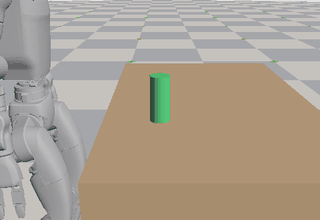
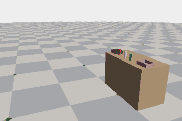
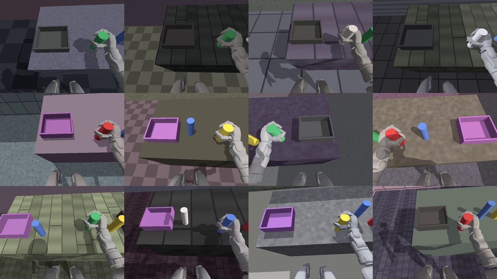
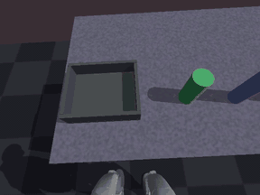

# Stage 3 results: task, scripted expert and demonstrations

Stage 3 builds the pick-and-place task, a scripted expert that solves it from simulator state
through the stage 1 controller, and the demonstrations the VLA learns from in stage 4. The plan
is in [PROJECT_PLAN.md](../../docs/PROJECT_PLAN.md), stage 3. Every result file in this folder
records the commit, package versions and GPU it came from.

**Contents**

- [Grasp test: can the Dex3 hand hold the task's objects in Newton?](#grasp-test-can-the-dex3-hand-hold-the-tasks-objects-in-newton)
- [NVIDIA's controller on our G1 in Newton](#nvidias-controller-on-our-g1-in-newton)
- [Step 1: the controller at 4 physics substeps](#step-1-the-controller-at-4-physics-substeps)
- [The task and the scripted expert](#the-task-and-the-scripted-expert)
- [The demonstrations](#the-demonstrations)
- [Rendering the head camera](#rendering-the-head-camera)
- [The export and its loader checks](#the-export-and-its-loader-checks)
- [NVIDIA's controller under the expert](#nvidias-controller-under-the-expert)
- [The evaluation loop, and what the command rate costs](#the-evaluation-loop-and-what-the-command-rate-costs)
- [What stage 3 leaves for later](#what-stage-3-leaves-for-later)

## Grasp test: can the Dex3 hand hold the task's objects in Newton?

The biggest risk of the stage was whether Dex3's three fingers can physically pick up and hold
an object in Newton, so it was tested first, on a G1 with its base fixed
([scripts/grasp_test.py](../../scripts/grasp_test.py)). The answer is yes, for round objects:

| Object (all 12-14 cm tall) | Placement error | Held | File |
|---|---|---:|---|
| Can, 5.2 cm across | up to 1 cm, 9 directions | 27/27 | [can-1cm.json](grasp/can-1cm.json) |
| Bottle, 4.4 cm across | up to 1 cm | 27/27 | [bottle-1cm.json](grasp/bottle-1cm.json) |
| Can | 1.5 cm, 8 directions | 20/24 | [can-1.5cm.json](grasp/can-1.5cm.json) |
| Square block, 4.5 cm | up to 1 cm | 3/27 | [block-1cm.json](grasp/block-1cm.json) |
| Box, 5 x 6.5 cm | up to 1 cm | 1/27 | [box-1cm.json](grasp/box-1cm.json) |
| Can, training's 2 physics substeps | up to 1 cm | 24/27 | [can-1cm-2substeps.json](grasp/can-1cm-2substeps.json) |
| Can, fingers closed before the thumb | up to 1 cm | 0/27 | [can-1cm-fingers-first.json](grasp/can-1cm-fingers-first.json) |

Each row is 3 object masses (0.1, 0.3 and 0.5 kg) times the placement errors: the object sits
that far off the spot the hand aims for, as when the walk to the table stops short. Held means
the object ends at least 10 cm above where it started and within 10 cm of the palm, after 3 s
of holding. The 1.5 cm misses are all with the can both farther forward and farther from the
palm (1.1 cm each way, 0/3) and one 1.5 cm forward. In the hold the can slides at most 1.7 cm in
the hand (4.4 cm with 2 substeps).

How the grasp works (the scripted expert will do the same):

- **Side grasp, coming straight down.** The palm faces the object from the side, fingers
  forward ("handshake"). Open, the fingers lie flat in the palm's plane and the thumb stands
  behind the object, so the hand comes down beside the object without touching it, 2-3 cm from
  the palm face. Closing curls the two fingers round the front and sweeps the thumb in behind,
  pressing the object against the palm (the palm carries about 90 N, each digit 40-100 N).
- **Fingers and thumb close together.** On a can both reach it about half-way through their
  sweep. Closing the fingers first pushes the object back before the thumb arrives: 0/27.
- **Round objects.** On a square block the thumb meets the back face near its far edge and the
  fingers the front face nearer the palm, so the pinch is off-centre and spins or tips the
  block. On a cylinder every contact pushes towards the axis. The task's objects are therefore
  cylinders (cans, bottles, cups) told apart by colour and size.
- **Where the object sits in the hand.** The grasp point is 8.5 cm along the fingers from the
  palm frame's origin and 6.2 cm out from it (2 cm from the palm face for the can), found with
  a kinematic contact sweep and then centred on the placement errors that still hold.
- **Reach.** Table top 0.75 m, pelvis at the controller's walking height (0.78 m), torso leaned
  forward 0.25 rad (the controller is trained for up to 0.45). Upright, a side grasp at that
  height is 5 cm out of reach within the arm ranges the controller was trained with.
- **Arm path.** The palm's path (rise in front of the chest, over the object, down, up) is
  solved for joint angles on Newton's own model of the robot
  ([src/pi_wbc/stage3/arm_ik.py](../../src/pi_wbc/stage3/arm_ik.py)), backwards from the grasp
  so that the arm stays on one smooth solution, and clamped to the controller's trained arm
  ranges. A slow, bounded correction on the measured palm error removes the 1-2 cm the arm
  sags under gravity; the palm arrives within 5 mm.
- **4 physics substeps** (800 Hz) instead of training's 2: the grasp holds with less slip (1.7
  instead of 4.4 cm) and more margin. With the controller in the loop this has to be checked
  (stage 1 trained at 2).

Not yet tested: the controller in the loop (here the pelvis is fixed), the left hand, and
releasing the object into a bin.

Also seen: Newton on the GPU does not repeat runs exactly. The block row gave 6/27 in an earlier
run of the same commit and settings, the box 2/27. The demonstration replay check (stage 3's
finish line) must allow for this: it can replay recorded states exactly for rendering, but a
physics re-run of recorded commands can only be expected to reproduce the outcome, not every
state.

## NVIDIA's controller on our G1 in Newton

NVIDIA's Decoupled WBC (the baseline, D-004) was tried in Newton before deciding which
controller records the demonstrations (D-032). Its two released policies, "Balance" (velocity
command below 0.05) and "Walk", ran on our G1 through the same commands
([scripts/nvidia_wbc_test.py](../../scripts/nvidia_wbc_test.py), fetched by
[scripts/fetch_nvidia_wbc.sh](../../scripts/fetch_nvidia_wbc.sh)), with its observation built as
in NVIDIA's code; our G1 already uses its PD gains and default leg pose (D-012). The bench's
commands, 10 robots each for 20 s, flat ground, friction 1.0:

| Command | Falls, arms hanging (stage 1's default) | Falls, arms at zero (NVIDIA's script) | Achieved (arms at zero) |
|---|---:|---:|---|
| stand | 10/10 | 0/10 | drifts back at 0.33 m/s |
| walk 0.5 m/s | 0/10 | 0/10 | 0.44 m/s |
| walk 1.0 m/s | 0/10 | 0/10 | 0.93 m/s |
| sideways 0.3 m/s | 0/10 | 0/10 | 0.20 m/s |
| turn in place 0.8 rad/s | 0/10 | 0/10 | 0.79 rad/s |
| walk 0.6 m/s and turn 0.5 rad/s | 0/10 | 0/10 | 0.55 m/s, 0.47 rad/s |
| crouch to 0.6 m | 0/10 | 0/10 | 0.58 m |
| walk 0.5 m/s at 0.65 m | 0/10 | 0/10 | 0.42 m/s, 0.64 m |
| lean 0.4 rad | 0/10 | 0/10 | still |
| stand, arms moving | 3/10 | 3/10 | drifts back at 0.31 m/s |
| walk 0.5 m/s, arms moving | 0/10 | 0/10 | 0.43 m/s |

Files: [all-arms-default.json](nvidia_wbc/all-arms-default.json),
[all-arms-zero.json](nvidia_wbc/all-arms-zero.json). Walking is solid, and turning in place
tracks better than our controller (0.77-0.79 against its 0.57-0.73 rad/s, D-029). Standing still
is not: over height commands from 0.70 to 0.78 m (its nominal is 0.74) it falls in 7-10 of 10
with the arms hanging, and with the arms at zero either drifts backwards at 0.26-0.32 m/s or, at
0.78 m, falls every time (files `stand-h*.json`). Yet crouching and leaning, which also run the
Balance policy, stay still.

### The drift comes from the asset's short heel

Each foot touches the floor through four small spheres: two at the toe and two at the heel.
Isaac Lab's G1 asset, on which stage 1 trained, puts the heel pair at x = -0.02 m on the
ankle-roll link; Unitree's URDF (in NVIDIA's copy), NVIDIA's MuJoCo models and MuJoCo
Menagerie's model all put it at -0.05 m, a 3 cm longer support (the toes are at 0.12 m in all of
them). In plain MuJoCo, NVIDIA's policy stands still on its own model and on Menagerie's, and
drifts backwards at 0.31-0.32 m/s on any of them once the heel spheres are moved to -0.02; on
Newton's model of our G1 it drifts at 0.32 m/s, and stands still once they are moved to -0.05.
The observation code was checked line by line against NVIDIA's.

In Newton, with the heel spheres moved to -0.05 m
([src/pi_wbc/stage3/feet.py](../../src/pi_wbc/stage3/feet.py), `--heel-x -0.05`):

| | Falls, all 11 commands | Standing still | Turn in place 0.8 rad/s |
|---|---:|---|---:|
| NVIDIA's, arms hanging | 0/110 (heel -0.02: 13/110) | still | 0.75 rad/s |
| NVIDIA's, arms at zero | 0/110 (heel -0.02: 3/110) | still (heel -0.02: back at 0.33 m/s) | 0.78 rad/s |
| Ours, seed 1, nominal | 0/1100 (heel -0.02, stage 1: 0/3300) | still | 0.64 rad/s (heel -0.02: 0.70) |
| Ours, seed 1, 1 m/s kicks | 0/550 (heel -0.02: 0/550) | — | 0.63 rad/s (heel -0.02: 0.68) |

Files: [nvidia_wbc/all-arms-default-heel-0.05.json](nvidia_wbc/all-arms-default-heel-0.05.json),
[nvidia_wbc/all-arms-zero-heel-0.05.json](nvidia_wbc/all-arms-zero-heel-0.05.json),
[heel/](heel/). Our controller, trained on the short heel, is unchanged on the longer one apart
from turning in place a little more slowly; it was already tested on Menagerie's longer heel in
MuJoCo in stage 1. So the stage 3 scenes are proposed to use the URDF's heel for every
controller (D-038), which also makes NVIDIA's controller usable for recording
demonstrations.

Not checked: which heel position matches the real robot's sole (Unitree's URDF is the closest
source here), and NVIDIA's controller under kicks.

## Step 1: the controller at 4 physics substeps

The grasp needs Newton at 4 substeps (D-034); the controller was trained at 2. In Isaac Lab, with
the URDF's heel (D-038), the bench's 11 commands, `--substeps 2` against `--substeps 4`
([src/pi_wbc/isaac_eval.py](../../src/pi_wbc/isaac_eval.py); kicks as in the MuJoCo bench at 3,
7, 11, 15 and 19 s; "randomized" keeps training's randomization and pushes):

| Seed | Condition | Robots | Falls, 2 substeps | Falls, 4 substeps | Speed at 1.0 m/s (2 / 4) | Turn at 0.8 rad/s (2 / 4) |
|---|---|---:|---:|---:|---|---|
| 1 | nominal | 1100 | 0 | 0 | 0.92 / 0.91 | 0.64 / 0.62 |
| 1 | randomized | 550 | 1 | 0 | 0.91 / 0.91 | 0.67 / 0.67 |
| 1 | kicks-1.0 | 550 | 0 | 0 | 0.91 / 0.90 | 0.62 / 0.62 |
| 1 | kicks-2.0 | 550 | 1 | 2 | 0.90 / 0.89 | 0.59 / 0.59 |
| 2 | nominal | 1100 | 0 | 0 | 0.92 / 0.92 | 0.51 / 0.51 |
| 3 | nominal | 1100 | 0 | 1 | 0.99 / 0.99 | 0.63 / 0.63 |

Files: [substeps/](substeps/). 4 substeps change nothing measurable: falls stay at noise level
(3 against 2 in 4,950 robots) and speed and turning agree within 0.02. Seed 1 had no falls at
2 m/s kicks in an earlier, identical run, so 1-2 falls in 550 are within Newton's run-to-run
variation. NVIDIA's controller is unchanged too: with the URDF's heel at 4 substeps it fell in
none of 110 robots with either arm pose, tracking as at 2
([nvidia_wbc/all-arms-default-heel-0.05-sub4.json](nvidia_wbc/all-arms-default-heel-0.05-sub4.json),
[nvidia_wbc/all-arms-zero-heel-0.05-sub4.json](nvidia_wbc/all-arms-zero-heel-0.05-sub4.json)).
So the stage 3 scenes run at 4 substeps.

## The task and the scripted expert

The task environment (`PiWbc-G1-PickPlace`,
[src/pi_wbc/tasks/g1_pick_place.py](../../src/pi_wbc/tasks/g1_pick_place.py)) puts the stage 1
controller (seed 1) in the loop with a table, three of five round objects, two bins and seeded
layouts ([src/pi_wbc/stage3/layout.py](../../src/pi_wbc/stage3/layout.py)). The scripted expert
([src/pi_wbc/stage3/expert.py](../../src/pi_wbc/stage3/expert.py)) reads the true state and
sends only the controller's commands: base velocity, body height and lean, and arm and hand
joint targets ([scripts/expert_rollout.py](../../scripts/expert_rollout.py)).

(An earlier version of the expert, on development layout 50,000.)

On unused test layouts 60,384-60,767, run once (D-041):

| | Episodes |
|---|---:|
| Success | 364 of 384 (94.8%; 95% CI 92.1-96.6%) |
| Pushed another object more than 2 cm | 16 (7 while the hand came down, 6 while it pulled back, 3 while carrying) |
| Missed the grasp | 3 |
| Dropped the object on the way | 1 |
| Robot fell | 0 |

Files: [expert/test-60384-60767.json](expert/test-60384-60767.json); fresh training layouts
1,000-1,383 give 361 of 384 (94.0%, [expert/train-1000-1383.json](expert/train-1000-1383.json)).
Success is judged when the episode ends, with the object resting in the named bin and no other
object moved more than 2 cm. The right hand did 294 of the test episodes (277 succeeded), the
left 90 (87). A successful episode takes 24-37 s (median 31 s). Test layouts 60,000-60,383 were
used while fixing the success rule and are retired.

What it took, each step found from the measured state of failed episodes:

- **Contact budget.** With the bins' kinematic boxes touching each other, the scene needed
  more contacts than the 120 per robot allowed; the rest were dropped and the objects tipped
  over by themselves after a second. The bin's parts now keep 1 mm gaps and the budget is 300.
- **Lean, then align.** Leaning the torso moves the pelvis back about 10 cm, which put the
  object out of reach. The robot now walks to its stance upright, leans, and steps onto the
  stance again with the lean held.
- **Gravity fed forward.** The arm's PD controllers leave it 1-2 cm low; a slow correction on
  the measured error, made stronger, oscillated with the torso. The targets now add each
  joint's gravity torque divided by its stiffness (`ArmIK.gravity_offset`), and the palm
  arrives within 2-4 mm.
- **Slide in.** On the way down the hand drifts up to 3 cm towards the object, enough for the
  lower finger to clip it. It now comes down 3 cm further out, waits there, and slides in.
- **Reach.** A lift of 15 cm and a carry pose in front of the chest were both at the edge of the
  arm's reach in the grasp's orientation: the IK sometimes ran to the joint limits and the hand
  flung the object at the bin. The lift is 10 cm, the arm then holds its joint angles while
  the robot straightens and walks (which raises the object clear of the others), the reach
  over the bin goes in joint space to a solution found beforehand, and an IK step that misses
  by more than 3 cm is not taken.
- **Which hand.** The right hand alone succeeded on 50-64% of layouts with under 10 cm of room
  to the target's right (another object or the right-hand bin's wall) and on 95-99% of the
  rest. The expert now uses the left hand, with every motion mirrored, when the right side
  has under 12 cm and the left side has more.
- **Pull back before lowering.** Lowering the arm from over the table after the release swung
  the hand through the other objects, and knocked 26 of 176 placed objects back out of the bin
  on development layouts. The hand now first moves back to the table's front edge.
- **Judged at the end.** Success used to be judged when the hand opened, which hid those
  knocks (earlier rates were about 13 points too high); pushing another object is now a
  failure of its own.

## The demonstrations

The expert recorded every episode from training seed 10,000 on: per control step (50 Hz) the
commands it sent, the robot's pelvis pose and velocity, all 43 joint positions and velocities,
the five objects' poses and the expert's phase, plus the layout, instruction and outcome
([src/pi_wbc/stage3/recorder.py](../../src/pi_wbc/stage3/recorder.py)). The training set is the
first 1,000 successes in seed order whose replay passes the check below (D-042):

| | Episodes |
|---|---:|
| Recorded (seeds 10,000-11,087) | 1,088 |
| Successful | 1,010 |
| Failed (kept, labelled, for stage 5) | 78: 66 pushed another object, 7 missed grasps, 3 drops, 2 knocked the target |
| Failed the replay check | 2 |
| In the training set (seeds 10,000-11,079) | 1,000: right hand 733, left 267 |

File: [dataset/train-v1-manifest.json](dataset/train-v1-manifest.json). **Replay check**
([scripts/replay_check.py](../../scripts/replay_check.py)): each episode's recorded commands go
through the controller and the physics again, without the expert. Newton on the GPU does not
repeat runs exactly, so an episode passes when its replay stays within 1 cm of the recording
over the first second, which separates recordings that belong to their commands (at most
2.7 mm) from mismatched ones (17-124 mm). Over the whole set, 695 of the 1,000 also succeed when
replayed open loop to the end (69.5%, 95% CI 66.6-72.3%): the expert corrects small
differences as it goes, a replay of its commands can't.

**More data, and a validation set** (D-047). The expert also recorded training seeds
11,088-12,239 and validation seeds 40,000-40,255 (training-range seeds kept apart from training).
[scripts/build_dataset_manifest.py](../../scripts/build_dataset_manifest.py) applies D-042's
rule (it rebuilds v1's manifest exactly):

| | Recorded | Successful | Replay check passed | In the set |
|---|---:|---:|---:|---:|
| Training seeds 11,088-12,239 | 1,152 | 1,076 (93.4%, CI 91.8-94.7%) | 1,147 | |
| **Training set v2** (seeds 10,000-12,155) | | | | **2,000** (v1 plus 1,000): right hand 1,484, left 516 |
| **Validation set v1** (seeds 40,000-40,255) | 256 | 241 (94.1%) | 256 | **241**: right 172, left 69 |

Files: [dataset/train-v2-manifest.json](dataset/train-v2-manifest.json),
[dataset/val-v1-manifest.json](dataset/val-v1-manifest.json). Stage 4 can measure what the
second 1,000 episodes add, and follow a validation loss on layouts it never trains on.

## Rendering the head camera

[scripts/render_episodes.py](../../scripts/render_episodes.py) renders each training episode
from the head camera with Newton's renderer (D-043): the recorded states are written into a
copy of the scene that runs no physics, every second control step, giving 640 x 480 video at 25
frames per second. Each episode has its own look, drawn from its seed
([src/pi_wbc/stage3/appearance.py](../../src/pi_wbc/stage3/appearance.py)): floor, table and
wall colours and patterns, the room's size, the sun's height and direction, the light's
brightness and colour, and up to 1 cm and 1 degree of error in the camera's mount. Object and
bin colours stay fixed, since the instructions name them.

(12 training episodes, each half a second after the hand starts lifting the object.)

(Training episode 10,060, "grab the green can and place it in the purple bin": from raising the
arm to the release, 20 s, every third frame at 288 x 216.)

| | |
|---|---|
| Videos | 1,000, one per episode: H.264, 640 x 480, 25 frames per second |
| Frames | 790,046 (599-1,003 per episode, median 788) |
| Size | 3.0 GiB (median 3 MB per episode) |
| Time | 21 min on the RTX 4070, about 650 frames per second for 32 episodes at once |
| Sun height | 30, 40, 50, 60, 70, 80 degrees: 163, 169, 170, 176, 171, 151 episodes |

Every video's frame count was checked against its recording. Each episode's look, frame count
and file hash: [render/train-v1-render.json.gz](render/train-v1-render.json.gz). Training set v2
(2,000 episodes, 1,581,058 frames, 6.0 GiB, 59 min with other jobs on the GPU) and the validation
set (241 episodes, 191,375 frames, 0.7 GiB) are rendered the same way. An episode rendered twice
keeps its look but not its exact pixels: of the 1,000 v1 episodes rendered again inside v2, 16
gave byte-identical videos and the rest differ by 0.02-0.84 grey levels on average, at edges
(D-043, amended).

**The lens is 87 degrees across** (D-044). The first render used Isaac Lab's default, 60.4
degrees, and lost the held object: the expert carries it beside the body.
[scripts/camera_view_check.py](../../scripts/camera_view_check.py) projects the target object
and the working palm into the camera for every frame of the 1,000 episodes. Share of frames
with the object in the picture ([render/view_check.json](render/view_check.json)):

| Lens (across) | Reach and grasp | Carry | Place | Palm, while carrying |
|---|---:|---:|---:|---:|
| 60.4 degrees (Isaac Lab's default) | 88.0% | 12.9% | 51.1% | 0.0% |
| 69.4 (the D435's colour camera) | 97.5% | 57.6% | 84.5% | 0.6% |
| 80 | 100.0% | 98.0% | 98.5% | 23.3% |
| **87 (the D435's depth cameras)** | **100.0%** | **99.9%** | **99.8%** | **67.5%** |
| 90 | 100.0% | 100.0% | 99.9% | 84.7% |

The colour image is therefore wider than the real D435's colour camera; that would matter on
the real robot, which this project doesn't claim.

## The export and its loader checks

[scripts/export_dataset.py](../../scripts/export_dataset.py) writes each set in the layout
GR00T N1.6 reads (LeRobot v2.1 plus GR00T's `meta/modality.json`), with the names of GR00T's own
`unitree_g1` data config (D-045). One row per video frame:

| Column | What |
|---|---|
| `observation.images.ego_view` | the head camera (the episode's video) |
| `observation.state` (43) | joint positions: legs, waist, left arm, left hand, right arm, right hand, in the order of NVIDIA's G1 datasets |
| `action` (35) | the expert's commands at that control step: arm and hand joint targets (28), waist yaw, roll and pitch goals (3), pelvis height goal (1), forward and sideways speed and turn rate (3) |
| `annotation.human.task_description` | the instruction (index into `meta/tasks.jsonl`) |

LeRobot's own converter makes a LeRobot v3.0 copy, with the quantile statistics LeRobot's
π0.5 normalizes by. Each set is checked with GR00T's `LeRobotEpisodeLoader` and its `unitree_g1`
config ([script](../../scripts/check_groot_dataset.py): every episode; group sizes, values,
instruction, frames equal to ffmpeg's decode and not off by one, 30-step training chunks), with
LeRobot's `LeRobotDataset` on the v3.0 copy ([script](../../scripts/check_lerobot_dataset.py): 12
episodes; rows, 50-step chunks with end padding, images equal to the source frames), and from
disk ([script](../../scripts/verify_files.py): every row recomputed from its recording, every
video's hash):

| Set | Frames per second | Episodes | Rows | GR00T's loader | LeRobot's loader | From disk |
|---|---:|---:|---:|---|---|---|
| Training v1 | 25 | 1,000 | 790,046 | 1,000 of 1,000 | 12 of 12 | all match |
| Training v1 | 50 | 1,000 | 1,579,583 | being checked | being checked | all match |
| Training v2 | 25 | 2,000 | 1,581,058 | 2,000 of 2,000 | being checked | all match |
| Validation v1 | 25 | 241 | 191,375 | 241 of 241 | 12 of 12 | all match |
| Validation v1 | 50 | 241 | 382,630 | 241 of 241 | 12 of 12 | all match |
| NVIDIA's training v1 | 25 | 1,000 | 929,052 | 1,000 of 1,000 | 12 of 12 | all match |

Before stage 4: LeRobot's π0.5 takes at most 32 state and 32 action values (ours: 43 and 35).
The working hand's 7 targets are exactly open + s x (closed - open) in every recorded step, and
the idle hand keeps its default pose, so a π0.5 copy can use 31 state values (without the legs)
and 23 action values (one closing value per hand) without losing anything.

## NVIDIA's controller under the expert

The task takes NVIDIA's Decoupled WBC as its low level under the same commands (D-046,
[src/pi_wbc/stage3/nvidia_wbc.py](../../src/pi_wbc/stage3/nvidia_wbc.py)): its observation is
built from the task's commands (velocity; pelvis height relative to each controller's nominal,
0.78 against 0.74 m; waist goals as its torso command), and its leg and waist targets are
applied exactly ([check](../../scripts/check_nvidia_targets.py): largest difference 0.0 rad).
The expert, unchanged, on the same 384 training layouts:

| Low level | Success | Failures | Median episode |
|---|---|---|---:|
| Ours (stage 1, seed 1) | 361 of 384 (94.0%, CI 91.2-96.0%) | 18 other objects pushed (10 in the retract), 4 missed grasps, 1 target knocked | 31.4 s |
| NVIDIA's | 367 of 384 (95.6%, CI 93.0-97.2%) | 15 other objects pushed (8 while the hand comes down, 4 over the bin), 2 missed grasps | 37.7 s |

Paired: 352 layouts succeed with both, 15 only with NVIDIA's, 9 only with ours, 8 with neither
(exact test p = 0.31), so no difference is shown. Files:
[expert/train-1000-1383.json](expert/train-1000-1383.json),
[nvidia_wbc/expert-train-1000-1383.json](nvidia_wbc/expert-train-1000-1383.json).

**The matched set** (D-046). The expert through NVIDIA's controller on the training set's own
layouts (seeds 10,000-11,087):

| | Ours | NVIDIA's |
|---|---:|---:|
| Successful | 1,010 of 1,088 (92.8%, CI 91.1-94.2%) | 1,049 (96.4%, CI 95.1-97.4%) |
| Other objects pushed during the retract | 45 | 4 |
| Other objects pushed elsewhere, missed grasps, drops | 33 | 35 |
| Passed the replay check's first second | 1,086 | 1,088 |
| Chosen episodes that also succeed replayed open loop | 695 of 1,000 (69.5%) | 974 of 1,000 (97.4%) |
| Median successful episode | 31.5 s | 37.7 s |

Paired on the same layouts: 986 succeed with both, 63 only with NVIDIA's, 24 only with ours, 15
with neither (p = 3.5e-5). Nearly all of the gap is other objects pushed while the arm withdraws
from the bin with our controller under the robot; why is not traced yet (a stage 5 lead). Under
NVIDIA's controller small differences between runs also grow far less: replaying its recorded
commands reproduces 97% of successes, ours 70%. NVIDIA's training set v1 is the first 1,000
qualifying episodes (seeds 10,000-11,036, 936 of them on the same layouts as ours):
[dataset/train-v1-nvidia-manifest.json](dataset/train-v1-nvidia-manifest.json), rendered and
exported like ours.

## The evaluation loop, and what the command rate costs

[scripts/vla_eval.py](../../scripts/vla_eval.py) is stage 4's closed-loop test, ready before any
model: our controller keeps the robot balanced, the head camera is rendered live with each
episode's look, and a policy (a GR00T policy server, or the expert's recorded commands for
testing) sends the commands. An episode succeeds once the target rests in the named bin, no
other object has moved more than 2 cm and the robot is up, for 1 s, within 60 s. Replaying the
expert's own commands open loop through it, on the 241 validation episodes (D-048):

| Commands sent | Success | 95% CI |
|---|---:|---|
| every control step's (50 Hz) | 171 (71.0%) | 65-76% |
| the 25 fps dataset's, each held for two control steps | 120 (49.8%) | 44-56% |
| the 25 fps dataset's, the second step the mean of it and the next | 143 (59.3%) | 53-65% |

Paired, every difference is significant (p from 5e-8 to 0.019): a 25 Hz command stream loses
much of the expert's step-by-step correction. Not with our controller only: NVIDIA's recorded
commands, on 241 of its matched set's episodes, succeed on 233 (96.7%) at 50 Hz and 173 (71.8%)
at 25 Hz held (66 against 6 episodes, p = 7e-14). The datasets are therefore also exported at 50
frames per second, NVIDIA's own G1 data rate. The 50 Hz result agrees with the replay check's 162
of 241 (67%), so the loop itself adds no loss. Files: [eval/](eval/).

## What stage 3 leaves for later

- **The ideal-body low level** (design section 7: the pelvis follows the commands exactly), the
  "perfect controller" row of stage 5's grid: an earlier attempt to pin the pelvis in Newton
  failed (the pinned root ignores resets, and rewriting its pose every step shakes the grip).
- **Why our controller pushes objects during the retract** where NVIDIA's doesn't (D-046).
- **OVRTX renders** of a few episodes for the front page (D-031); the dataset itself uses
  Newton's renderer.
